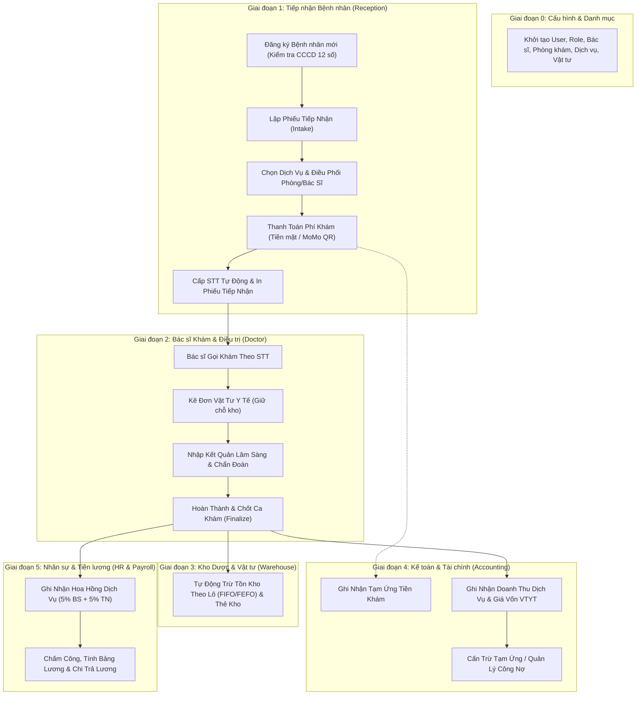
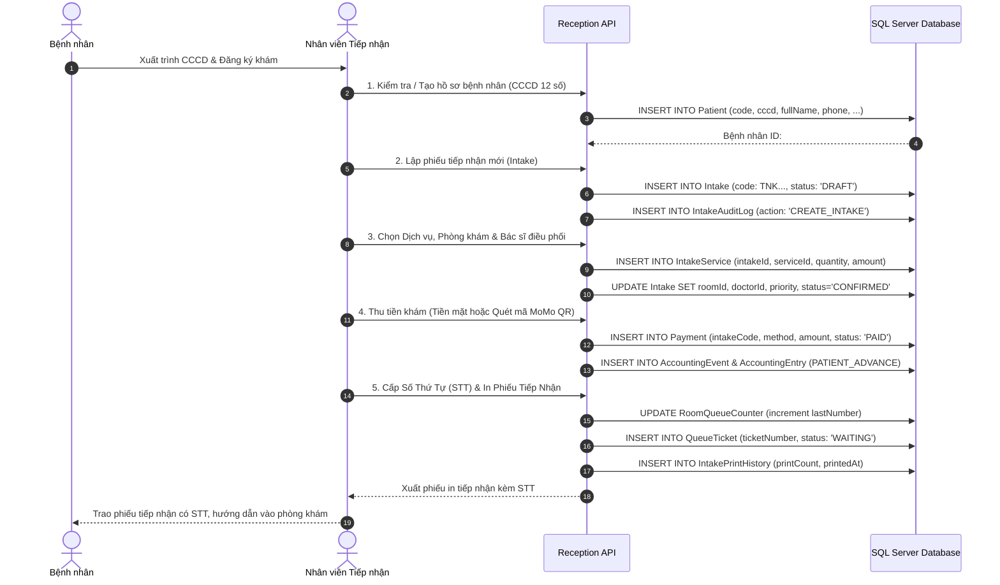
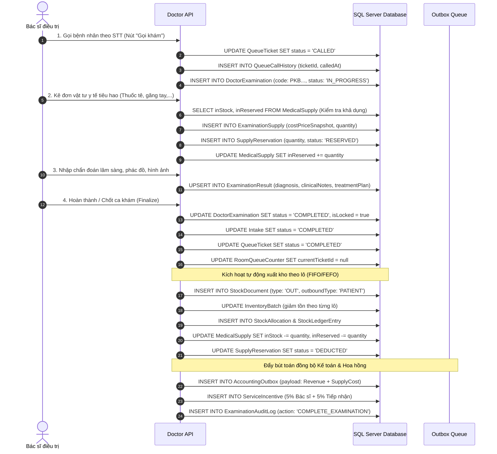
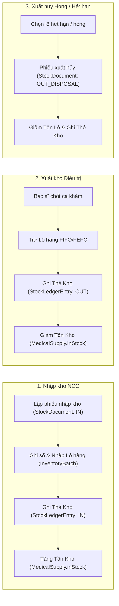
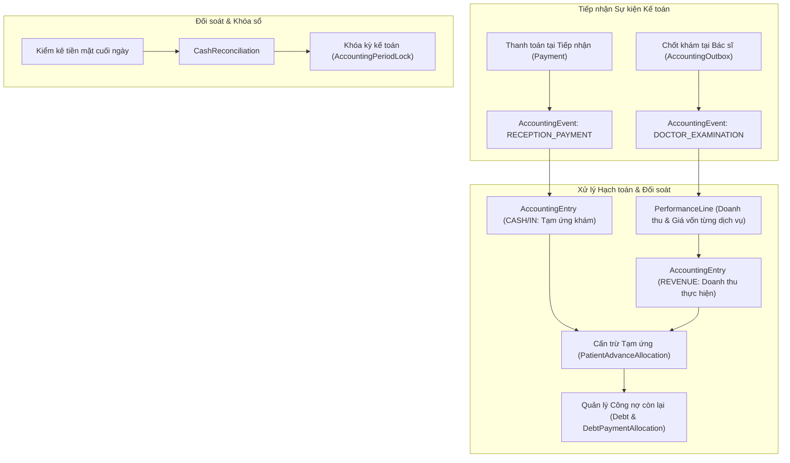
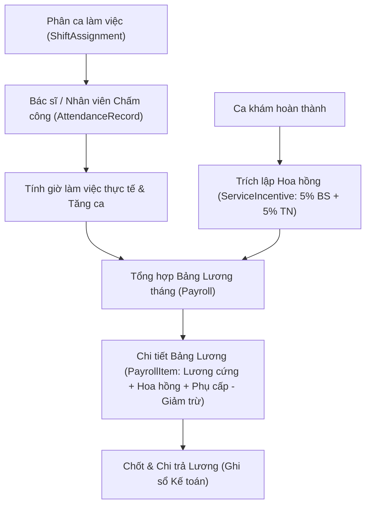
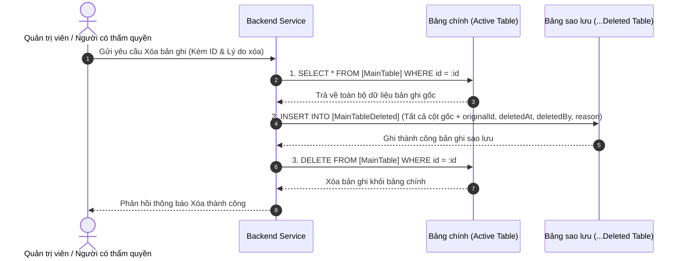

# TÀI LIỆU QUY TRÌNH DỮ LIỆU TOÀN DIỆN CƠ SỞ DỮ LIỆU (DATABASE FLOW SPECIFICATION)
## Hệ thống Quản trị Phòng khám Nha khoa Đa khoa (Graduation Project)

> **Mục tiêu tài liệu:**  
> 1. Rà soát và phân loại toàn bộ 60+ bảng dữ liệu trong hệ thống, giải trình kiến trúc các bảng phụ sao lưu `...Deleted` (khi có thao tác xóa/hủy) và cơ sở khoa học đối với các bảng không cần bảng `...Deleted`.  
> 2. Mô tả chi tiết luồng dữ liệu nghiệp vụ End-to-End từ Bắt đầu đến Kết thúc (Test Journey xuyên suốt 5 phân hệ: Tiếp nhận, Bác sĩ, Kho dược, Kế toán, Nhân sự & Tiền lương).  
> 3. Cung cấp Ma trận CRUD (Create - Read - Update - Delete - Backup) của toàn bộ các bảng trong cơ sở dữ liệu.

---

## PHẦN 1: TỔNG QUAN KIẾN TRÚC DỮ LIỆU & CƠ CHẾ SAO LƯU (...DELETED TABLES)

Hệ thống áp dụng chuẩn an toàn dữ liệu y tế và tài chính: **Không làm mất mát dữ liệu lịch sử**. Khi có thao tác Xóa (Delete) phát sinh từ người dùng có thẩm quyền, hệ thống thực hiện cơ chế **Sao lưu trước khi Xóa (Backup before Delete)**: toàn bộ thông tin bản ghi gốc được snapshot và ghi sang bảng phụ `...Deleted` tương ứng kèm thời gian xóa (`deletedAt`), người thực hiện (`deletedBy`) và lý do xóa (`reason`).

### 1.1. Danh mục 26 bảng chính có bảng phụ `...Deleted` tương ứng

| STT | Bảng chính (Active Table) | Bảng sao lưu (Deleted Backup Table) | Phân hệ | Nghiệp vụ có thao tác Xóa / Hủy |
|:---:|:---|:---|:---|:---|
| 1 | `Role` | `RoleDeleted` | Quản trị hệ thống | Xóa vai trò người dùng tùy biến |
| 2 | `User` | `UserDeleted` | Quản trị hệ thống | Xóa tài khoản người dùng |
| 3 | `UserRoleAssignment` | `UserRoleAssignmentDeleted` | Quản trị & Nhân sự | Thu hồi / hủy phân quyền vai trò của nhân viên |
| 4 | `Patient` | `PatientDeleted` | Tiếp nhận (Reception) | Xóa hồ sơ bệnh nhân khi nhập sai / hủy yêu cầu |
| 5 | `ClinicRoom` | `ClinicRoomDeleted` | Danh mục phòng khám | Xóa phòng khám ngừng hoạt động |
| 6 | `DentalService` | `DentalServiceDeleted` | Danh mục dịch vụ | Xóa dịch vụ nha khoa ngừng cung cấp |
| 7 | `Intake` | `IntakeDeleted` | Tiếp nhận (Reception) | Hủy / xóa phiếu tiếp nhận (chưa khám) |
| 8 | `IntakeService` | `IntakeServiceDeleted` | Tiếp nhận (Reception) | Bỏ bớt dịch vụ nha khoa đã chọn trong phiếu tiếp nhận |
| 9 | `Payment` | `PaymentDeleted` | Thu ngân tiếp nhận | Hủy giao dịch thanh toán bị nhầm lẫn / lỗi cổng MoMo |
| 10 | `DoctorExamination` | `DoctorExaminationDeleted` | Bác sĩ (Doctor) | Xóa ca khám khi bị trùng lặp hoặc hủy phiếu |
| 11 | `ExaminationSupply` | `ExaminationSupplyDeleted` | Bác sĩ (Doctor) | Bác sĩ hủy / xóa vật tư tiêu hao đã kê nhầm |
| 12 | `SupplyReservation` | `SupplyReservationDeleted` | Bác sĩ & Kho dược | Hủy giữ chỗ tồn kho khả dụng của vật tư |
| 13 | `ExaminationResult` | `ExaminationResultDeleted` | Bác sĩ (Doctor) | Xóa kết luận chẩn đoán lâm sàng / phác đồ nhầm |
| 14 | `ExaminationPrintHistory` | `ExaminationPrintHistoryDeleted` | Bác sĩ (Doctor) | Xóa nhật ký in toa thuốc / phiếu điều trị |
| 15 | `AccountingOutbox` | `AccountingOutboxDeleted` | Tích hợp Bác sĩ - Kế toán | Xóa gói tin outbox đồng bộ bị lỗi |
| 16 | `ExaminationAuditLog` | `ExaminationAuditLogDeleted` | Bác sĩ (Doctor) | Dọn dẹp bản ghi kiểm toán ca khám đã hủy |
| 17 | `Supplier` | `SupplierDeleted` | Kho dược (Warehouse) | Xóa nhà cung cấp ngừng hợp tác |
| 18 | `MedicalSupply` | `MedicalSupplyDeleted` | Kho dược (Warehouse) | Xóa vật tư y tế ngừng lưu hành |
| 19 | `InventoryBatch` | `InventoryBatchDeleted` | Kho dược (Warehouse) | Hủy / xóa lô hàng nhập kho lỗi |
| 20 | `StockDocument` | `StockDocumentDeleted` | Kho dược (Warehouse) | Xóa phiếu nhập/xuất kho đang ở trạng thái DRAFT |
| 21 | `StockDocumentLine` | `StockDocumentLineDeleted` | Kho dược (Warehouse) | Xóa dòng hàng trong phiếu nhập/xuất kho |
| 22 | `StockAllocation` | `StockAllocationDeleted` | Kho dược (Warehouse) | Hủy phân bổ xuất kho theo lô |
| 23 | `StockLedgerEntry` | `StockLedgerEntryDeleted` | Kho dược (Warehouse) | Xóa thẻ kho liên kết của phiếu đã xóa |
| 24 | `WarehousePrintLog` | `WarehousePrintLogDeleted` | Kho dược (Warehouse) | Xóa nhật ký in phiếu kho |
| 25 | `WarehouseAuditLog` | `WarehouseAuditLogDeleted` | Kho dược (Warehouse) | Xóa vết kiểm toán kho của chứng từ đã hủy |
| 26 | `AccountingWarehouseEntry` | `AccountingWarehouseEntryDeleted` | Kho & Kế toán | Xóa bút toán hạch toán kho liên kết của phiếu đã xóa |

---

### 1.2. Danh mục các bảng KHÔNG CẦN bảng `...Deleted` & Luận giải nghiệp vụ

Trong hệ thống có các nhóm bảng **tuyệt đối không được xóa vật lý** (no physical deletion) do các nguyên tắc chuẩn mực về y tế, kế toán và tính toàn vẹn chuỗi dữ liệu:

#### A. Nhóm Quản lý Hàng đợi & Số thứ tự (Queue Tickets & Counters)
- **Các bảng:** `RoomQueueCounter`, `QueueTicket`, `QueueCallHistory`.
- **Căn cứ nghiệp vụ:**
  - Số thứ tự (STT) khám là chuỗi số tăng dần liên tục trong ngày làm việc (`businessDate`) theo từng phòng khám.
  - Nếu bệnh nhân không khám hoặc hủy hẹn: Vé chuyển trạng thái sang `CANCELLED` (Đã hủy) hoặc `ABSENT` (Vắng mặt).
  - Nghiêm cấm xóa vật lý dòng dữ liệu để đảm bảo STT không bị nhảy cóc số, không bị trùng lặp số giữa các bệnh nhân và phục vụ đối soát số lượng lượt khám trong ngày.

#### B. Nhóm Sổ cái Tài chính & Hạch toán Kế toán (Financial Ledger & Entries)
- **Các bảng:** `AccountingEvent`, `AccountingEntry`, `PerformanceLine`, `Debt`, `DebtPaymentAllocation`, `PatientAdvanceAllocation`, `SupplierInvoice`, `SupplierInvoiceStockDocument`, `RefundRequest`, `AccountingPeriodLock`, `CashReconciliation`, `AccountingAuditLog`.
- **Căn cứ nghiệp vụ:**
  - Tuân thủ nguyên tắc kế toán bất biến (**Immutability of Financial Ledgers**).
  - Một khi bút toán đã ghi sổ (`POSTED`), nghiêm cấm mọi hành vi sửa đổi hoặc xóa vật lý.
  - Nếu phát sinh sai sót, kế toán thực hiện bút toán điều chỉnh / đảo ngược (Reversal Entry) hoặc lập yêu cầu hoàn tiền (`RefundRequest`).
  - Khi kỳ kế toán đã khóa (`AccountingPeriodLock`), toàn bộ giao dịch trong kỳ bị niêm phong.

#### C. Nhóm Nhân sự, Hợp đồng & Tiền lương (Personnel & Payroll History)
- **Các bảng:** `Employee`, `EmployeeContract`, `WorkShift`, `ShiftAssignment`, `AttendanceRecord`, `AttendanceAudit`, `WorkingHoursConfig`, `WorkingHoursAudit`, `Payroll`, `PayrollItem`, `ServiceIncentive`, `HrAuditLog`, `RoleConfiguration`.
- **Căn cứ nghiệp vụ:**
  - Hồ sơ nhân viên khi nghỉ việc được chuyển trạng thái sang `TERMINATED`, không xóa để bảo toàn lịch sử công tác, hợp đồng lao động, đóng bảo hiểm và nghĩa vụ thuế thu nhập cá nhân.
  - Bảng chấm công (`AttendanceRecord`) và phân ca (`ShiftAssignment`) là căn cứ pháp lý tính lương hàng tháng.
  - Bảng lương (`Payroll`) nếu tính nhầm được hủy bằng trạng thái `CANCELLED` và tạo bảng lương mới, không xóa bản ghi lịch sử.
  - Hoa hồng dịch vụ (`ServiceIncentive` 5% Bác sĩ + 5% Tiếp nhận) là dữ liệu đối soát gắn liền với ca khám đã hoàn thành.

#### D. Nhóm Nhật ký kiểm toán tiếp nhận & In ấn (Append-only Audit Logs)
- **Các bảng:** `IntakeAuditLog`, `IntakePrintHistory`.
- **Căn cứ nghiệp vụ:**
  - Đây là các bảng dạng nhật ký bất biến (Append-only): mỗi thao tác tiếp nhận hoặc in ấn phiếu đều được ghi nối tiếp vào cuối bảng để truy vết an ninh khi thanh tra phòng khám.

---

## PHẦN 2: LUỒNG HOẠT ĐỘNG END-TO-END (TEST JOURNEY) & ÁNH XẠ VÀO CƠ SỞ DỮ LIỆU

Dưới đây là chi tiết toàn bộ chu trình khám chữa bệnh từ khi bệnh nhân bước vào phòng khám đến khi kết thúc điều trị, trừ kho, hạch toán kế toán và tính lương nhân sự.

---

### GIAI ĐOẠN 0: KHỞI TẠO HỆ THỐNG & DANH MỤC BAN ĐẦU

Mục tiêu: Thiết lập danh mục dùng chung cho toàn bộ phòng khám.

| Bước thao tác | Mô tả nghiệp vụ | Bảng DB tương tác | Thao tác dữ liệu (CRUD) |
|:---|:---|:---|:---|
| **0.1. Tạo chức danh & vai trò** | Tạo các vai trò: Quản trị viên, Bác sĩ, Tiếp tân, Thủ kho, Kế toán | `Role` `RoleConfiguration` | **Create:** Lưu tên mã vai trò (`ADMIN`, `DOCTOR`, `RECEPTION`, `WAREHOUSE`, `ACCOUNTANT`). |
| **0.2. Tạo hồ sơ nhân viên & tài khoản** | Nhập thông tin nhân sự, tạo user đăng nhập hệ thống, gán vai trò | `Employee` `User` `UserRoleAssignment` `EmployeeContract` | **Create:** Tạo mã nhân viên (`code`), mã tài khoản (`username`, `passwordHash`), gán vai trò vào `UserRoleAssignment`. |
| **0.3. Thiết lập phòng khám & ca trực** | Khởi tạo phòng khám răng hàm mặt, cấu hình khung giờ làm việc | `ClinicRoom` `WorkShift` `WorkingHoursConfig` | **Create:** Tạo phòng khám (`code`, `name`), tạo ca sáng/chiều (`startTime`, `endTime`). |
| **0.4. Khai báo dịch vụ nha khoa** | Cấu hình bảng giá dịch vụ (Nhổ răng, Trám răng, Cạo vôi răng, v.v.) | `DentalService` | **Create:** Lưu mã dịch vụ, tên dịch vụ, đơn giá, thuế suất VAT mặc định (`defaultTaxRate`). |
| **0.5. Khai báo danh mục vật tư y tế** | Nhập danh mục thuốc tê, kim tiêm, găng tay, composite hàn răng | `MedicalSupply` `Supplier` | **Create:** Lưu mã vật tư, đơn vị cơ sở (`baseUnit`), giá vốn ước tính (`costPrice`), tồn kho ban đầu = 0. |

---

### GIAI ĐOẠN 1: TIẾP NHẬN BỆNH NHÂN & ĐIỀU PHỐI (RECEPTION FLOW)

Mục tiêu: Đón tiếp bệnh nhân, xác thực định danh pháp lý bằng CCCD, lập phiếu khám, thu phí và cấp số thứ tự vào phòng bác sĩ.

#### Chi tiết tương tác Database ở Giai đoạn 1:

1. **Bước 1.1: Tạo mới hồ sơ Bệnh nhân (Định danh CCCD 12 số chuẩn)**
   - **Bảng ghi:** `Patient`.
   - **Các trường chính:** `code` (MBN + YYYYMMDD/Sequence), `cccd` (bắt buộc đúng cấu trúc 12 chữ số theo quy định), `fullName`, `gender`, `birthDate`, `phone`, `address`.
   - **Bảng nhật ký:** `IntakeAuditLog` (action = `CREATE_PATIENT`).

2. **Bước 1.2: Lập Phiếu Tiếp Nhận (Intake)**
   - **Bảng ghi:** `Intake`.
   - **Các trường chính:** `code` (TNK + YYYYMMDD/Sequence), `patientId`, `status = 'DRAFT'`, `receptionistId`, `businessDate`.
   - **Bảng nhật ký:** `IntakeAuditLog` (action = `CREATE_INTAKE`).

3. **Bước 1.3: Chọn Dịch vụ Điều trị & Điều phối Phòng / Bác sĩ**
   - **Bảng ghi:** `IntakeService`.
   - **Các trường chính:** `intakeId`, `serviceId`, `quantity`, `unitPriceSnapshot`, `amount`.
   - **Cập nhật:** `Intake` (cập nhật `roomId`, `doctorId`, `priority` = 'Bình thường' / 'Ưu tiên', `priorityReason`, `status = 'CONFIRMED'`).

4. **Bước 1.4: Thanh toán tiền khám (Thu phí trước khi cấp số)**
   - **Bảng ghi:** `Payment`.
   - **Các trường chính:** `intakeCode`, `orderId`, `method` (`CASH` hoặc `MOMO`), `amount`, `status = 'PAID'`, `paidAt`.
   - **Tích hợp Kế toán tức thì:**
     - `AccountingEvent`: Lưu sự kiện loại `RECEPTION_PAYMENT`, eventType = `PATIENT_ADVANCE_PAID`.
     - `AccountingEntry`: Bút toán sổ quỹ tiền mặt (category = `PATIENT_ADVANCE`, direction = `IN`, affectsCash = `true`).

5. **Bước 1.5: Cấp Số Thứ Tự (STT) Hàng Đợi & In Phiếu Tiếp Nhận**
   - **Bảng ghi:** `RoomQueueCounter`.
     - Tìm hoặc tạo bộ đếm theo `businessDate` và `roomId`, tăng `lastNumber` thêm 1.
   - **Bảng ghi:** `QueueTicket`.
     - Lưu `ticketNumber` (STT vừa cấp, ví dụ: 001, 002), `businessDate`, `roomId`, `intakeId`, `status = 'WAITING'`, `issuedAt`.
   - **Cập nhật:** `Intake` (gán liên kết `queueTicketId`).
   - **Bảng ghi:** `IntakePrintHistory`.
     - Lưu nhật ký in phiếu (`intakeId`, `printedById`, `printedAt`, `printReason`).

---

### GIAI ĐOẠN 2: BÁC SĨ KHÁM, ĐIỀU TRỊ & KÊ VẬT TƯ (DOCTOR FLOW)

Mục tiêu: Bác sĩ gọi số thứ tự, tiến hành khám răng, kê đơn vật tư y tế (giữ chỗ kho), nhập bệnh án lâm sàng, chốt ca khám và kích hoạt chuỗi trừ kho - kế toán tự động.

#### Chi tiết tương tác Database ở Giai đoạn 2:

1. **Bước 2.1: Gọi bệnh nhân vào phòng khám**
   - **Cập nhật:** `QueueTicket` (`status = 'CALLED'`, `calledAt = now()`).
   - **Bảng ghi:** `QueueCallHistory` (lưu vết thời điểm gọi, lần gọi thứ mấy).
   - **Bảng ghi:** `DoctorExamination`.
     - Lưu `code` (PKB + YYYYMMDD/Sequence), `intakeId`, `patientId`, `doctorId`, `roomId`, `status = 'IN_PROGRESS'`, `startedAt = now()`.

2. **Bước 2.2: Kê đơn vật tư y tế & Cơ chế giữ chỗ kho an toàn (Reservation)**
   - **Đọc kiểm tra:** Đọc `MedicalSupply` kiểm tra `available = inStock - inReserved >= requestedQuantity`. Nếu không đủ, chặn không cho kê để tránh xuất âm.
   - **Bảng ghi:** `ExaminationSupply`: Lưu danh mục vật tư đã kê, đơn vị tính, số lượng, giá vốn thời điểm kê (`costPriceSnapshot`).
   - **Bảng ghi:** `SupplyReservation`: Trạng thái `RESERVED`, giữ chỗ số lượng vật tư.
   - **Cập nhật:** `MedicalSupply` (`inReserved = inReserved + quantity`).

3. **Bước 2.3: Nhập Kết luận lâm sàng, Phác đồ & Kết quả cận lâm sàng**
   - **Bảng ghi:** `ExaminationResult`.
   - **Các trường chính:** `examinationId`, `symptoms`, `diagnosis` (chẩn đoán bệnh, mã ICD-10), `clinicalNotes`, `treatmentPlan` (kế hoạch điều trị các buổi tiếp theo), `prescriptionJson` (đơn thuốc về nhà).

4. **Bước 2.4: Hoàn thành / Chốt ca khám (Finalize Treatment)**
   Thao tác diễn ra trong 1 Database Transaction đảm bảo tính toàn vẹn (ACID):
   - **Đổi trạng thái ca khám & Tiếp nhận:**
     - `DoctorExamination`: `status = 'COMPLETED'`, `completedAt = now()`, `isLocked = true` (khóa cứng bệnh án).
     - `Intake`: `status = 'COMPLETED'`.
     - `QueueTicket`: `status = 'COMPLETED'`.
     - `RoomQueueCounter`: giải phóng `currentTicketId = null`, `currentNumber = null` để sẵn sàng gọi lượt tiếp theo.
   - **Tự động thực xuất kho vật tư tiêu hao (Warehouse Deduct):**
     - Tạo phiếu xuất kho: `StockDocument` (type = `OUT`, outboundType = `PATIENT`, status = `POSTED`, patientId, examinationId).
     - Tạo chi tiết xuất: `StockDocumentLine` cho từng loại vật tư.
     - Phân bổ trừ kho theo từng lô (FIFO/FEFO): `StockAllocation`, giảm số lượng `InventoryBatch.quantity`.
     - Ghi nhận thẻ kho xuất: `StockLedgerEntry` (direction = `OUT`, balanceAfter).
     - Cập nhật tồn kho tổng: `MedicalSupply` (giảm `inStock`, giảm `inReserved`).
     - Chuyển trạng thái giữ chỗ: `SupplyReservation` chuyển từ `RESERVED` sang `DEDUCTED`.
     - Tạo bút toán kho: `AccountingWarehouseEntry` (goodsAmount, totalAmount).
   - **Đẩy gói tin sang phân hệ Kế toán:**
     - Ghi vào `AccountingOutbox`: Lưu Doanh thu dịch vụ (`serviceRevenue`), Giá vốn vật tư tiêu hao (`supplyCost`), danh sách dòng dịch vụ và thuế VAT.
   - **Tự động trích lập Hoa hồng dịch vụ (Service Incentives):**
     - Bác sĩ điều trị: Tạo dòng `ServiceIncentive` (5% giá trị dịch vụ thực hiện).
     - Nhân viên tiếp nhận phụ trách: Tạo dòng `ServiceIncentive` (5% giá trị dịch vụ).
   - **Ghi nhật ký in ấn & kiểm toán:**
     - `ExaminationPrintHistory`: Lưu khi in bảng kết quả khám / toa thuốc cho bệnh nhân.
     - `ExaminationAuditLog`: Ghi log `COMPLETE_EXAMINATION`.

5. **Trường hợp Ngoại lệ: Bệnh nhân vắng mặt hoặc Ngừng khám giữa chừng**
   - **Bệnh nhân vắng mặt (Absent):** `QueueTicket.status = 'ABSENT'`, `Intake.status = 'ABSENT'`.
   - **Ngừng khám / Bác sĩ từ chối (Cancelled):**
     - Bắt buộc nhập lý do vào `DoctorExamination.cancelReason`.
     - Giải phóng số lượng vật tư chưa sử dụng: `SupplyReservation.status = 'RELEASED'`, giảm `MedicalSupply.inReserved`.
     - Nếu đã dùng một phần vật tư: Trừ kho phần đã dùng, doanh thu dịch vụ ghi nhận = 0.
     - Đẩy Outbox hủy: `AccountingOutbox.isCancelled = true`.

---

### GIAI ĐOẠN 3: QUẢN LÝ KHO DƯỢC & VẬT TƯ Y TẾ (WAREHOUSE FLOW)

Mục tiêu: Quản lý vòng đời vật tư y tế từ khâu nhập từ Nhà cung cấp, theo dõi hạn sử dụng theo từng lô, cấp phát điều trị và thanh lý tiêu hủy lô hỏng.

#### Chi tiết tương tác Database ở Giai đoạn 3:

1. **Nhập kho hàng hóa từ Nhà Cung Cấp (Receipt Document)**
   - **Tạo chứng từ:** `StockDocument` (type = `IN`, supplierId, invoiceNumber, status = `DRAFT` $\rightarrow$ `POSTED`).
   - **Tạo chi tiết mặt hàng:** `StockDocumentLine` (supplyId, inputQuantity, inputUnitPrice, vatRate).
   - **Ghi nhận Lô hàng:** `InventoryBatch` (lưu số lô `batchNumber`, ngày sản xuất `manufacturedAt`, hạn dùng `expiryDate`, số lượng nhập `quantity`, đơn giá vốn `unitCost`).
   - **Ghi thẻ kho:** `StockLedgerEntry` (direction = `IN`, balanceAfter).
   - **Cập nhật tồn kho:** Tăng `MedicalSupply.inStock`.
   - **Đồng bộ kế toán kho:** `AccountingWarehouseEntry` (ghi nhận giá trị nhập kho để đối soát công nợ NCC).
   - **Kiểm toán kho:** `WarehouseAuditLog` (action = `POST_RECEIPT`).

2. **Xuất hủy hàng hỏng, hàng hết hạn (Dispose Expired Batch)**
   - **Tạo chứng từ:** `StockDocument` (type = `OUT`, outboundType = `DISPOSAL`, reason).
   - **Cập nhật Lô:** Giảm số lượng `InventoryBatch.quantity` về 0 hoặc trừ số lượng hủy.
   - **Ghi thẻ kho:** `StockLedgerEntry` (direction = `OUT`).
   - **Cập nhật tồn kho:** Giảm `MedicalSupply.inStock`.
   - **Kiểm toán:** `WarehouseAuditLog` (action = `DISPOSE_BATCH`).

---

### GIAI ĐOẠN 4: TÀI CHÍNH KẾ TOÁN & CÔNG NỢ (ACCOUNTING FLOW)

Mục tiêu: Thu nhận toàn bộ dòng tiền từ Tiếp nhận và chi phí vật tư từ Bác sĩ, quản lý công nợ bệnh nhân/nhà cung cấp, sổ quỹ và đối soát khóa sổ kỳ kế toán.

#### Chi tiết tương tác Database ở Giai đoạn 4:

1. **Ghi nhận dòng tiền Tạm ứng từ Tiếp nhận (Patient Advance)**
   - **Bảng ghi:** `AccountingEvent` (sourceType = `RECEPTION_PAYMENT`, eventType = `PATIENT_ADVANCE_PAID`).
   - **Bảng ghi:** `AccountingEntry`:
     - Phân loại: `ledgerView = 'CASH'`, `category = 'PATIENT_ADVANCE'`, `direction = 'IN'`.
     - Lưu số tiền `totalAmount`, hình thức thanh toán `paymentMethod` (Tiền mặt / MoMo), gắn mã bệnh nhân và mã tiếp nhận.

2. **Ghi nhận Doanh thu dịch vụ & Giá vốn từ Ca khám hoàn thành**
   - **Quét Outbox:** `AccountingOutbox` (lấy các gói tin trạng thái `PENDING` $\rightarrow$ `PROCESSED`).
   - **Bảng ghi:** `AccountingEvent` (sourceType = `DOCTOR_EXAMINATION`, eventType = `EXAMINATION_COMPLETED`).
   - **Bảng ghi:** `PerformanceLine`:
     - Tách chi tiết từng dòng dịch vụ đã thực hiện: Lưu `serviceId`, `doctorId`, `roomId`, `serviceType`, đơn giá, thuế suất VAT, tiền thuế, doanh thu thuần và chi phí vật tư tiêu hao tương ứng.
   - **Cấn trừ Tạm ứng tự động:**
     - Tìm kiếm các khoản tạm ứng của bệnh nhân trong `AccountingEntry`.
     - Tạo bản ghi `PatientAdvanceAllocation` để cấn trừ số tiền đã nộp trước với doanh thu thực tế.
     - Nếu doanh thu > tạm ứng: Tạo bản ghi công nợ `Debt` (bệnh nhân còn thiếu).
     - Nếu tạm ứng > doanh thu: Ghi nhận số dư thừa hoặc lập phiếu hoàn tiền `RefundRequest`.

3. **Quản lý Hóa đơn & Công nợ Nhà Cung Cấp**
   - **Bảng ghi:** `SupplierInvoice` (hóa đơn mua hàng từ NCC).
   - **Bảng ghi:** `SupplierInvoiceStockDocument` (liên kết hóa đơn với các phiếu nhập kho `StockDocument`).
   - **Bảng ghi:** `Debt` (ghi nhận công nợ phải trả NCC, hạn thanh toán `dueDate`).
   - **Thanh toán nợ NCC:** Khi chi tiền trả NCC $\rightarrow$ Tạo `DebtPaymentAllocation` và tạo bút toán `AccountingEntry` (`direction = 'OUT'`).

4. **Kiểm kê Quỹ & Khóa sổ Kỳ kế toán**
   - **Kiểm kê tiền mặt:** `CashReconciliation` (đối soát số dư sổ sách hệ thống tính toán với số tiền mặt thực tế trong két cuối ngày; ghi nhận chênh lệch `discrepancy`).
   - **Khóa sổ kỳ kế toán:** `AccountingPeriodLock` (khóa kỳ theo tháng hoặc quý). Toàn bộ thao tác ghi sổ có `effectiveDate` nằm trong khoảng thời gian đã khóa sẽ bị từ chối (`assertOpenPeriod`).

---

### GIAI ĐOẠN 5: NHÂN SỰ, CA TRỰC, CHẤM CÔNG & LƯƠNG (HR & PAYROLL FLOW)

Mục tiêu: Quản lý lịch trực của bác sĩ, ghi nhận giờ công làm việc thực tế, tự động tổng hợp hoa hồng 5% và kết xuất bảng lương.

#### Chi tiết tương tác Database ở Giai đoạn 5:

1. **Phân ca làm việc cho Bác sĩ & Tiếp tân**
   - **Bảng ghi:** `WorkShift` (danh mục ca trực: Ca Sáng 08:00 - 12:00, Ca Chiều 13:00 - 17:00).
   - **Bảng ghi:** `ShiftAssignment`: Gán cụ thể ngày trực (`shiftDate`), nhân viên (`employeeId`), phòng khám phụ trách (`roomId`).

2. **Chấm công hàng ngày (Time Attendance)**
   - **Bảng ghi:** `AttendanceRecord`:
     - Lưu thời điểm quẹt thẻ vào (`checkInTime`), thời điểm ra (`checkOutTime`), tổng giờ làm việc (`workingHours`), số giờ làm ngoài giờ (`overtimeHours`), trạng thái đi làm (`PRESENT`, `LATE`, `LEAVE`).
   - **Bảng nhật ký:** `AttendanceAudit` (ghi lại vết sửa đổi nếu quản lý can thiệp điều chỉnh giờ công).

3. **Tổng hợp Hoa hồng Dịch vụ (5% Doctor + 5% Reception)**
   - **Bảng ghi:** `ServiceIncentive`.
   - **Các trường chính:** `examinationId`, `intakeServiceId`, `employeeId`, `roleType` (`DOCTOR` hoặc `RECEPTION`), `baseAmount` (doanh thu dịch vụ), `incentiveRate` = 5.0, `incentiveAmount` = doanh thu $\times$ 5%, `status = 'VALID'`.

4. **Tính toán & Chốt Bảng Lương hàng tháng**
   - **Bảng ghi:** `Payroll`:
     - Đại diện cho bảng lương của 1 nhân viên trong tháng: Lưu lương cơ bản (`baseSalary`), tổng lương tăng ca (`overtimePay`), tổng hoa hồng dịch vụ (`serviceIncentiveAmount`), phụ cấp (`allowances`), khấu trừ bảo hiểm/thuế (`deductions`), thực lĩnh (`netSalary`), trạng thái (`DRAFT` $\rightarrow$ `APPROVED` $\rightarrow$ `PAID`).
   - **Bảng ghi:** `PayrollItem`:
     - Tách chi tiết các khoản cấu thành nên lương (Lương ngày công, Tiền làm thêm giờ, Tiền hoa hồng nhổ răng/trám răng, Thưởng hiệu suất).
   - **Khấu trừ tạm ứng:** Nếu nhân viên có tạm ứng lương trước đó $\rightarrow$ Đọc bảng `Debt` loại tạm ứng nhân viên để cấn trừ vào thực lĩnh.
   - **Bảng nhật ký:** `HrAuditLog` (action = `GENERATE_PAYROLL`, `APPROVE_PAYROLL`).

---

### GIAI ĐOẠN 6: NGHIỆP VỤ XÓA / HỦY VÀ CƠ CHẾ SAO LƯU AN TOÀN (DELETED BACKUP FLOW)

Mục tiêu: Đảm bảo khi người dùng có thẩm quyền thực hiện thao tác Xóa (Delete) trên giao diện, dữ liệu không biến mất hoàn toàn mà luôn được chuyển lưu an toàn.

#### Quy trình kỹ thuật 3 bước thống nhất trong mã nguồn:
1. **Bước 1 - Snapshot:** Dùng Prisma đọc nguyên vẹn bản ghi gốc từ bảng chính (bao gồm các quan hệ 1-N liên đới).
2. **Bước 2 - Lưu trữ dự phòng:** Ghi vào bảng `...Deleted` tương ứng với:
   - Toàn bộ các trường dữ liệu nghiệp vụ của bản ghi cũ.
   - Cột `originalId`: Lưu lại ID cũ ở bảng chính để phục vụ tra cứu ngược.
   - Cột `deletedAt`: Thời gian chính xác thực hiện lệnh xóa (`new Date()`).
   - Cột `deletedBy`: Tên tài khoản hoặc User ID của người thực hiện xóa.
   - Cột `reason`: Lý do bắt buộc khi xóa (giúp kiểm toán minh bạch).
3. **Bước 3 - Thực thi xóa:** Gọi lệnh `.delete()` hoặc `.deleteMany()` trên bảng chính trong khối Transaction.

---

## PHẦN 3: MA TRẬN CRUD VÀ ÁNH XẠ TOÀN BỘ 60+ BẢNG DATABASE

Bảng ma trận tổng hợp dưới đây thể hiện rõ ràng hành vi của toàn bộ các bảng trong hệ thống:

| Tên Bảng | Phân hệ chính | Tạo (Create) | Đọc (Read) | Sửa (Update) | Xóa (Delete) | Bảng Sao lưu Deleted | Ghi chú & Căn cứ nghiệp vụ |
|:---|:---|:---:|:---:|:---:|:---:|:---:|:---|
| `Role` | Quản trị | Quản trị viên tạo | Phân quyền, Token JWT | Sửa quyền hạn | Xóa vai trò tùy biến | `RoleDeleted` | Bảng vai trò người dùng |
| `User` | Quản trị | Thêm tài khoản | Đăng nhập, /me, Đối soát | Đổi mật khẩu, avatar | Xóa tài khoản | `UserDeleted` | Tài khoản đăng nhập |
| `UserRoleAssignment` | Quản trị / HR | Phân quyền vai trò | Xác thực Request, RBAC | Cập nhật vai trò | Thu hồi quyền vai trò | `UserRoleAssignmentDeleted` | Quan hệ gán User - Role |
| `Patient` | Tiếp nhận | Tiếp tân đăng ký mới | Tìm kiếm, xem lịch sử | Sửa thông tin cá nhân | Xóa khi nhập sai | `PatientDeleted` | Hồ sơ bệnh nhân (CCCD chuẩn) |
| `ClinicRoom` | Quản trị | Khởi tạo phòng | Chọn phòng khám | Sửa trạng thái phòng | Xóa phòng ngừng dùng | `ClinicRoomDeleted` | Danh mục phòng khám |
| `DentalService` | Quản trị | Khai báo dịch vụ | Chọn dịch vụ khám | Cập nhật bảng giá | Xóa dịch vụ ngừng cấp | `DentalServiceDeleted` | Danh mục dịch vụ nha khoa |
| `Intake` | Tiếp nhận | Lập phiếu tiếp nhận | Danh sách hàng đợi | Đổi phòng, BS, ưu tiên | Hủy phiếu tiếp nhận | `IntakeDeleted` | Phiếu tiếp nhận bệnh nhân |
| `IntakeService` | Tiếp nhận | Thêm dịch vụ vào phiếu | Tính tổng tiền khám | Sửa số lượng | Xóa bớt dịch vụ đã chọn | `IntakeServiceDeleted` | Dòng dịch vụ trong phiếu tiếp nhận |
| `RoomQueueCounter` | Hàng đợi | Tự tạo theo ngày/phòng | Đọc STT hiện tại | Tăng số thứ tự | **Không xóa vật lý** | *Không cần* | Bộ đếm số thứ tự liên tục |
| `QueueTicket` | Hàng đợi | Cấp khi thu tiền | Bác sĩ gọi STT | Đổi trạng thái gọi/khám | Chuyển CANCELLED/ABSENT | *Không cần* | Vé số thứ tự khám trong ngày |
| `QueueCallHistory` | Hàng đợi | Bác sĩ ấn Gọi | Xem lịch sử gọi | Không sửa | **Không xóa vật lý** | *Không cần* | Nhật ký lượt gọi khám |
| `IntakePrintHistory` | Tiếp nhận | In phiếu tiếp nhận | Xem lịch sử in ấn | Không sửa | **Không xóa vật lý** | *Không cần* | Log in phiếu tiếp nhận (Append-only) |
| `IntakeAuditLog` | Tiếp nhận | Mỗi thao tác tiếp nhận | Đối soát an ninh | Không sửa | **Không xóa vật lý** | *Không cần* | Nhật ký kiểm toán tiếp nhận |
| `Payment` | Thu ngân | Quẹt thẻ/MoMo/Tiền mặt | Tra cứu biên lai | Cập nhật kết quả MoMo | Hủy giao dịch nhầm | `PaymentDeleted` | Biên lai thanh toán tiền khám |
| `DoctorExamination` | Bác sĩ | Bác sĩ nhận khám | Xem bệnh án, khám bệnh | Cập nhật tiến trình | Xóa ca khám lỗi | `DoctorExaminationDeleted` | Hồ sơ ca khám điều trị |
| `MedicalSupply` | Kho dược | Khai báo vật tư mới | Tra cứu danh mục kho | Cập nhật giá, tồn kho | Xóa vật tư ngừng dùng | `MedicalSupplyDeleted` | Danh mục vật tư y tế |
| `Supplier` | Kho dược | Thêm nhà cung cấp | Lập phiếu nhập | Sửa liên hệ NCC | Xóa NCC ngừng hợp tác | `SupplierDeleted` | Nhà cung cấp thiết bị/dược |
| `InventoryBatch` | Kho dược | Nhập kho theo lô | Xuất kho FIFO/FEFO | Trừ số lượng khi dùng | Xóa lô nhập sai | `InventoryBatchDeleted` | Lô vật tư (Hạn dùng, số lô) |
| `StockDocument` | Kho dược | Lập phiếu nhập/xuất | Quản lý chứng từ | Sửa phiếu DRAFT | Xóa phiếu DRAFT | `StockDocumentDeleted` | Chứng từ nhập / xuất kho |
| `StockDocumentLine` | Kho dược | Thêm mặt hàng vào phiếu | Chi tiết phiếu kho | Sửa số lượng, đơn giá | Xóa dòng mặt hàng | `StockDocumentLineDeleted` | Dòng chi tiết phiếu kho |
| `StockAllocation` | Kho dược | Tự động khi xuất kho | Xem phân bổ theo lô | Không sửa | Xóa khi hủy phiếu | `StockAllocationDeleted` | Bảng phân bổ lô hàng xuất |
| `StockLedgerEntry` | Kho dược | Tự động khi Ghi sổ | Báo cáo Thẻ Kho | Không sửa | Xóa khi hủy phiếu | `StockLedgerEntryDeleted` | Thẻ kho chi tiết nhập/xuất |
| `WarehousePrintLog` | Kho dược | In phiếu nhập/xuất kho | Xem số lần in phiếu | Không sửa | Xóa log in chứng từ | `WarehousePrintLogDeleted` | Lịch sử in ấn phiếu kho |
| `WarehouseAuditLog` | Kho dược | Thao tác nhập/xuất/sửa | Kiểm toán kho | Không sửa | Xóa vết chứng từ hủy | `WarehouseAuditLogDeleted` | Nhật ký kiểm toán phân hệ kho |
| `AccountingWarehouseEntry` | Kho & Kế toán | Tự động khi Ghi sổ kho | Hạch toán giá vốn | Không sửa | Xóa cùng phiếu kho hủy | `AccountingWarehouseEntryDeleted` | Bút toán kho tích hợp kế toán |
| `ExaminationSupply` | Bác sĩ | Bác sĩ kê vật tư | Xem đơn vật tư đã kê | Sửa số lượng kê | Bác sĩ xóa vật tư đã kê | `ExaminationSupplyDeleted` | Vật tư tiêu hao trong ca khám |
| `SupplyReservation` | Bác sĩ & Kho | Tự động khi kê vật tư | Kiểm tra giữ chỗ | Đổi RESERVED->DEDUCTED | Hủy giữ chỗ vật tư | `SupplyReservationDeleted` | Giữ chỗ tồn kho khả dụng |
| `ExaminationResult` | Bác sĩ | Bác sĩ nhập chẩn đoán | Xem kết luận bệnh án | Sửa kết luận lâm sàng | Xóa chẩn đoán nhầm | `ExaminationResultDeleted` | Kết quả chẩn đoán, phác đồ |
| `ExaminationPrintHistory` | Bác sĩ | In toa thuốc/bệnh án | Đếm số lần in | Không sửa | Xóa lịch sử in | `ExaminationPrintHistoryDeleted` | Lịch sử in bệnh án |
| `AccountingOutbox` | Bác sĩ & Kế toán | Chốt ca khám | Worker Kế toán đọc | Đổi PENDING->PROCESSED | Xóa bản ghi lỗi | `AccountingOutboxDeleted` | Hàng đợi Outbox đồng bộ Kế toán |
| `AccountingEvent` | Kế toán | Nhận từ Payment/Doctor | Nhật ký sự kiện tài chính | Đổi trạng thái xử lý | **Không xóa vật lý** | *Không cần* | Sự kiện kế toán gốc (Bất biến) |
| `AccountingEntry` | Kế toán | Tự động sinh bút toán | Báo cáo Sổ Cái, Sổ Quỹ | Không sửa trực tiếp | Đảo bút toán (Reversal) | *Không cần* | Bút toán kế toán kép (Bất biến) |
| `PerformanceLine` | Kế toán | Bóc tách dòng dịch vụ | Báo cáo doanh thu BS | Không sửa | **Không xóa vật lý** | *Không cần* | Dòng hiệu suất doanh thu/giá vốn |
| `Debt` | Kế toán | Sinh khi khám thiếu tiền | Quản lý công nợ BN/NCC | Cập nhật tiền còn nợ | Chuyển PAID/WRITTEN_OFF | *Không cần* | Sổ theo dõi công nợ |
| `DebtPaymentAllocation` | Kế toán | Thu tiền nợ / Trả nợ | Lịch sử thanh toán nợ | Không sửa | Đảo phân bổ (Reversed) | *Không cần* | Phân bổ trả nợ theo đợt |
| `PatientAdvanceAllocation` | Kế toán | Cấn trừ tạm ứng khám | Báo cáo sử dụng tiền cọc | Không sửa | Đảo phân bổ (Reversed) | *Không cần* | Phân bổ tạm ứng vào doanh thu |
| `SupplierInvoice` | Kế toán | Nhập hóa đơn NCC | Báo cáo thuế đầu vào | Sửa số hóa đơn | Hủy trạng thái VOID | *Không cần* | Hóa đơn tài chính từ NCC |
| `SupplierInvoiceStockDocument` | Kế toán | Gắn hóa đơn với phiếu | Đối chiếu kho - hóa đơn | Không sửa | Gỡ liên kết | *Không cần* | Bảng nối Hóa đơn - Phiếu kho |
| `RefundRequest` | Kế toán | Lập phiếu hoàn tiền | Xử lý trả lại tiền thừa | Duyệt / Từ chối hoàn | Hủy trạng thái REJECTED | *Không cần* | Chứng từ hoàn tiền bệnh nhân |
| `AccountingPeriodLock` | Kế toán | Kế toán trưởng khóa sổ | Kiểm tra kỳ mở/khóa | Mở khóa kỳ kế toán | **Không xóa vật lý** | *Không cần* | Niêm phong kỳ kế toán |
| `CashReconciliation` | Kế toán | Kiểm kê quỹ cuối ngày | Biên bản kiểm kê quỹ | Không sửa | **Không xóa vật lý** | *Không cần* | Biên bản đối soát tiền mặt |
| `AccountingAuditLog` | Kế toán | Mọi thay đổi tài chính | Thanh tra kế toán | Không sửa | **Không xóa vật lý** | *Không cần* | Nhật ký kiểm toán tài chính |
| `ExaminationAuditLog` | Bác sĩ | Mọi thao tác khám | Giám sát chuyên môn | Không sửa | Xóa log ca khám hủy | `ExaminationAuditLogDeleted` | Nhật ký kiểm toán bác sĩ |
| `Employee` | Nhân sự | Tạo hồ sơ nhân viên | Danh sách nhân sự | Sửa thông tin cá nhân | Chuyển TERMINATED | *Không cần* | Hồ sơ nhân sự (Bảo toàn thuế/BH) |
| `EmployeeContract` | Nhân sự | Ký hợp đồng lao động | Xem điều khoản HĐ | Gia hạn hợp đồng | Chuyển EXPIRED/TERMINATED | *Không cần* | Hợp đồng lao động |
| `WorkShift` | Nhân sự | Khởi tạo ca trực mẫu | Xem lịch làm việc | Sửa khung giờ ca | Chuyển INACTIVE | *Không cần* | Ca làm việc chuẩn |
| `ShiftAssignment` | Nhân sự | Phân ca cho bác sĩ | Xem lịch trực tuần | Đổi ca trực | Chuyển CANCELLED | *Không cần* | Lịch phân ca trực |
| `AttendanceRecord` | Nhân sự | Nhân viên quẹt thẻ | Tính công hàng tháng | Bổ sung giờ quên chấm | Không xóa dòng chấm | *Không cần* | Bảng chấm công hàng ngày |
| `AttendanceAudit` | Nhân sự | Khi sửa giờ chấm công | Đối soát giải trình | Không sửa | **Không xóa vật lý** | *Không cần* | Vết sửa đổi chấm công |
| `WorkingHoursConfig` | Nhân sự | Cấu hình giờ chuẩn | Tính công chuẩn | Sửa số giờ chuẩn | Cập nhật cấu hình mới | *Không cần* | Cấu hình giờ công tháng |
| `WorkingHoursAudit` | Nhân sự | Khi đổi giờ chuẩn | Lịch sử cấu hình | Không sửa | **Không xóa vật lý** | *Không cần* | Vết thay đổi cấu hình giờ |
| `Payroll` | Nhân sự | Tính bảng lương tháng | Báo cáo chi trả lương | Duyệt bảng lương | Chuyển CANCELLED | *Không cần* | Bảng lương nhân viên |
| `PayrollItem` | Nhân sự | Chi tiết khoản lương | Xem phiếu lương | Sửa phụ cấp/thưởng | Chuyển cùng bảng lương | *Không cần* | Dòng chi tiết lương |
| `ServiceIncentive` | Nhân sự | Tự động khi chốt khám | Báo cáo hoa hồng BS/TN | Đổi trạng thái VALID | Chuyển VOID khi hủy ca | *Không cần* | Hoa hồng 5% Bác sĩ + 5% Tiếp nhận |
| `HrAuditLog` | Nhân sự | Mọi thao tác nhân sự | Thanh tra nội bộ | Không sửa | **Không xóa vật lý** | *Không cần* | Nhật ký kiểm toán nhân sự |
| `RoleConfiguration` | Quản trị | Cấu hình vai trò | Khởi động hệ thống | Sửa mô tả vai trò | Giữ nguyên danh mục | *Không cần* | Danh mục vai trò mặc định |

---

## TỔNG KẾT & KẾT LUẬN

1. **Về tính đầy đủ của cơ chế Sao lưu `...Deleted`:**  
   Toàn bộ các bảng có thao tác xóa thực tế trong mã nguồn đã được trang bị bảng phụ `...Deleted` tương ứng (tổng cộng **26 bảng**). Trường hợp thiếu sót duy nhất trước đây là `UserRoleAssignment` đã được bổ sung hoàn chỉnh bảng `UserRoleAssignmentDeleted` và đồng bộ vào database.
2. **Về tính bất biến và chuẩn mực dữ liệu:**  
   Các bảng hàng đợi (Queue), sổ cái kế toán (Accounting Ledger), hồ sơ nhân sự (HR) và nhật ký kiểm toán (Audit Logs) tuân thủ chặt chẽ nguyên tắc **Append-only** và **Soft-Status** (`CANCELLED`, `ABSENT`, `TERMINATED`, `REVERSED`), hoàn toàn không cần bảng `...Deleted`, đảm bảo đáp ứng chuẩn mực kiểm toán tài chính và y tế.
3. **Về tính thông suốt của chu trình nghiệp vụ:**  
   Luồng dữ liệu được kết nối chặt chẽ và nhất quán qua 5 phân hệ: từ khi Bệnh nhân đăng ký bằng CCCD hợp lệ $\rightarrow$ Tiếp nhận lập phiếu $\rightarrow$ Thu ngân nhận tiền $\rightarrow$ Cấp số thứ tự $\rightarrow$ Bác sĩ khám và kê vật tư $\rightarrow$ Tự động trừ kho theo lô $\rightarrow$ Kế toán ghi nhận doanh thu và giá vốn $\rightarrow$ Nhân sự trích hoa hồng 5% và thanh toán bảng lương.
