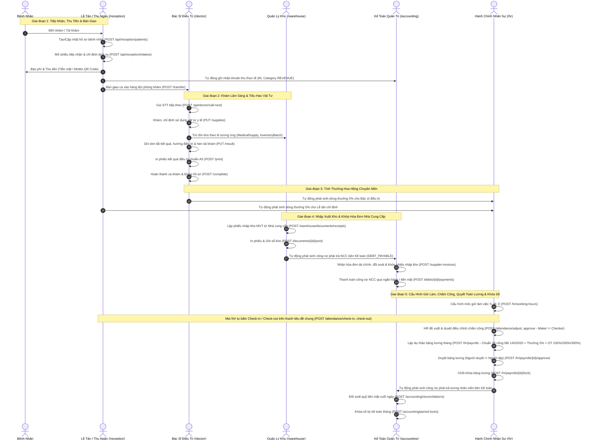

# Báo Cáo Tổng Hợp Quy Trình Nghiệp Vụ & Toàn Bộ Danh Mục API Hệ Thống

> **Dự án:** KhoiDent ERP - Hệ thống quản lý toàn diện phòng khám nha khoa chuyên sâu  
> **Thời gian cập nhật:** 19/10/2026  
> **Môi trường vận hành:** Node.js v24, MS SQL Server Local Express 2017+, NestJS 11, React 19 + Vite, Prisma ORM v6, TailwindCSS  
> **Trạng thái dịch vụ trực tuyến:**  
> - 🌐 **Giao diện người dùng (Web Client):** [http://localhost:5173](http://localhost:5173) (Đang chạy)  
> - ⚙️ **Máy chủ dịch vụ (Backend API):** [http://localhost:3000](http://localhost:3000) (Đang chạy)  
> - 📖 **Tài liệu Swagger / OpenAPI tương tác:** [http://localhost:3000/api/docs/](http://localhost:3000/api/docs/) (Đang chạy)  
> - 📊 **Tổng số API Endpoints chức năng:** **114 Endpoints** (158 đường dẫn đăng ký, bao gồm hỗ trợ kép cho `/api/hr` và `/api/personnel`)  
> - 🧪 **Chất lượng kiểm thử:** ✅ **199/199 Unit Tests Passed (131 API + 68 Web)** | ✅ **20/20 E2E Tests Passed** | ✅ **0 Linter Errors** | ✅ **Build Production 100% Succeeded**

---

## 1. Thông Tin Môi Trường & Danh Mục 10 Tài Khoản Thực Tế

Hệ thống được thiết kế theo đúng quy mô phòng khám nha khoa hiện đại tiêu chuẩn gồm **6 Vai trò (Roles)** với **10 tài khoản người dùng (`User`)** liên kết chặt chẽ với **10 hồ sơ cán bộ nhân viên (`Employee`)** và phòng khám/quầy trực tế:

| STT | Họ và Tên | Tên Đăng Nhập | Mã NV | Vai Trò (Role Code) | Vị Trí Chuyên Môn | Khối / Phòng Ban | Quầy / Phòng Khám | Mật Khẩu | Điền Nhanh Trên Login |
| :---: | :--- | :---: | :---: | :---: | :--- | :--- | :--- | :---: | :---: |
| **1** | **Trần Nguyễn Minh Khôi** | `admin` | `NV-0001` | `ADMIN` | Giám đốc Điều hành & Quản trị Hệ thống | Ban Quản Trị | Trụ sở điều hành | `Dental@123` | Nút **"Quản trị viên"** |
| **2** | **Lê Thị Nhân Sự** | `hr` | `NV-0002` | `HR` | Trưởng phòng Hành chính - Nhân sự & Quản lý | Phòng Hành chính - Nhân sự & Quản lý | Văn phòng Nhân sự | `Dental@123` | Nút **"Hành chính nhân sự"** |
| **3** | **Trần Thị Tiếp Nhận** | `reception` | `NV-0003` | `RECEPTION_STAFF` | Tổ trưởng Lễ tân & Thu ngân trung tâm | Phòng Tiếp nhận | Quầy đón tiếp trung tâm | `Dental@123` | Nút **"Tiếp nhận"** |
| **4** | **Nguyễn Thanh Hoa** | `reception-hoa` | `NV-0004` | `RECEPTION_STAFF` | Nhân viên Lễ tân & CSKH | Phòng Tiếp nhận | Quầy đón tiếp 01 | `Dental@123` | Nhập trực tiếp |
| **5** | **Võ Phương Mai** | `reception-mai` | `NV-0005` | `RECEPTION_STAFF` | Nhân viên Tiếp nhận & Điều phối ca khám | Phòng Tiếp nhận | Quầy đón tiếp 02 | `Dental@123` | Nhập trực tiếp |
| **6** | **BS. CKI. Nguyễn Hoàng Minh** | `doctor-minh` | `NV-0006` | `DOCTOR` | Bác sĩ CKI Nha khoa tổng quát & Phục hình | Khối Chuyên môn Lâm sàng | **Phòng khám 01** (`room-01`) | `Dental@123` | Nút **"Bác sĩ"** (alias: `doctor`) |
| **7** | **BS. ThS. Trần Ngọc Lan** | `doctor-lan` | `NV-0007` | `DOCTOR` | Bác sĩ Thạc sĩ Thẩm mỹ & Chỉnh nha | Khối Chuyên môn Lâm sàng | **Phòng khám 02** (`room-02`) | `Dental@123` | Nhập trực tiếp |
| **8** | **BS. CKI. Lê Quốc Huy** | `doctor-huy` | `NV-0008` | `DOCTOR` | Bác sĩ CKI Tiểu phẫu & Cấy ghép Implant | Khối Chuyên môn Lâm sàng | **Phòng tiểu phẫu** (`room-03`) | `Dental@123` | Nhập trực tiếp |
| **9** | **Phạm Văn Kho** | `warehouse` | `NV-0009` | `WAREHOUSE_MANAGEMENT` | Tổ trưởng Quản lý Kho Dược & Vật tư Y tế | Bộ phận Quản lý Kho | Kho Dược & VTYT | `Dental@123` | Nút **"Quản lý kho"** |
| **10** | **Hoàng Thị Kế Toán** | `accounting` | `NV-0010` | `ACCOUNTING_STAFF` | Kế toán trưởng phụ trách Tài chính - Thu chi | Phòng Tài chính - Kế toán | Văn phòng Kế toán | `Dental@123` | Nút **"Kế toán"** |

---

## 2. Sơ Đồ Chu Trình Vận Hành Khép Kín Xuyên Suốt 6 Phân Hệ

Toàn bộ dữ liệu của phòng khám vận hành nhịp nhàng theo chu trình khép kín 5 giai đoạn:



---

## 3. Danh Mục Chi Tiết Toàn Bộ 105 API Endpoints Hệ Thống

Hệ thống cung cấp tổng cộng **105 API chức năng độc lập** (được đăng ký dưới **140 đường dẫn** trong NestJS do phân hệ Nhân sự hỗ trợ song song hai prefix chuẩn hóa `/api/hr` và tương thích ngược `/api/personnel`):

---

### 3.1. Phân Hệ Kiểm Tra Trạng Thái Hệ Thống (`/api`) - 1 API

| STT | Phương Thức | Đường Dẫn Endpoint | Tên Chức Năng Nghiệp Vụ | Dữ Liệu Đầu Vào | Phân Quyền | Tác Động Dữ Liệu / Phản Hồi |
| :-: | :---: | :--- | :--- | :--- | :---: | :--- |
| **1** | `GET` | `/api/health` | Kiểm tra tình trạng máy chủ | Không có | Public | Trả về `{ status: "ok", service: "dental-erp-api" }` xác nhận API hoạt động |

---

### 3.2. Phân Hệ Xác Thực & Phân Quyền (`/api/auth`) - 1 API

| STT | Phương Thức | Đường Dẫn Endpoint | Tên Chức Năng Nghiệp Vụ | Dữ Liệu Đầu Vào | Phân Quyền | Tác Động Dữ Liệu / Phản Hồi |
| :-: | :---: | :--- | :--- | :--- | :---: | :--- |
| **2** | `POST` | `/api/auth/login` | Đăng nhập tài khoản nội bộ | `username`, `password` | Public | Xác thực mật khẩu băm, cấp mã Access Token JWT mang đầy đủ thông tin quyền hạn |

---

### 3.3. Phân Hệ Cổng Thanh Toán Trực Tuyến MoMo (`/api/payments`) - 4 APIs

| STT | Phương Thức | Đường Dẫn Endpoint | Tên Chức Năng Nghiệp Vụ | Dữ Liệu Đầu Vào | Phân Quyền | Tác Động Dữ Liệu / Phản Hồi |
| :-: | :---: | :--- | :--- | :--- | :---: | :--- |
| **3** | `POST` | `/api/payments/momo` | Khởi tạo giao dịch MoMo QR | `intakeCode`, `amount`, `orderInfo` | Bearer JWT | Ký số HMAC-SHA256, gửi yêu cầu tới cổng MoMo, trả về mã QR & `payUrl` |
| **4** | `POST` | `/api/payments/momo/ipn` | Tiếp nhận Webhook IPN từ MoMo | Payload MoMo callback | Public | Kiểm tra chữ ký bảo mật; nếu hợp lệ, tự động cập nhật phiếu tiếp nhận và sổ quỹ |
| **5** | `GET` | `/api/payments/momo/return` | Xử lý điều hướng bệnh nhân | Tham số URL từ MoMo | Public | Hiển thị kết quả thanh toán trên màn hình người dùng |
| **6** | `GET` | `/api/payments/momo/{orderId}/status` | Truy vấn trạng thái giao dịch MoMo | `orderId` (path) | Bearer JWT | Tra cứu trạng thái giao dịch thực tế từ cổng MoMo |

---

### 3.4. Phân Hệ Tiếp Nhận & Thu Ngân (`/api/reception`) - 12 APIs

| STT | Phương Thức | Đường Dẫn Endpoint | Tên Chức Năng Nghiệp Vụ | Dữ Liệu Đầu Vào | Phân Quyền | Tác Động Dữ Liệu / Phản Hồi |
| :-: | :---: | :--- | :--- | :--- | :---: | :--- |
| **7** | `GET` | `/api/reception/master-data` | Lấy danh mục phòng khám, dịch vụ, bác sĩ | Không có | Bearer JWT | Trả về danh sách phòng khám, bảng giá dịch vụ nha khoa và bác sĩ trực |
| **8** | `GET` | `/api/reception/patients` | Tra cứu danh sách hồ sơ bệnh nhân | `search` (query) | Bearer JWT | Trả về danh sách bệnh nhân kèm lịch sử tiếp đón |
| **9** | `POST` | `/api/reception/patients` | Tạo mới hồ sơ bệnh nhân | `fullName`, `dateOfBirth`, `gender`, `phone`, `address`, `note` | Bearer JWT | Tự động sinh mã `MBN-YYYYMMDD/XXXX`, lưu vào bảng `Patient` |
| **10** | `PUT` | `/api/reception/patients/{code}` | Cập nhật hồ sơ bệnh nhân | `code` (path), thông tin cập nhật | Bearer JWT | Cập nhật thông tin hành chính, số điện thoại, ghi chú dị ứng |
| **11** | `DELETE` | `/api/reception/patients/{code}` | Xóa hồ sơ bệnh nhân (Sao lưu an toàn) | `code` (path), `reason` (query) | Bearer JWT | Chuyển bản ghi sang `PatientDeleted` kèm người xóa và lý do |
| **12** | `GET` | `/api/reception/intakes` | Danh sách phiếu tiếp nhận trong ngày | `status`, `date` (query) | Bearer JWT | Lấy danh sách lượt khám và tiến độ thanh toán/khám |
| **13** | `POST` | `/api/reception/intakes` | Tạo mới phiếu tiếp nhận khám | `patientCode`, `symptoms`, `priority` | Bearer JWT | Tự động sinh mã `TN-YYYYMMDD/XXXX`, đưa bệnh nhân vào trạng thái chờ chỉ định |
| **14** | `PUT` | `/api/reception/intakes/{code}/services` | Chỉ định dịch vụ, phòng khám & bác sĩ | `code` (path), `roomCode`, `doctorUsername`, `services[]` | Bearer JWT | Gắn dịch vụ nha khoa, tính tổng tiền, chỉ định ghế khám |
| **15** | `POST` | `/api/reception/intakes/{code}/pay-cash` | Thu tiền mặt tại quầy tiếp đón | `code` (path) | Bearer JWT | Cập nhật `isPaid = true`, tự động ghi sổ thu tiền mặt bên Kế toán (`CashLedger`) |
| **16** | `POST` | `/api/reception/intakes/{code}/transfer` | Bàn giao hồ sơ cho bác sĩ phòng khám | `code` (path) | Bearer JWT | Chuyển trạng thái lượt khám sang `TRANSFERRED`, đưa vào hàng đợi bác sĩ |
| **17** | `DELETE` | `/api/reception/intakes/{code}` | Xóa phiếu tiếp nhận (Sao lưu an toàn) | `code` (path), `reason` (query) | Bearer JWT | Chuyển lượt khám sang bảng `IntakeDeleted`, lưu vết người xóa |
| **18** | `GET` | `/api/reception/backup/deleted` | Tra cứu bản ghi đã xóa phân hệ Tiếp nhận | Không có | Bearer JWT | Truy vấn lịch sử dữ liệu bệnh nhân/tiếp nhận đã bị xóa |

---

### 3.5. Phân Hệ Bác Sĩ Điều Trị Lâm Sàng (`/api/doctor`) - 13 APIs

| STT | Phương Thức | Đường Dẫn Endpoint | Tên Chức Năng Nghiệp Vụ | Dữ Liệu Đầu Vào | Phân Quyền | Tác Động Dữ Liệu / Phản Hồi |
| :-: | :---: | :--- | :--- | :--- | :---: | :--- |
| **19** | `GET` | `/api/doctor/rooms` | Danh sách phòng khám đang hoạt động | Không có | DOCTOR, ADMIN | Lấy danh mục phòng/ghế điều trị nha khoa |
| **20** | `GET` | `/api/doctor/queue` | Hàng đợi bệnh nhân của phòng khám | `roomCode` (query) | DOCTOR, ADMIN | Lấy danh sách bệnh nhân đang chờ theo thứ tự ưu tiên |
| **21** | `GET` | `/api/doctor/current` | Lấy ca khám đang diễn ra của bác sĩ | Không có | DOCTOR, ADMIN | Truy vấn hồ sơ ca khám `IN_PROGRESS` của bác sĩ đang đăng nhập |
| **22** | `POST` | `/api/doctor/call-next` | Gọi số thứ tự tiếp theo (Bước 1) | `roomCode` | DOCTOR, ADMIN | Chuyển bệnh nhân tiếp theo vào trạng thái đang khám, khởi tạo ca khám |
| **23** | `GET` | `/api/doctor/supplies` | Danh mục VTYT mẫu (Bước 2) | Không có | DOCTOR, ADMIN | Danh mục vật tư y tế trong kho (Bảo mật: Ẩn giá vốn) |
| **24** | `GET` | `/api/doctor/examinations/{id}` | Lấy chi tiết hồ sơ khám bệnh | `id` (path) | DOCTOR, ADMIN | Trả về thông tin đầy đủ về chẩn đoán, dịch vụ, vật tư tiêu hao |
| **25** | `PUT` | `/api/doctor/examinations/{id}/supplies` | Cập nhật vật tư y tế sử dụng (Bước 2) | `supplies[]`: `intakeServiceId`, `supplyCode`, `quantity` | DOCTOR, ADMIN | Gắn vật tư vào dịch vụ; kiểm tra tồn kho theo lô trong CSDL |
| **26** | `PUT` | `/api/doctor/examinations/{id}/result` | Cập nhật kết quả chẩn đoán (Bước 3) | `summary`, `treatmentMethod`, `orientation`, `nextDate` | DOCTOR, ADMIN | Lưu tóm tắt tình trạng răng miệng, hướng điều trị và lịch hẹn |
| **27** | `POST` | `/api/doctor/examinations/{id}/print` | Ghi nhận lịch sử in kết quả điều trị | `id` (path) | DOCTOR, ADMIN | Tăng số lần in phiếu và lưu vết người in |
| **28** | `POST` | `/api/doctor/examinations/{id}/complete` | Ghi sổ hoàn thành ca khám (Bước 4) | `id` (path) | DOCTOR, ADMIN | Khóa hồ sơ, trừ tồn kho thực tế, sinh thưởng hoa hồng 5% Bác sĩ + 5% Lễ tân |
| **29** | `POST` | `/api/doctor/examinations/{id}/cancel` | Từ chối / Ngừng khám (Mọi bước) | `reason` | DOCTOR, ADMIN | Bắt buộc nhập lý do từ chối (bệnh nhân bỏ về, huyết áp cao...) |
| **30** | `POST` | `/api/doctor/examinations/{id}/unlock` | Mở khóa hồ sơ ca khám đã hoàn thành | `reason` | ADMIN, Bác sĩ trưởng | Cho phép chỉnh sửa thông tin ca khám khi có yêu cầu đặc biệt |
| **31** | `GET` | `/api/doctor/backup/deleted` | Tra cứu ca khám đã hủy/xóa | Không có | DOCTOR, ADMIN | Truy vấn danh sách ca khám trong bảng `ExaminationDeleted` |

---

### 3.6. Phân Hệ Quản Lý Kho Y Tế (`/api/warehouse`) - 19 APIs

| STT | Phương Thức | Đường Dẫn Endpoint | Tên Chức Năng Nghiệp Vụ | Dữ Liệu Đầu Vào | Phân Quyền | Tác Động Dữ Liệu / Phản Hồi |
| :-: | :---: | :--- | :--- | :--- | :---: | :--- |
| **32** | `GET` | `/api/warehouse/overview` | Tổng quan kho & chỉ số cảnh báo (Tab 1) | Không có | WAREHOUSE, ADMIN | Trả về tổng giá trị tồn kho, vật tư sắp hết, lô cận hạn sử dụng |
| **33** | `GET` | `/api/warehouse/items` | Danh mục vật tư & tồn theo lô (Tab 2) | `group`, `search` (query) | WAREHOUSE, ADMIN | Danh mục vật tư y tế, thuốc tê, chỉ nha khoa kèm số lượng tồn từng lô |
| **34** | `POST` | `/api/warehouse/items` | Tạo mới vật tư y tế | Thông tin vật tư, đơn vị quy đổi | WAREHOUSE, ADMIN | Tự động sinh mã `VT-xxxx`, tạo mới trong `MedicalSupply` |
| **35** | `GET` | `/api/warehouse/usage` | Lịch sử tiêu hao vật tư lâm sàng | `startDate`, `endDate`, `doctorId`, `roomId` | WAREHOUSE, ADMIN | Thống kê số lượng vật tư bác sĩ đã dùng trong các ca khám |
| **36** | `GET` | `/api/warehouse/documents` | Danh sách chứng từ kho (Tab 3) | `type`, `status`, `startDate`, `endDate` | WAREHOUSE, ADMIN | Danh sách phiếu nhập MVT, phiếu xuất XVT, phiếu điều chuyển |
| **37** | `GET` | `/api/warehouse/documents/{id}` | Xem chi tiết chứng từ kho | `id` (path) | WAREHOUSE, ADMIN | Xem chi tiết từng dòng mặt hàng, đơn giá, số lô, hạn sử dụng |
| **38** | `PUT` | `/api/warehouse/documents/{id}` | Cập nhật chứng từ kho nháp | `id` (path), thông tin cập nhật | WAREHOUSE, ADMIN | Cho phép sửa số lượng, đơn giá khi chứng từ ở trạng thái `DRAFT` |
| **39** | `DELETE` | `/api/warehouse/documents/{id}` | Xóa chứng từ kho nháp | `id` (path), `reason` (query) | WAREHOUSE, ADMIN | Lưu vết chứng từ bị xóa vào bảng `StockDocumentDeleted` |
| **40** | `GET` | `/api/warehouse/suppliers` | Danh mục nhà cung cấp dược/vật tư | Không có | WAREHOUSE, ADMIN | Danh sách các đối tác cung cấp thiết bị và vật tư y tế |
| **41** | `POST` | `/api/warehouse/suppliers` | Tạo mới nhà cung cấp | Tên, mã số thuế, địa chỉ, SĐT | WAREHOUSE, ADMIN | Thêm mới nhà cung cấp vào cơ sở dữ liệu |
| **42** | `GET` | `/api/warehouse/clinic-context` | Dữ liệu ngữ cảnh phòng khám | Không có | WAREHOUSE, ADMIN | Cung cấp danh sách bệnh nhân, bác sĩ, phòng khám cho màn hình xuất kho |
| **43** | `POST` | `/api/warehouse/documents/receipts` | Lập phiếu nhập kho (MVT) | `supplierId`, `lines[]`: `supplyId`, `quantity`, `unitCost`, `batchNo`, `expiryDate` | WAREHOUSE, ADMIN | Khởi tạo phiếu nhập kho mua hàng từ nhà cung cấp |
| **44** | `POST` | `/api/warehouse/documents/issues` | Lập phiếu xuất kho (XVT) | `roomId`, `doctorId`, `patientId`, `lines[]` | WAREHOUSE, ADMIN | Khởi tạo phiếu xuất vật tư phục vụ điều trị chuyên môn |
| **45** | `POST` | `/api/warehouse/documents/{id}/print` | In phiếu kho chuẩn A5 | `id` (path) | WAREHOUSE, ADMIN | Tăng số lần in; in lần thứ 2 tự động đóng dấu `BẢN SAO` |
| **46** | `POST` | `/api/warehouse/documents/{id}/post` | Ghi sổ kho chính thức | `id` (path) | WAREHOUSE, ADMIN | Tăng/giảm tồn kho thực tế, sinh công nợ phải trả NCC sang Kế toán |
| **47** | `POST` | `/api/warehouse/documents/{id}/cancel` | Hủy chứng từ kho | `id` (path), `reason` | WAREHOUSE, ADMIN | Đảo ngược chứng từ nếu chưa ghi sổ hoặc xử lý hủy phiếu |
| **48** | `POST` | `/api/warehouse/batches/{id}/dispose` | Hủy lô vật tư hư hỏng / hết hạn | `id` (path), `quantity`, `reason` | WAREHOUSE, ADMIN | Trừ số lượng tồn, chuyển thông tin sang bảng `InventoryBatchDeleted` |
| **49** | `DELETE` | `/api/warehouse/items/{id}` | Ngừng kinh doanh / Xóa vật tư | `id` (path), `reason` | WAREHOUSE, ADMIN | Sao lưu toàn bộ vật tư và lô tồn vào `MedicalSupplyDeleted` |
| **50** | `GET` | `/api/warehouse/backup/deleted` | Tra cứu bản ghi đã xóa phân hệ Kho | Không có | WAREHOUSE, ADMIN | Xem lại các vật tư và chứng từ đã bị xóa/hủy |

---

### 3.7. Phân Hệ Kế Toán Quản Trị & Dòng Tiền (`/api/accounting`) - 20 APIs

| STT | Phương Thức | Đường Dẫn Endpoint | Tên Chức Năng Nghiệp Vụ | Dữ Liệu Đầu Vào | Phân Quyền | Tác Động Dữ Liệu / Phản Hồi |
| :-: | :---: | :--- | :--- | :--- | :---: | :--- |
| **51** | `GET` | `/api/accounting/overview` | Tổng quan dòng tiền, hiệu quả & công nợ | `startDate`, `endDate`, `roomId`, bộ lọc | ACCOUNTING, ADMIN | Thống kê 3 khối: Dòng tiền thực tế, Hiệu quả chuyên môn, Công nợ |
| **52** | `GET` | `/api/accounting/cash` | Sổ quỹ thu chi tiền mặt & ngân hàng | `startDate`, `endDate`, `category`, `method` | ACCOUNTING, ADMIN | Bảng kê chi tiết mọi giao dịch thu chi phát sinh trong kỳ |
| **53** | `GET` | `/api/accounting/losses` | Báo cáo chi phí hao hụt & hủy vật tư | `startDate`, `endDate`, `roomId` | ACCOUNTING, ADMIN | Thống kê giá trị vật tư tiêu hao quá mức hoặc hết hạn bị hủy |
| **54** | `GET` | `/api/accounting/debts` | Sổ theo dõi công nợ phải thu & phải trả | `type` (`RECEIVABLE`, `PAYABLE`) | ACCOUNTING, ADMIN | Theo dõi nợ tiền bệnh nhân và nghĩa vụ thanh toán cho NCC/Nhân viên |
| **55** | `GET` | `/api/accounting/supplier-invoices` | Danh sách hóa đơn đầu vào nhà cung cấp | Không có | ACCOUNTING, ADMIN | Danh sách hóa đơn GTGT, trạng thái khớp chứng từ kho |
| **56** | `POST` | `/api/accounting/supplier-invoices` | Tạo & khớp hóa đơn NCC với phiếu nhập kho | Thông tin hóa đơn, `stockDocumentIds[]` | ACCOUNTING, ADMIN | Khớp số tiền hóa đơn với phiếu nhập kho, phát hiện chênh lệch |
| **57** | `GET` | `/api/accounting/pending-stock-documents` | Phiếu nhập kho chờ gắn hóa đơn tài chính | Không có | ACCOUNTING, ADMIN | Danh sách phiếu nhập hàng chưa có hóa đơn đỏ |
| **58** | `GET` | `/api/accounting/reconciliations` | Danh sách biên bản đối soát quỹ tiền mặt | Không có | ACCOUNTING, ADMIN | Lịch sử các lần kiểm quỹ cuối ngày tại các quầy thu ngân |
| **59** | `POST` | `/api/accounting/reconciliations` | Lập biên bản kiểm kê quỹ tiền mặt | `countedBalance`, `roomId`, `businessDate`, `reason` | ACCOUNTING, ADMIN | So sánh tiền thực đếm với số dư trên sổ sách, ghi nhận chênh lệch |
| **60** | `POST` | `/api/accounting/reconciliations/{id}/confirm` | Xác nhận xử lý chênh lệch quỹ tiền mặt | `id` (path) | ACCOUNTING, ADMIN | Hạch toán chênh lệch thừa (Thu nhập khác) hoặc thiếu (Bồi thường) |
| **61** | `GET` | `/api/accounting/period-locks` | Lịch sử các kỳ kế toán đã khóa sổ | Không có | ACCOUNTING, ADMIN | Danh sách các tháng kế toán đã đóng |
| **62** | `POST` | `/api/accounting/period-locks` | Khóa sổ kỳ kế toán tháng | `year`, `month`, `note` | ACCOUNTING, ADMIN | Khóa toàn bộ dữ liệu thu chi tháng, chặn chỉnh sửa hồi tố |
| **63** | `GET` | `/api/accounting/refunds` | Danh sách yêu cầu hoàn tiền bệnh nhân | Không có | ACCOUNTING, ADMIN | Bảng kê các ca bệnh nhân yêu cầu hoàn lại tiền |
| **64** | `POST` | `/api/accounting/refunds` | Tạo yêu cầu hoàn tiền dịch vụ | `intakeId`, `patientId`, `amount`, `reason` | ACCOUNTING, ADMIN | Tạo yêu cầu hoàn tiền, chờ cấp trên phê duyệt |
| **65** | `POST` | `/api/accounting/refunds/{id}/approve` | Phê duyệt hoàn tiền (Maker $\ne$ Checker) | `id` (path) | ADMIN, Kế toán trưởng | Duyệt hoàn tiền, ghi nhận giảm trừ doanh thu và sinh phiếu chi |
| **66** | `GET` | `/api/accounting/audit-logs` | Nhật ký kiểm toán kế toán & tài chính | Không có | ACCOUNTING, ADMIN | Lưu lại lịch sử ai đã sửa, duyệt, xóa hoặc khóa sổ dữ liệu |
| **67** | `GET` | `/api/accounting/performance-details` | Chi tiết báo cáo lãi gộp & giá vốn | `startDate`, `endDate`, `roomId` | ACCOUNTING, ADMIN | Tính doanh thu dịch vụ trừ giá vốn vật tư lâm sàng theo từng ca |
| **68** | `PUT` | `/api/accounting/entries/{id}/tax` | Xác nhận trạng thái thuế & hóa đơn VAT | `id` (path), `isTaxEntered`, `vatInvoiceNumber` | ACCOUNTING, ADMIN | Đánh dấu khoản thu chi đã xuất/nhận hóa đơn thuế GTGT |
| **69** | `POST` | `/api/accounting/debts/{id}/payments` | Ghi nhận thanh toán / thu hồi công nợ | `id` (path), `amount`, `method`, `transactionCode` | ACCOUNTING, ADMIN | Thu tiền nợ bệnh nhân hoặc chi tiền trả nợ nhà cung cấp/lương |
| **70** | `POST` | `/api/accounting/expenses` | Lập phiếu chi chi phí vận hành | `category`, `amount`, `method`, `supplierId`, `reason` | ACCOUNTING, ADMIN | Chi tiền điện, nước, thuê mặt bằng, văn phòng phẩm phòng khám |

---

### 3.8. Phân Hệ Hành Chính Nhân Sự & Tiền Lương (`/api/hr` & `/api/personnel`) - 44 APIs

*(Lưu ý: Mọi API dưới đây đều hỗ trợ đồng thời hai đường dẫn tương đương: `/api/hr/...` và `/api/personnel/...`)*

| STT | Phương Thức | Đường Dẫn Endpoint | Tên Chức Năng Nghiệp Vụ | Dữ Liệu Đầu Vào | Phân Quyền | Tác Động Dữ Liệu / Phản Hồi |
| :-: | :---: | :--- | :--- | :--- | :---: | :--- |
| **71** | `GET` | `/api/hr/overview` | Tổng quan nhân sự, ca trực & lương | Không có | HR, ADMIN | Thống kê số lượng nhân viên, ca trực hôm nay, bảng lương mới nhất |
| **72** | `GET` | `/api/hr/employees` | Tra cứu danh sách hồ sơ nhân sự | `search`, `department`, `status`, `maskSensitive` | HR, ADMIN | Bảng thông tin nhân viên (Bảo mật: che dấu CCCD, Số tài khoản ngân hàng) |
| **73** | `POST` | `/api/hr/employees` | Tạo mới hồ sơ nhân viên | Họ tên, ngày sinh, chức danh, phòng ban, lương cơ bản | HR, ADMIN | Tự động sinh mã `NV-xxxx` tiếp theo, tạo bản ghi trong bảng `Employee` |
| **74** | `GET` | `/api/hr/employees/{id}` | Xem chi tiết hồ sơ nhân viên | `id` (path) | HR, ADMIN | Trả về thông tin chi tiết hồ sơ, hợp đồng, tài khoản ngân hàng |
| **75** | `PUT` | `/api/hr/employees/{id}` | Cập nhật thông tin cán bộ nhân viên | `id` (path), thông tin cập nhật | HR, ADMIN | Cập nhật chức vụ, mức lương cơ bản, phụ cấp cố định |
| **76** | `POST` | `/api/hr/employees/{id}/terminate` | Cho thôi việc & Khóa tài khoản nhân viên | `id` (path), `terminationDate`, `reason` | HR, ADMIN | Khóa tài khoản nhân viên (Bảo vệ: Chặn thôi việc nếu Bác sĩ đang khám dở dang) |
| **77** | `GET` | `/api/hr/roles` | Danh mục vai trò & tổ hợp cấm (SoD) | Không có | HR, ADMIN | Danh sách 6 vai trò hệ thống và các quy tắc cấm kiêm nhiệm nội bộ |
| **78** | `GET` | `/api/hr/users` | Danh sách tài khoản người dùng | `search`, `roleCode`, `isActive` | HR, ADMIN | Quản lý 10 tài khoản hệ thống (Bác sĩ, Tiếp nhận, Kho, Kế toán...) |
| **79** | `POST` | `/api/hr/users` | Cấp tài khoản đăng nhập mới | `username`, `fullName`, `password`, `roleId`, `employeeId` | HR, ADMIN | Khởi tạo tài khoản người dùng gắn với hồ sơ nhân viên |
| **80** | `PUT` | `/api/hr/users/{id}` | Cập nhật thông tin tài khoản | `id` (path), thông tin cập nhật | HR, ADMIN | Đổi họ tên hiển thị, thay đổi liên kết nhân viên |
| **81** | `POST` | `/api/hr/users/{id}/toggle-active` | Khóa / Mở khóa tài khoản đăng nhập | `id` (path) | HR, ADMIN | Bật/tắt trạng thái hoạt động của tài khoản người dùng |
| **82** | `POST` | `/api/hr/users/{id}/reset-password` | Đặt lại mật khẩu tài khoản | `id` (path), `newPassword` (mặc định Dental@123) | HR, ADMIN | Đặt lại mật khẩu đăng nhập của nhân viên khi bị quên |
| **83** | `GET` | `/api/hr/user-roles` | Danh sách phân quyền vai trò người dùng | Không có | HR, ADMIN | Theo dõi vai trò chính và các vai trò kiêm nhiệm |
| **84** | `POST` | `/api/hr/users/{id}/roles` | Gán vai trò kiêm nhiệm cho tài khoản | `id` (path), `roleId`, `isPrimary` | HR, ADMIN | Kiểm tra tự động tổ hợp cấm kiêm nhiệm trước khi gán |
| **85** | `POST` | `/api/hr/user-roles/{id}/approve` | Phê duyệt vai trò nhạy cảm (2 bước) | `id` (path) | ADMIN, Quản lý | Duyệt quyền nhạy cảm (Yêu cầu Người duyệt $\ne$ Người gán) |
| **86** | `DELETE` | `/api/hr/user-roles/{id}` | Thu hồi vai trò kiêm nhiệm | `id` (path) | HR, ADMIN | Hủy bỏ vai trò đã gán của người dùng |
| **87** | `GET` | `/api/hr/shifts` | Danh mục ca làm việc tiêu chuẩn | Không có | Mọi nhân sự | Ca sáng, chiều, tối, ca trực cấp cứu |
| **88** | `POST` | `/api/hr/shifts` | Định nghĩa thêm ca làm việc mới | Mã ca, tên ca, giờ bắt đầu, giờ kết thúc | HR, ADMIN | Tạo ca làm việc linh hoạt cho phòng khám |
| **89** | `GET` | `/api/hr/shift-assignments` | Lịch phân ca làm việc theo ngày | `startDate`, `endDate`, `employeeId`, `roomId` | HR, ADMIN | Bảng lịch trực tổng thể của phòng khám |
| **90** | `POST` | `/api/hr/shift-assignments` | Phân công ca trực cho nhân viên | `employeeId`, `shiftId`, `date`, `roomId` | HR, ADMIN | Gắn nhân viên trực tại phòng/ghế nha khoa cụ thể |
| **91** | `GET` | `/api/hr/working-hours` | Lấy cấu hình thời gian làm việc có hiệu lực | `date` (query, tùy chọn) | Mọi nhân sự | Lấy bộ mốc giờ $S$ (Vào làm), $M$ (Phân buổi), $E$ (Tan làm) theo ngày hiệu lực |
| **92** | `GET` | `/api/hr/working-hours/history` | Lịch sử thay đổi cấu hình thời gian làm việc | Không có | HR, ADMIN | Truy vấn toàn bộ lịch sử các phiên bản cấu hình mốc giờ và audit log |
| **93** | `POST` | `/api/hr/working-hours` | Thiết lập cấu hình mốc giờ làm việc mới | `startTime`, `splitTime`, `endTime`, `effectiveDate`, `note` | HR, ADMIN | Kiểm tra ràng buộc $S < M < E$, ngày hiệu lực không ở quá khứ, ghi audit log |
| **94** | `GET` | `/api/hr/attendance/status` | Trạng thái Check-in / Check-out hôm nay | Không có | Mọi nhân sự đã đăng nhập | Kiểm tra trạng thái cá nhân hôm nay: Chưa Check-in / Đã Check-in / Đã Check-out |
| **95** | `POST` | `/api/hr/attendance/check-in` | Thực hiện Check-in cá nhân (Toàn màn hình) | `clinicRoom` (tùy chọn) | Mọi nhân sự đã đăng nhập | Lấy giờ máy chủ Asia/Ho_Chi_Minh, ghi nhận lần đầu, chống spam/ghi đè bản gốc |
| **96** | `POST` | `/api/hr/attendance/check-out` | Thực hiện Check-out cá nhân (Toàn màn hình) | `clinicRoom`, `confirmLeaveExamining` | Mọi nhân sự đã đăng nhập | Lấy giờ máy chủ, tính tăng ca/đi trễ, cảnh báo nếu bác sĩ có ca khám dở dang |
| **97** | `GET` | `/api/hr/attendance/summary` | Báo cáo tổng hợp chấm công tháng | `year`, `month` (query) | HR, ADMIN | Tổng hợp chi tiết ngày công lẻ (0.5 công), số phút đi trễ, giờ OT, thiếu check-out |
| **98** | `POST` | `/api/hr/attendance/adjust` | Đề xuất bổ sung / điều chỉnh chấm công | `recordId` hoặc (`employeeId`, `date`), `checkInTime`, `checkOutTime`, `reason` | HR, ADMIN | HR nhập bổ sung/sửa giờ; lưu vết bảo lưu giờ gốc, trạng thái PENDING_APPROVAL |
| **99** | `POST` | `/api/hr/attendance/{id}/approve` | Phê duyệt điều chỉnh chấm công | `id` (path), `action` (`APPROVE`/`REJECT`), `note` | ADMIN, Quản lý | Maker $\ne$ Checker: Người duyệt phải khác người đề xuất điều chỉnh |
| **100** | `GET` | `/api/hr/attendance` | Bảng tổng hợp chấm công chi tiết | `month`, `year`, `employeeId`, `status`, `roomId` | HR, ADMIN | Bảng công chi tiết giờ vào, giờ ra, đi muộn, tăng ca, trạng thái có mặt |
| **101** | `POST` | `/api/hr/attendance` | Ghi nhận chấm công hàng ngày thủ công | `employeeId`, `date`, `checkInTime`, `checkOutTime`, `status` | HR, ADMIN | Ghi nhận giờ chấm công thực tế của nhân viên (không tự trừ phạt tiền) |
| **102** | `POST` | `/api/hr/attendance/lock` | Khóa sổ dữ liệu chấm công tháng | `month`, `year` | HR, ADMIN | Khóa dữ liệu công làm căn cứ tính lương, ngăn sửa đổi |
| **103** | `GET` | `/api/hr/incentives` | Thống kê thưởng hoa hồng dịch vụ nha khoa | `roleType`, `status`, `employeeId` | HR, ADMIN | Bảng kê chi tiết tiền thưởng hoa hồng 5% Bác sĩ + 5% Lễ tân |
| **104** | `POST` | `/api/hr/incentives/sync` | Đồng bộ thưởng từ ca khám hoàn thành | Không có | HR, ADMIN | Quét các ca khám mới hoàn thành để tự động sinh dòng thưởng |
| **105** | `GET` | `/api/hr/payrolls` | Danh sách các kỳ bảng lương | Không có | HR, ADMIN | Danh sách các kỳ tính lương tháng |
| **106** | `POST` | `/api/hr/payrolls` | Lập dự thảo kỳ bảng lương mới | `year`, `month`, `standardWorkingDays = 26`, `title` | HR, ADMIN | Khởi tạo bảng lương `DRAFT`, tính lương chuẩn 26 công (NĐ 145/2020) + Thưởng 5% |
| **107** | `GET` | `/api/hr/payrolls/{id}` | Chi tiết dòng lương từng nhân viên | `id` (path) | HR, ADMIN | Bảng chi tiết lương cơ bản, ngày công, làm thêm giờ OT, phụ cấp, thưởng, thực nhận |
| **108** | `PUT` | `/api/hr/payrolls/{id}/items/{itemId}` | Điều chỉnh phụ cấp, làm thêm giờ & khấu trừ | `id` (path), `itemId` (path), các khoản điều chỉnh | HR, ADMIN | Điều chỉnh tiền thưởng, phạt, OT (Tự động trả trạng thái về DRAFT để duyệt lại) |
| **109** | `POST` | `/api/hr/payrolls/{id}/approve` | Phê duyệt bảng lương (Maker $\ne$ Checker) | `id` (path) | ADMIN, Quản lý | Duyệt bảng lương (Bắt buộc người duyệt khác với người lập bảng) |
| **110** | `POST` | `/api/hr/payrolls/{id}/lock` | Chốt khóa bảng lương & Ghi nợ Kế toán | `id` (path) | ADMIN, Quản lý | Chốt sổ bảng lương, tự động phát sinh công nợ phải trả nhân viên bên Kế toán |
| **111** | `POST` | `/api/hr/payrolls/{id}/cancel` | Hủy bỏ bảng lương | `id` (path), `cancelReason` | ADMIN, Quản lý | Hủy kỳ bảng lương chưa chi trả, lưu lý do hủy vào nhật ký kiểm toán |
| **112** | `GET` | `/api/hr/audit-logs` | Nhật ký kiểm toán nhân sự & tiền lương | Không có | HR, ADMIN | Theo dõi toàn bộ lịch sử phân quyền, sửa lương và chốt công |
| **113** | `GET` | `/api/hr/me/profile` | Xem thông tin hồ sơ của chính mình | Không có | Đăng nhập | Trả về thông tin hồ sơ cá nhân của tài khoản đang truy cập |
| **114** | `GET` | `/api/hr/me/payslips` | Xem các phiếu lương của chính mình | Không có | Đăng nhập | Cho phép nhân viên tự tra cứu phiếu lương cá nhân của các kỳ đã khóa |

---

## 4. Các Nguyên Tắc Kiểm Soát Nội Bộ & Cơ Chế Bảo Mật Toàn Diện

Hệ thống Dental ERP tuân thủ nghiêm ngặt các quy chuẩn kiểm soát tài chính và quản trị nhân sự y tế:

1. **Phân Tách Trách Nhiệm (Segregation of Duties - Maker $\ne$ Checker):**
   - Tài khoản lập dự thảo bảng lương (`createdById`) **tuyệt đối không thể tự phê duyệt** bảng lương của chính mình. Phải có tài khoản độc lập có thẩm quyền kiểm tra và phê duyệt (`approvedById`).
   - Tương tự, người tạo yêu cầu hoàn tiền bên Kế toán không thể tự phê duyệt yêu cầu hoàn tiền; người đề xuất điều chỉnh chấm công không thể tự duyệt điều chỉnh chấm công.
2. **Quy Tắc Cấm Kiêm Nhiệm Vai Trò Xung Đột (Forbidden Role Combinations):**
   - Hệ thống tự động chặn gán các cặp vai trò gây xung đột lợi ích:
     - `ACCOUNTING_STAFF` $\leftrightarrow$ `WAREHOUSE_MANAGEMENT`: Kế toán không được kiêm nhiệm Thủ kho (tránh vừa mua hàng vừa quản lý kho vật lý).
     - `ACCOUNTING_STAFF` $\leftrightarrow$ `RECEPTION_STAFF`: Kế toán không được kiêm nhiệm Thu ngân / Lễ tân (tránh vừa thu tiền mặt vừa đối trừ sổ sách).
3. **Phê Duyệt 2 Bước Cho Vai Trò Nhạy Cảm (Dual-Control Approval):**
   - Khi gán thêm các vai trò trọng yếu (`ADMIN`, `HR`, `ACCOUNTING_STAFF`), trạng thái ban đầu là `isApproved = false`. Vai trò chỉ có hiệu lực sau khi một tài khoản Admin/HR độc lập khác xác nhận phê duyệt.
4. **Bảo Mật Che Dấu Dữ Liệu Tài Chính Cá Nhân (Sensitive Data Masking):**
   - Số Căn cước công dân (`citizenId`) và Số tài khoản ngân hàng (`bankAccountNumber`) của nhân viên luôn được mã hóa che dấu (ví dụ: `******1122`, `******4567`) trên giao diện thông thường, chỉ hiển thị đầy đủ khi có thẩm quyền đặc biệt.
5. **Cơ Chế Khóa Sổ Kỳ Kế Toán & Bảng Lương (Data Tampering Prevention):**
   - Sau khi Bảng lương được chốt (`LOCKED`) hoặc Kỳ kế toán được khóa (`PERIOD_LOCKED`), toàn bộ dữ liệu giao dịch trong kỳ bị đóng băng tuyệt đối, ngăn chặn mọi hành vi can thiệp sửa đổi hồi tố.
6. **Sao Lưu Xóa Mềm An Toàn (Soft-Delete Backup):**
   - Khi xóa hồ sơ bệnh nhân, lượt tiếp nhận, vật tư y tế hay chứng từ kho, hệ thống không xóa vĩnh viễn khỏi CSDL mà tự động sao lưu toàn bộ thông tin sang các bảng lịch sử: `PatientDeleted`, `IntakeDeleted`, `MedicalSupplyDeleted`, `InventoryBatchDeleted`, `StockDocumentDeleted`, `ExaminationDeleted` kèm thông tin tài khoản người thực hiện và lý do xóa.
7. **Bảo Lưu Dữ Liệu Chấm Công Gốc & Bản Chụp Mốc Giờ:**
   - Giờ Check-in và Check-out đầu tiên do máy chủ ghi nhận luôn là bản gốc bất biến. Mọi sự điều chỉnh của HR phải có lý do, lưu lại giờ cũ/mới và được cấp quản lý phê duyệt. Mỗi bản ghi công lưu bản chụp mốc giờ ($S, M, E$) tại ngày phát sinh để việc thay đổi cấu hình sau này không làm sai lệch số liệu quá khứ.

---

## 5. Hướng Dẫn Vận Hành & Kiểm Thử Nhanh

### 5.1. Khởi Chạy Hệ Thống Bằng Một Lệnh Duy Nhất

```bash
# Khởi chạy đồng thời cả Frontend Web (5173) và Backend API (3000)
npm run dev
```

- **Truy cập ứng dụng:** [http://localhost:5173](http://localhost:5173)
- **Truy cập tài liệu API tương tác:** [http://localhost:3000/api/docs/](http://localhost:3000/api/docs/)

### 5.2. Đăng Nhập Nhanh Qua Các Vai Trò Thực Tế

Tại trang Đăng nhập [http://localhost:5173/login](http://localhost:5173/login), khu vực *"Tài khoản thử nghiệm"* cung cấp các nút bấm điền nhanh mật khẩu chung `Dental@123`:
1. Nút **"Quản trị viên"** $\rightarrow$ Đăng nhập tài khoản `admin` (Trần Nguyễn Minh Khôi) $\rightarrow$ Vào `/admin`.
2. Nút **"Hành chính nhân sự"** $\rightarrow$ Đăng nhập tài khoản `hr` (Lê Thị Nhân Sự) $\rightarrow$ Vào **`/hr`** (Quản lý hồ sơ, tài khoản, công ca, cấu hình giờ làm, bảng lương, thưởng).
3. Nút **"Tiếp nhận"** $\rightarrow$ Đăng nhập tài khoản `reception` (Trần Thị Tiếp Nhận) $\rightarrow$ Vào `/reception` (Tiếp đón, thu tiền, in phiếu A5).
4. Nút **"Bác sĩ"** $\rightarrow$ Đăng nhập tài khoản `doctor-minh` (BS. CKI. Nguyễn Hoàng Minh - Phòng 01) $\rightarrow$ Vào `/doctor` (Khám 4 bước, in kết quả A5).
5. Nút **"Quản lý kho"** $\rightarrow$ Đăng nhập tài khoản `warehouse` (Phạm Văn Kho) $\rightarrow$ Vào `/warehouse` (Tồn kho, nhập MVT, xuất XVT, hủy lô).
6. Nút **"Kế toán"** $\rightarrow$ Đăng nhập tài khoản `accounting` (Hoàng Thị Kế Toán) $\rightarrow$ Vào `/accounting` (Thu chi, công nợ, đối soát quỹ, khóa sổ).

### 5.3. Chạy Kiểm Thử Tự Động Toàn Diện

```bash
# 1. Chạy toàn bộ 199 Unit Tests (131 API + 68 Web)
npm test

# 2. Chạy 20 E2E Tests trên cơ sở dữ liệu thực tế SQL Server
npm run test:e2e --workspace api

# 3. Kiểm tra định dạng mã nguồn và Linter
npm run lint

# 4. Kiểm tra biên dịch Production (NestJS build + Vite build)
npm run build --workspaces --if-present
```

---

## 6. Tổng Kết

Dự án **KhoiDent ERP** đã đạt mức độ hoàn thiện xuất sắc trên toàn bộ 6 phân hệ nghiệp vụ:
- Cả hai máy chủ Backend API (cổng 3000) và Frontend Web (cổng 5173) đang chạy ổn định.
- **114 API chức năng** đã được chuẩn hóa, ghi chú đầy đủ mô tả nghiệp vụ trên Swagger UI và tài liệu hóa chi tiết trong báo cáo này.
- Phân hệ Hành chính Nhân sự đã hoàn tất tích hợp Check-in/Check-out toàn diện mọi màn hình, cấu hình giờ làm việc có hiệu lực, và tính lương theo chuẩn 26 ngày công (Nghị định 145/2020/NĐ-CP) & tỷ lệ làm thêm giờ OT theo Điều 98 BLLĐ 2019.
