# Báo Cáo Kiểm Tra Toàn Diện: CSDL Quan Hệ & Luồng Kế Toán Quản Trị (/accounting)

> **Dự án:** Dental ERP (Hệ thống quản lý phòng khám nha khoa chuyên sâu)  
> **Thời gian cập nhật:** 19/10/2026  
> **Môi trường:** Localhost (Windows 11, Node.js v22, MS SQL Server Express 2017+, NestJS, React 19 + Vite, Prisma ORM v6, TailwindCSS)  
> **Tài liệu đặc tả đối chiếu:** `Role Kế Toán.md`, `Role Bác Sĩ.md`, `Role nhan vien tiep nhan.md`, `Role Quản Lý Kho.md`  
> **Trạng thái kiểm thử:** ✅ **PASSED (151/151 Automated Unit Tests + 20/20 Backend E2E Tests + 0 Lint Warnings + Clean Production Build)**

---

## 1. Thiết Kế Cơ Sở Dữ Liệu Quan Hệ Phân Hệ Kế Toán (Database Relational Schema)

Phân hệ Kế toán (`/accounting`) giữ vai trò trung tâm **tiếp nhận dữ liệu tiền và chứng từ** từ cả 3 phân hệ: Quầy tiếp nhận (`/reception`), Bác sĩ điều trị (`/doctor`) và Quản lý kho (`/warehouse`). Hệ thống cơ sở dữ liệu trên Microsoft SQL Server đã được thiết kế và bổ sung **12 bảng dữ liệu chuyên biệt** với kiến trúc **bất biến (Immutable Ledger)**, không xóa cứng, truy vết nguồn gốc 2 chiều (Bi-directional Tracing):

### 1.1. Sơ Đồ Quan Hệ Thực Thể Phân Hệ Kế Toán (ERD)

```mermaid
erDiagram
    AccountingEvent ||--o{ AccountingEntry : "phát sinh bút toán (eventId)"
    Intake ||--o{ AccountingEvent : "tiếp nhận nguồn (sourceId)"
    DoctorExamination ||--o{ AccountingEvent : "ca khám nguồn (sourceId)"
    StockDocument ||--o{ AccountingEvent : "phiếu kho nguồn (sourceId)"

    AccountingEntry ||--o{ DebtPaymentAllocation : "thanh toán công nợ (cashEntryId)"
    Debt ||--o{ DebtPaymentAllocation : "phân bổ nợ (debtId)"

    Intake ||--o{ PatientAdvanceAllocation : "tiền thu trước (intakeId)"
    DoctorExamination ||--o{ PatientAdvanceAllocation : "đối trừ ca khám (examinationId)"

    DoctorExamination ||--o{ PerformanceLine : "hiệu quả dịch vụ (examinationId)"
    DentalService ||--o{ PerformanceLine : "dịch vụ (serviceId)"
    User ||--o{ PerformanceLine : "bác sĩ (doctorId)"

    Supplier ||--o{ SupplierInvoice : "xuất hóa đơn (supplierId)"
    SupplierInvoice ||--|{ SupplierInvoiceStockDocument : "liên kết N-N (invoiceId)"
    StockDocument ||--o{ SupplierInvoiceStockDocument : "phiếu nhập kho (stockDocumentId)"

    AccountingEntry ||--o{ RefundRequest : "yêu cầu hoàn tiền (originalEntryId)"
    AccountingEntry ||--o| RefundRequest : "bút toán đảo (refundEntryId)"

    AccountingEvent {
        int id PK "Tự tăng (Identity)"
        varchar sourceType "INTAKE | DOCTOR_EXAMINATION | WAREHOUSE_DOC"
        varchar sourceCode "Mã chứng từ nguồn (paymentId, examinationCode, stockDocCode)"
        varchar eventType "PATIENT_ADVANCE_PAID | CLINICAL_CASE_COMPLETED |..."
        varchar idempotencyKey UK "Khóa chống ghi đúp giao dịch"
        nvarchar payloadJson "Bản chụp JSON dữ liệu sự kiện"
        varchar status "PENDING | PROCESSING | PROCESSED | FAILED"
        datetime2 createdAt "Thời điểm phát sinh sự kiện"
    }

    AccountingEntry {
        int id PK "Tự tăng (Identity)"
        int eventId FK "Tham chiếu AccountingEvent(id)"
        varchar ledgerView "CASH (Dòng tiền) | LOSS (Tổn thất phi tiền tệ)"
        varchar direction "IN (Thu) | OUT (Chi) | NONE (Không tiền)"
        varchar category "TREATMENT_COLLECTION | PATIENT_ADVANCE | SUPPLIER_PAYMENT | LABO_PAYMENT | MATERIAL_PAYMENT | ADMIN_EXPENSE | SALARY | CARD_FEE | REFUND"
        datetime2 effectiveDate "Ngày thực thu / thực chi"
        int roomId FK "Phòng khám liên kết"
        int patientId FK "Bệnh nhân nộp tiền"
        int supplierId FK "Nhà cung cấp / Labo nhận tiền"
        varchar sourceType "INTAKE | DOCTOR_EXAMINATION | STOCK_DOCUMENT | MANUAL_EXPENSE"
        varchar sourceCode "Mã chứng từ gốc: PT..., PC..., TNK..., MVT..."
        int preTaxAmount "Tiền trước thuế (VNĐ)"
        decimal taxRate "Thuế suất GTGT (% nhập tay)"
        int taxAmount "Tiền thuế GTGT (VNĐ)"
        int totalAmount "Tổng tiền thanh toán (VNĐ)"
        bit affectsCash "Cờ ảnh hưởng quỹ tiền mặt/ngân hàng"
        varchar paymentMethod "CASH | TRANSFER | CARD"
        varchar transactionCode "Mã giao dịch ngân hàng / FT code / POS"
        varchar status "POSTED | REVERSED | ADJUSTED"
        int reversalOfId FK "Tham chiếu bút toán bị đảo"
        nvarchar reason "Lý do thu chi / đảo bút toán"
        int actorId FK "Tài khoản thực hiện"
        int approverId FK "Tài khoản phê duyệt / xác nhận thuế"
        datetime2 taxConfirmedAt "Thời điểm xác nhận thuế"
    }

    PerformanceLine {
        int id PK "Tự tăng"
        int eventId FK "Tham chiếu AccountingEvent(id)"
        int examinationId FK "Ca khám hoàn thành"
        int intakeServiceId FK "Dòng chỉ định dịch vụ"
        int serviceId FK "Danh mục dịch vụ nha khoa"
        int doctorId FK "Bác sĩ trực tiếp điều trị"
        int roomId FK "Phòng khám / ghế điều trị"
        varchar serviceType "TREATMENT | COSMETIC | ORTHODONTIC"
        decimal taxRate "Thuế suất GTGT (nếu có)"
        int taxAmount "Tiền thuế GTGT"
        int recognizedRevenue "Doanh thu ghi nhận dịch vụ"
        int supplyCost "Giá vốn VTYT tiêu hao theo lô"
        datetime2 effectiveDate "Ngày hoàn thành ca khám"
    }

    Debt {
        int id PK "Tự tăng"
        varchar debtType "PATIENT_RECEIVABLE (Phải thu BN) | SUPPLIER_PAYABLE (Phải trả NCC/Labo)"
        int patientId FK "Bệnh nhân nợ tiền"
        int supplierId FK "Nhà cung cấp nợ"
        int roomId FK "Phòng khám phát sinh"
        varchar sourceType "EXAMINATION | STOCK_DOCUMENT"
        varchar sourceCode "Mã chứng từ gốc phát sinh nợ"
        int principalAmount "Nợ gốc ban đầu (VNĐ)"
        datetime2 dueDate "Hạn thanh toán nợ"
        varchar status "UNPAID | PARTIAL | PAID | CANCELLED"
        datetime2 effectiveDate "Ngày phát sinh công nợ"
    }

    DebtPaymentAllocation {
        int id PK "Tự tăng"
        int debtId FK "Tham chiếu Debt(id)"
        int cashEntryId FK "Tham chiếu AccountingEntry(id)"
        int amount "Số tiền thanh toán phân bổ đợt này"
        datetime2 reversedAt "Thời điểm đảo thanh toán (nếu có)"
        datetime2 createdAt "Thời điểm phân bổ"
    }

    PatientAdvanceAllocation {
        int id PK "Tự tăng"
        int cashEntryId FK "Bút toán thu cọc gốc (AccountingEntry)"
        int patientId FK "Bệnh nhân"
        int intakeId FK "Lượt tiếp nhận"
        int examinationId FK "Ca khám nhận tiền đối trừ"
        int amount "Số tiền cọc đem đối trừ doanh thu"
        datetime2 reversedAt "Thời điểm đảo phân bổ"
        datetime2 createdAt "Thời điểm đối trừ"
    }

    SupplierInvoice {
        int id PK "Tự tăng"
        varchar invoiceNumber "Số hóa đơn tài chính VAT"
        varchar series "Ký hiệu hóa đơn (VD: 1C26TLL)"
        date invoiceDate "Ngày phát hành hóa đơn"
        int supplierId FK "Nhà cung cấp"
        varchar supplierTaxCode "Mã số thuế bên bán"
        nvarchar buyerName "Tên pháp nhân bên mua trên HĐ"
        varchar buyerTaxCode "Mã số thuế bên mua"
        nvarchar buyerAddress "Địa chỉ bên mua trên HĐ"
        int goodsAmount "Tiền hàng chưa thuế"
        int taxAmount "Tiền thuế GTGT"
        int totalAmount "Tổng tiền thanh toán trên HĐ"
        varchar documentStatus "VALID (Khớp chuẩn) | INVALID (Sai pháp nhân) | PENDING (Chờ đối chiếu)"
        nvarchar differenceNote "Giải trình chênh lệch tiền hàng"
        int createdById FK "Kế toán nhập hóa đơn"
    }

    SupplierInvoiceStockDocument {
        int id PK "Tự tăng"
        int supplierInvoiceId FK "Tham chiếu SupplierInvoice(id)"
        int stockDocumentId FK "Tham chiếu StockDocument(id) nhập kho"
        int linkedAmount "Số tiền phiếu kho đối chiếu"
    }

    RefundRequest {
        int id PK "Tự tăng"
        int originalEntryId FK "Phiếu thu gốc cần hoàn"
        int refundEntryId FK "Phiếu chi hoàn tiền đã duyệt"
        int patientId FK "Bệnh nhân nhận lại tiền"
        int amount "Số tiền hoàn lại"
        nvarchar reason "Lý do bắt buộc hoàn tiền"
        varchar status "PENDING_APPROVAL | APPROVED | REJECTED"
        int createdById FK "Nhân viên yêu cầu (Thu ngân / Kế toán)"
        int approvedById FK "Người phê duyệt độc lập (Admin / Giám đốc)"
        datetime2 approvedAt "Thời điểm duyệt"
    }

    AccountingPeriodLock {
        int id PK "Tự tăng"
        int year "Năm tài chính"
        int month "Tháng khóa sổ (1 - 12)"
        nvarchar reason "Căn cứ chốt khóa kỳ"
        int lockedById FK "Tài khoản thực hiện khóa"
        datetime2 lockedAt "Thời điểm chốt sổ"
    }

    CashReconciliation {
        int id PK "Tự tăng"
        date businessDate "Ngày kinh doanh kiểm quỹ"
        int roomId FK "Phòng khám kiểm quỹ (NULL nếu toàn viện)"
        int openingBalance "Số dư đầu ngày (Số cuối ngày trước)"
        int calculatedBalance "Số dư tính toán trên sổ sách hệ thống"
        int countedBalance "Số tiền mặt đếm thực tế trong két"
        int differenceAmount "Chênh lệch (counted - calculated)"
        nvarchar reason "Giải trình nguyên nhân chênh lệch"
        int recordedById FK "Người đếm quỹ ban đầu"
        int confirmedById FK "Người thứ hai kiểm tra & xác nhận"
        datetime2 confirmedAt "Thời điểm xác nhận đối chiếu"
    }

    AccountingAuditLog {
        int id PK "Tự tăng"
        varchar entityType "ACCOUNTING_ENTRY | DEBT | PERIOD_LOCK |..."
        int entityId "ID đối tượng kiểm toán"
        varchar action "CREATE | TAX_CONFIRM | REVERSAL | LOCK | APPROVE_REFUND"
        int actorId FK "Tài khoản thực hiện"
        nvarchar reason "Lý do thao tác nghiệp vụ"
        nvarchar beforeJson "Dữ liệu trước thay đổi"
        nvarchar afterJson "Dữ liệu sau thay đổi"
        datetime2 createdAt "Thời điểm đóng dấu microsecond"
    }
```



---

### 1.2. Danh Sách 12 Bảng Dữ Liệu Phân Hệ Kế Toán

| STT | Tên Bảng (Prisma Model) | Phân Loại | Chức Năng Nghiệp Vụ CSDL |
|:---:|---|---|---|
| 1 | `AccountingEvent` | Bảng sự kiện gốc (Event Sourcing) | Lưu vết mọi sự kiện nghiệp vụ tài chính phát sinh từ Tiếp nhận, Bác sĩ, Quản lý kho; có `idempotencyKey` ngăn chặn ghi trùng. |
| 2 | `AccountingEntry` | Sổ cái tài chính (General Ledger) | Lưu trữ chi tiết từng bút toán Thu/Chi/Tổn thất/Hoàn tiền. Quản lý trạng thái dòng tiền (`affectsCash`), kê khai thuế GTGT, tham chiếu đảo bút toán. |
| 3 | `PerformanceLine` | Hiệu quả chuyên môn ca khám | Ghi nhận doanh thu, giá vốn VTYT xuất dùng theo lô và lãi gộp theo từng dịch vụ, bác sĩ và phòng khám. |
| 4 | `Debt` | Sổ theo dõi công nợ | Quản lý 2 chiều công nợ: Phải thu bệnh nhân (`PATIENT_RECEIVABLE`) và Phải trả nhà cung cấp/Labo (`SUPPLIER_PAYABLE`), theo dõi hạn thanh toán và dải tuổi nợ. |
| 5 | `DebtPaymentAllocation` | Phân bổ thanh toán công nợ | Liên kết giữa bút toán thu/chi tiền mặt (`AccountingEntry`) và khoản công nợ (`Debt`), cho phép thanh toán nhiều lần cho 1 khoản nợ. |
| 6 | `PatientAdvanceAllocation` | Đối trừ tiền thu trước / cọc | Cấn trừ tiền tạm ứng của bệnh nhân vào các ca khám hoàn thành theo thứ tự ưu tiên lượt tiếp nhận và thời gian (FIFO). |
| 7 | `SupplierInvoice` | Hóa đơn tài chính nhà cung cấp | Quản lý hóa đơn VAT đầu vào từ NCC, lưu trữ thông tin bên bán/bên mua, tự động xác thực pháp nhân theo MST phòng khám. |
| 8 | `SupplierInvoiceStockDocument` | Đối chiếu N-N Hóa đơn & Phiếu kho | Bảng liên kết nhiều-nhiều giữa Hóa đơn NCC và các Phiếu nhập kho (`StockDocument`), kiểm soát sai lệch giá trị hàng hóa. |
| 9 | `RefundRequest` | Yêu cầu hoàn tiền ca khám | Quản lý quy trình hoàn trả tiền cọc/tiền thừa cho bệnh nhân theo nguyên tắc tách biệt 2 vai trò (Người yêu cầu $\neq$ Người phê duyệt). |
| 10 | `AccountingPeriodLock` | Chốt khóa kỳ kế toán | Đóng băng toàn bộ sổ sách tài chính theo Tháng/Năm, ngăn chặn mọi hành vi thêm/sửa/xóa/đảo bút toán thuộc kỳ đã khóa. |
| 11 | `CashReconciliation` | Biên bản kiểm kê quỹ cuối ngày | Đối chiếu giữa số dư sổ sách và số tiền mặt đếm thực tế trong két cuối ngày, xác nhận bởi 2 người độc lập. |
| 12 | `AccountingAuditLog` | Nhật ký kiểm toán bất biến | Ghi nhận chi tiết mọi biến động tài chính: thay đổi thuế, xác nhận quỹ, khóa kỳ, duyệt hoàn tiền kèm snapshot Before/After dạng JSON. |

---

### 1.3. Khóa Chính (PK), Khóa Ngoại (FK), Khóa Duy Nhất (UK) & Chỉ Mục (Indexes)

| Tên Bảng | Tên Chỉ Mục / Ràng Buộc | Phân Loại | Cột Tham Chiếu / Biểu Thức | Ý Nghĩa Nghiệp Vụ CSDL |
|---|---|:---:|---|---|
| `AccountingEvent` | `AccountingEvent_pkey` | **PK** | `id` | Khóa chính tự tăng |
| `AccountingEvent` | `AccountingEvent_unique_key` | **UK** | `sourceType, sourceCode, eventType, idempotencyKey` | Chống ghi đúp sự kiện kế toán trùng lặp |
| `AccountingEvent` | `IX_AccountingEvent_status_createdAt` | **INDEX** | `status, createdAt` | Tối ưu hóa truy vấn sự kiện đang xử lý |
| `AccountingEntry` | `AccountingEntry_pkey` | **PK** | `id` | Khóa chính tự tăng |
| `AccountingEntry` | `AccountingEntry_eventId_fkey` | **FK** | `eventId` $\rightarrow$ `AccountingEvent(id)` | Tham chiếu sự kiện gốc sinh ra bút toán |
| `AccountingEntry` | `AccountingEntry_reversalOfId_fkey` | **FK** | `reversalOfId` $\rightarrow$ `AccountingEntry(id)` | Tham chiếu bút toán gốc bị đảo/hủy |
| `AccountingEntry` | `IX_AccountingEntry_ledger_date` | **INDEX** | `ledgerView, effectiveDate` | Tối ưu hóa tra cứu sổ quỹ theo kỳ |
| `AccountingEntry` | `IX_AccountingEntry_patient_date` | **INDEX** | `patientId, effectiveDate` | Tra cứu lịch sử nộp tiền của bệnh nhân |
| `AccountingEntry` | `IX_AccountingEntry_supplier_date` | **INDEX** | `supplierId, effectiveDate` | Tra cứu thanh toán cho từng nhà cung cấp |
| `PerformanceLine` | `PerformanceLine_pkey` | **PK** | `id` | Khóa chính tự tăng |
| `PerformanceLine` | `PerformanceLine_eventId_fkey` | **FK** | `eventId` $\rightarrow$ `AccountingEvent(id)` | Tham chiếu sự kiện ca khám |
| `PerformanceLine` | `IX_PerformanceLine_doctor_date` | **INDEX** | `doctorId, effectiveDate` | Tối ưu hóa báo cáo hiệu quả chuyên môn bác sĩ |
| `Debt` | `Debt_pkey` | **PK** | `id` | Khóa chính tự tăng |
| `Debt` | `IX_Debt_type_status_due` | **INDEX** | `debtType, status, dueDate` | Tối ưu hóa phân tích tuổi nợ và cảnh báo quá hạn |
| `DebtPaymentAllocation` | `DebtPaymentAllocation_debtId_fkey` | **FK** | `debtId` $\rightarrow$ `Debt(id)` | Khoản nợ được thanh toán |
| `DebtPaymentAllocation` | `DebtPaymentAllocation_cash_fkey` | **FK** | `cashEntryId` $\rightarrow$ `AccountingEntry(id)` | Bút toán thu/chi thực tế đối ứng |
| `PatientAdvanceAllocation`| `PatientAdvanceAllocation_cash_fkey`| **FK** | `cashEntryId` $\rightarrow$ `AccountingEntry(id)` | Bút toán cọc gốc đem cấn trừ |
| `SupplierInvoice` | `SupplierInvoice_uk` | **UK** | `invoiceNumber, series, supplierTaxCode` | Chống nhập trùng hóa đơn tài chính VAT |
| `SupplierInvoiceStockDocument`| `SupplierInvoiceStockDoc_uk` | **UK** | `supplierInvoiceId, stockDocumentId` | Chống gán trùng 1 phiếu nhập kho vào 1 hóa đơn |
| `AccountingPeriodLock` | `AccountingPeriodLock_year_month_key` | **UK** | `year, month` | Mỗi tháng/năm chỉ có 1 trạng thái khóa duy nhất |
| `CashReconciliation` | `CashReconciliation_date_room_key` | **UK** | `businessDate, roomId` | Mỗi phòng khám chỉ có 1 biên bản kiểm quỹ mỗi ngày |

---

## 2. Ba Góc Nhìn Tài Chính Tách Bạch & Nghiệp Vụ Cốt Lõi (Core Principles)

Theo yêu cầu nghiêm ngặt trong tài liệu đặc tả `Role Kế Toán.md`, hệ thống tuyệt đối **không cộng gộp** các chỉ số giữa 3 góc nhìn để tránh sai lệch dòng tiền và bức tranh kinh doanh phòng khám:

```
┌────────────────────────────────────────────────────────────────────────────────────────────────────────┐
│                                  3 GÓC NHÌN TÀI CHÍNH TÁCH BẠCH DENTAL ERP                             │
├────────────────────────────────┬───────────────────────────────────────┬───────────────────────────────┤
│ 1. DÒNG TIỀN (Cash Flow)       │ 2. HIỆU QUẢ CHUYÊN MÔN (Performance)  │ 3. QUẢN TRỊ CÔNG NỢ (Debts)   │
├────────────────────────────────┼───────────────────────────────────────┼───────────────────────────────┤
│ • Tiền thực tế vào/ra quỹ/NH   │ • Doanh thu ghi nhận ca hoàn thành    │ • Khoản phải thu bệnh nhân    │
│ • Thu tiền trước / Thu cọc     │ • Trừ giá vốn VTYT tiêu hao theo lô   │ • Khoản phải trả NCC & Labo   │
│ • Chi thanh toán NCC / Labo    │ • Ra LÃI GỘP theo từng ca/bác sĩ/DV   │ • Phân tích tuổi nợ 4 nhóm:   │
│ • Chi hành chính, lương, POS   │ • Bác sĩ xuất kho KHÔNG tạo chi tiền  │   0-30, 31-60, 61-90, >90 ngày│
│ • Tiền tổn thất xuất hủy: TAB  │ • Chi VTYT chỉ tính 1 lần lúc trả NCC │ • Không dùng biểu đồ tròn do  │
│   RIÊNG, không ảnh hưởng quỹ   │ • Xuất kho lâm sàng = Giá vốn nội bộ  │   2 chiều đối lập nhau        │
└────────────────────────────────┴───────────────────────────────────────┴───────────────────────────────┘
```

### 2.1. Quy Tắc Đối Trừ Khi Ca Khám Kết Thúc (Settlement Algorithm)

Gọi $D$ là tổng doanh thu ghi nhận của các dịch vụ hoàn thành thực tế trong ca khám, $T$ là tổng số tiền bệnh nhân đã nộp trước (tạm ứng/cọc gắn mã TNK hoặc hợp đồng):
- **Trường hợp 1: $T < D$ (Thu chưa đủ)**: Hệ thống tự động tạo bản ghi **Phải thu bệnh nhân (PATIENT_RECEIVABLE)** với số tiền nợ gốc = $D - T$. Bệnh nhân có thể trả ngay tại quầy hoặc ghi nợ trả góp.
- **Trường hợp 2: $T > D$ (Thu thừa / Ngừng khám giữa chừng)**: Khoản tiền dư thừa = $T - D$. Kế toán có 2 lựa chọn nghiệp vụ minh bạch:
  1. *Hoàn tiền cho bệnh nhân*: Tạo yêu cầu hoàn tiền (`RefundRequest`), sinh bút toán chi đảo ngược (`REFUND`), bắt buộc có lý do và người thứ hai phê duyệt độc lập.
  2. *Giữ làm khoản thu trước cho lần sau*: Gắn số dư vào mã hồ sơ bệnh nhân (`patientId`) để cấn trừ vào các ca khám kế tiếp.
- **Trường hợp 3: $T = D$ (Thu vừa đủ)**: Tự động tất toán đối trừ `PatientAdvanceAllocation`, trạng thái hoàn tất 100%, không phát sinh công nợ.

### 2.2. Quy Định Quản Lý Thuế GTGT (Nhập Tay & Xác Nhận Độc Lập)

1. **Không tự suy luận thuế**: Tiếp nhận thu tiền không chọn thuế; hệ thống không tự áp đặt thuế suất. Kế toán chịu trách nhiệm nhập tay tỷ lệ thuế suất (%) hoặc tiền thuế GTGT trực tiếp trên từng chứng từ.
2. **Công thức tiền chuẩn hóa**:
   $$\text{Tổng thanh toán} = \text{Tiền chưa thuế} + \text{Tiền thuế}$$
   Kế toán nhập % thuế $\rightarrow$ Tiền thuế tự động tính $= \text{Tiền chưa thuế} \times \frac{\text{\% thuế}}{100}$. Nếu kế toán sửa trực tiếp tiền thuế thì % thuế tự động tính ngược lại.
3. **Audit Log xác nhận thuế**: Mọi thao tác xác nhận thuế GTGT đều ghi nhận mã kế toán (`taxConfirmedBy`), thời điểm (`taxConfirmedAt`) và lý do (`taxAuditReason`). Sau khi khóa kỳ kế toán, mọi trường thuế đều bị đóng băng.

### 2.3. Quy Chuẩn Phiếu In Khổ A5 Chuẩn Nha Khoa (Dental A5 Standard Printing)

- Mọi phiếu thu (`PT{yyyyMMdd}/{seq}`) và phiếu chi (`PC{yyyyMMdd}/{seq}`) được xuất theo chuẩn **khổ giấy A5 chuẩn dọc (148mm × 210mm)**.
- Bố cục trang in gồm:
  - Header: Logo phòng khám, Tên pháp nhân: `PHÒNG KHÁM NHA KHOA DENTALCARE`, Mã số thuế: `0312345678`, Hotline, Địa chỉ.
  - Tên phiếu: `PHIẾU THU TIỀN` hoặc `PHIẾU CHI TIỀN` in hoa đậm, đi kèm số chứng từ và ngày hiệu lực.
  - Bảng chi tiết: Tiền trước thuế, Thuế suất VAT, Tiền thuế, Tổng tiền thanh toán và **Dòng chữ đọc số tiền tiếng Việt chuẩn âm** (Ví dụ: *"Năm triệu đồng chẵn"*).
  - Khung chữ ký 3 bên: Người lập phiếu, Thủ quỹ phòng khám, Người nộp/Người nhận tiền.
  - Footer an toàn: Dấu thời gian in hệ thống, Tài khoản thực hiện in và **Mã băm SHA256 snapshot (Security Hash)** chống giả mạo phiếu in.

---

## 3. Kiến Trúc 5 Màn Hình Giao Diện Phân Hệ Kế Toán (`/accounting`)

Phân hệ được tổ chức theo cấu trúc layout thống nhất (`AccountingLayout`) với thanh điều hướng 5 tab chuyên biệt:

```
[Tổng quan kế toán]  [Sổ quỹ & Thu chi]  [Quản trị công nợ]  [Hóa đơn nhà cung cấp]  [Kiểm soát & Khóa kỳ]
       (/)                 (/cash)              (/debts)             (/invoices)             (/controls)
```

### 3.1. Tab 1: Tổng Quan Kế Toán Quản Trị (`/accounting`)
- **Bộ lọc toàn diện theo kỳ**: Cho phép lọc nhanh theo *Hôm nay*, *Tuần này*, *Tháng này*, *Quý này*, hoặc *Tất cả thời gian*; kết hợp lọc theo Phòng khám nha khoa, Nhóm dịch vụ, Nhóm vật tư y tế.
- **Khối 1 – Dòng tiền thực tế**:
  - 4 thẻ đo lường: Tổng thu vào, Tổng chi ra, Dòng tiền thuần ($Thu - Chi$), Tổng thuế GTGT đã ghi nhận.
  - Biểu đồ phân bổ tỷ trọng cơ cấu nguồn tiền thu (Điều trị, Thẩm mỹ, Tạm ứng cọc, Khác).
  - Biểu đồ phân bổ cơ cấu chi tiền (Chi vật tư y tế, Chi labo, Chi quản lý hành chính, Lương, Phí cà thẻ POS).
  - Tỷ trọng theo phương thức thanh toán: Tiền mặt tại két vs Chuyển khoản ngân hàng vs Thẻ POS.
- **Khối 2 – Hiệu quả chuyên môn & Lãi gộp ca khám**:
  - 3 thẻ đo lường: Doanh thu ghi nhận ca hoàn thành, Giá vốn VTYT tiêu hao theo lô, Lãi gộp chuyên môn và Tỷ suất lãi gộp (%).
  - Bảng hiệu quả chi tiết theo từng Dịch vụ nha khoa: Số ca, Doanh thu, Giá vốn, Lãi gộp.
  - Bảng hiệu quả theo Bác sĩ trực tiếp điều trị: Số ca phụ trách, Doanh thu mang lại, Giá vốn vật tư sử dụng, Lãi gộp đóng góp.
- **Khối 3 – Quản trị công nợ & Tuổi nợ**:
  - Tổng nợ phải thu từ bệnh nhân và Tổng nợ phải trả cho nhà cung cấp/labo.
  - 4 thẻ phân tích tuổi nợ trực quan: Trong hạn (0-30 ngày), Chậm thanh toán (31-60 ngày), Cảnh báo thu hồi (61-90 ngày), Nợ xấu (>90 ngày).
  - Chú thích rõ ràng: Không dùng biểu đồ tròn do tính chất 2 chiều công nợ ngược nhau.

### 3.2. Tab 2: Sổ Quỹ & Quản Lý Thu Chi (`/accounting/cash`)
- **Hai chế độ xem tách biệt (Sub-tabs)**:
  - *Sổ dòng tiền (Thực thu & Thực chi)*: Danh sách mọi giao dịch tiền mặt, chuyển khoản, POS có tác động đến số dư quỹ.
  - *Tổn thất & Hao hụt (Phi tiền tệ)*: Ghi nhận các đợt xuất hủy vật tư hỏng, quá hạn từ kho theo giá vốn lô (`affectsCash = false`), hoàn toàn không làm sai lệch số dư tiền thực tế.
- **Bộ lọc giao dịch**: Lọc theo chiều (Tất cả / Tiền vào / Tiền ra), Khoản mục, Hình thức thanh toán, Phòng khám và Ô tìm kiếm mã chứng từ `PT...`, `PC...`, tên bệnh nhân, tên nhà cung cấp.
- **Modal Lập phiếu chi tiền mới (PC)**:
  - Chọn khoản mục: Chi vật tư y tế trả NCC (`MATERIAL_PAYMENT`), Chi labo phục hình (`LABO_PAYMENT`), Chi hành chính (`ADMIN_EXPENSE`), Chi lương (`SALARY`), Phí quẹt thẻ (`CARD_FEE`).
  - Hình thức thanh toán: Tiền mặt, Chuyển khoản, Thẻ POS; ô nhập Mã giao dịch ngân hàng / FT code.
  - Hệ thống tự sinh mã phiếu chi chuẩn quy cách `PC{yyyyMMdd}/{seq}` tự động trong Transaction.
- **Modal Xác nhận & Kê khai thuế GTGT**:
  - Cho phép kế toán nhập % thuế suất hoặc số tiền thuế, ghi nhận lý do điều chỉnh thuế vào nhật ký kiểm toán.
- **Modal Yêu cầu hoàn tiền ca khám**:
  - Gắn chứng từ gốc, nhập số tiền hoàn lại và lý do bắt buộc để chuyển sang phê duyệt độc lập.
- **Tính năng In phiếu thu / phiếu chi A5**:
  - Nút biểu tượng máy in trên từng dòng, mở ngay bản xem trước chuẩn in A5 có đầy đủ thông tin pháp nhân và chữ ký.

### 3.3. Tab 3: Quản Trị Công Nợ & Tuổi Nợ (`/accounting/debts`)
- **3 thẻ thống kê tổng hợp**: Tổng phải thu bệnh nhân, Tổng phải trả NCC & Labo, Tổng công nợ quá hạn (>30 ngày).
- **Bộ thẻ lọc nhanh theo dải tuổi nợ**: Click nhanh để lọc danh sách nợ Trong hạn 0-30 ngày, 31-60 ngày, 61-90 ngày, hoặc >90 ngày.
- **Bộ lọc nâng cao**: Phân loại nợ (Phải thu BN / Phải trả NCC), Trạng thái nợ (Chưa trả / Trả một phần / Đã tất toán), Tìm kiếm theo mã TNK, mã ca khám `DT...`, mã phiếu nhập `PNK...`.
- **Modal Thu nợ / Thanh toán nợ**:
  - Hiển thị đầy đủ: Mã công nợ, Đối tượng nợ, Nợ gốc, Đã trả trước đó, Số nợ còn lại.
  - Nhập số tiền trả đợt này (ràng buộc không vượt quá số nợ còn lại), hình thức thanh toán (Tiền mặt, Chuyển khoản, Thẻ), mã giao dịch.
  - Tự động sinh bút toán đối ứng trong sổ quỹ tiền và cập nhật số dư công nợ giảm dần.

### 3.4. Tab 4: Hóa Đơn Nhà Cung Cấp & Đối Soát Nhập Kho (`/accounting/invoices`)
- **Banner cảnh báo phiếu nhập kho chờ hóa đơn quá hạn (> 7 ngày)**:
  - Tự động quét toàn bộ phiếu nhập kho `PURCHASE_RECEIPT` có trạng thái "Chờ hóa đơn" quá 7 ngày kể từ ngày nhập hàng.
  - Cảnh báo kế toán liên hệ ngay nhà cung cấp xuất hóa đơn tài chính hợp lệ để bảo vệ quyền khấu trừ thuế đầu vào.
- **Xác thực pháp nhân mua hàng tự động**:
  - So khớp nghiêm ngặt Tên bên mua (`PHÒNG KHÁM NHA KHOA DENTALCARE`) và Mã số thuế bên mua (`0312345678`).
  - Đánh nhãn trực quan: `Hóa đơn đúng` (Màu xanh lá) nếu khớp 100%; `Hóa đơn sai thông tin pháp nhân` (Màu đỏ cảnh báo) nếu lệch tên hoặc MST.
- **Quan hệ đối chiếu nhiều-nhiều (N-N Matching)**:
  - Cho phép chọn liên kết 1 hóa đơn với 1 hoặc nhiều phiếu nhập kho đã ghi sổ.
  - Tự động tính chênh lệch giữa Tổng tiền hóa đơn với Tổng tiền phiếu nhập kho: nếu có chênh lệch $\neq 0$, bắt buộc kế toán nhập Giải trình nguyên nhân chênh lệch trước khi lưu.

### 3.5. Tab 5: Kiểm Soát Kế Toán, Khóa Kỳ & Phê Duyệt (`/accounting/controls`)
- **Sub-tab 1: Kiểm kê quỹ tiền mặt cuối ngày (Cash Reconciliation)**:
  - Bảng đối chiếu số dư đầu ngày, số dư tính toán trên sổ sách hệ thống, số dư đếm thực tế trong két.
  - Tự động tính Chênh lệch (Thừa/Thiếu quỹ), bắt buộc nhập biên bản giải trình.
  - Nguyên tắc tách biệt 2 người: Người lập biên bản kiểm đếm $\neq$ Người xác nhận duyệt biên bản.
- **Sub-tab 2: Chốt khóa kỳ kế toán (Period Lock)**:
  - Dành cho Quản trị viên / Kế toán trưởng: chọn Tháng/Năm và nhập lý do chốt kỳ kế toán.
  - Sau khi khóa, toàn bộ các thao tác thêm/sửa/xóa/đảo bút toán thuộc kỳ đó đều bị chặn ở cả tầng Backend lẫn Frontend.
- **Sub-tab 3: Phê duyệt hoàn tiền (Refund Approvals - Segregation of Duties)**:
  - Tách bạch vai trò: Kế toán viên/Thu ngân chỉ tạo yêu cầu hoàn tiền; chỉ Admin hoặc Người quản lý mới có quyền bấm duyệt hoặc từ chối.
  - Khi duyệt thành công, hệ thống tự động sinh bút toán đảo chi tiền (`REFUND`) trong sổ quỹ tiền.
- **Sub-tab 4: Nhật ký kiểm toán bất biến (Accounting Audit Log)**:
  - Ghi nhận lịch sử chi tiết mọi hành vi tài chính: Xác nhận thuế, Phân bổ thanh toán, Lập biên bản kiểm quỹ, Khóa kỳ kế toán, Đảo bút toán kèm mã tài khoản, thời gian chính xác và dữ liệu JSON Before/After.

---

## 4. Danh Mục API Backend Endpoints & Hợp Đồng Dữ Liệu (NestJS Accounting Controller)

Tất cả các endpoint của phân hệ Kế toán được đặt tại Controller `apps/api/src/accounting/accounting.controller.ts` và được bảo vệ bởi `AccountingAccessGuard` (yêu cầu JWT token hợp lệ của vai trò `ACCOUNTANT` hoặc `ADMIN`).

### 4.1. Bảng 20 Endpoints `/api/accounting`

| STT | Method | Endpoint Path | Mục Đích Nghiệp Vụ CSDL | Phân Quyền Vai Trò | Trạng Thái Test |
|:---:|:---:|---|---|:---:|:---:|
| 1 | `GET` | `/api/accounting/overview` | Lấy dữ liệu 3 khối tách biệt: Dòng tiền, Hiệu quả, Công nợ theo bộ lọc | `ACCOUNTANT`, `ADMIN` | ✅ **PASS** |
| 2 | `GET` | `/api/accounting/performance-details` | Lấy chi tiết hiệu quả chuyên môn theo từng Dịch vụ và Bác sĩ điều trị | `ACCOUNTANT`, `ADMIN` | ✅ **PASS** |
| 3 | `GET` | `/api/accounting/cash` | Lấy danh sách giao dịch sổ quỹ tiền thực tế (Thu, Chi, Hoàn tiền) | `ACCOUNTANT`, `ADMIN` | ✅ **PASS** |
| 4 | `GET` | `/api/accounting/losses` | Lấy danh sách giá trị tổn thất xuất hủy (Phi tiền tệ, `affectsCash = false`) | `ACCOUNTANT`, `ADMIN` | ✅ **PASS** |
| 5 | `POST` | `/api/accounting/expenses` | Lập phiếu chi tiền thủ công mới (`PC{yyyyMMdd}/{seq}`) | `ACCOUNTANT`, `ADMIN` | ✅ **PASS** |
| 6 | `PUT` | `/api/accounting/entries/:id/tax` | Xác nhận hoặc điều chỉnh thuế suất GTGT cho chứng từ | `ACCOUNTANT`, `ADMIN` | ✅ **PASS** |
| 7 | `GET` | `/api/accounting/debts` | Lấy danh sách công nợ phải thu bệnh nhân & phải trả NCC/Labo | `ACCOUNTANT`, `ADMIN` | ✅ **PASS** |
| 8 | `POST` | `/api/accounting/debts/:id/payments` | Ghi nhận thanh toán giảm trừ công nợ & sinh bút toán đối ứng | `ACCOUNTANT`, `ADMIN` | ✅ **PASS** |
| 9 | `GET` | `/api/accounting/supplier-invoices` | Lấy danh sách hóa đơn tài chính của nhà cung cấp | `ACCOUNTANT`, `ADMIN` | ✅ **PASS** |
| 10 | `POST` | `/api/accounting/supplier-invoices` | Đăng ký hóa đơn NCC, đối chiếu khớp N-N phiếu nhập kho | `ACCOUNTANT`, `ADMIN` | ✅ **PASS** |
| 11 | `GET` | `/api/accounting/pending-stock-documents` | Quét danh sách phiếu nhập kho chờ hóa đơn (cảnh báo quá 7 ngày) | `ACCOUNTANT`, `ADMIN` | ✅ **PASS** |
| 12 | `GET` | `/api/accounting/reconciliations` | Lấy danh sách biên bản kiểm kê số dư quỹ tiền mặt cuối ngày | `ACCOUNTANT`, `ADMIN` | ✅ **PASS** |
| 13 | `POST` | `/api/accounting/reconciliations` | Lập biên bản kiểm quỹ tiền mặt cuối ngày | `ACCOUNTANT`, `ADMIN` | ✅ **PASS** |
| 14 | `POST` | `/api/accounting/reconciliations/:id/confirm` | Người thứ 2 xác nhận duyệt biên bản kiểm quỹ | `ACCOUNTANT`, `ADMIN` | ✅ **PASS** |
| 15 | `GET` | `/api/accounting/period-locks` | Lấy danh sách các kỳ kế toán đã khóa | `ACCOUNTANT`, `ADMIN` | ✅ **PASS** |
| 16 | `POST` | `/api/accounting/period-locks` | Thực hiện khóa sổ kỳ kế toán theo Tháng/Năm | `ADMIN` (Chỉ Quản trị viên) | ✅ **PASS** |
| 17 | `GET` | `/api/accounting/refunds` | Lấy danh sách các yêu cầu hoàn tiền ca khám | `ACCOUNTANT`, `ADMIN` | ✅ **PASS** |
| 18 | `POST` | `/api/accounting/refunds` | Tạo yêu cầu hoàn tiền từ chứng từ thu gốc | `ACCOUNTANT`, `ADMIN`, `RECEPTION` | ✅ **PASS** |
| 19 | `POST` | `/api/accounting/refunds/:id/approve` | Phê duyệt hoàn tiền & tự động sinh bút toán đảo | `ADMIN` (Tách người duyệt) | ✅ **PASS** |
| 20 | `GET` | `/api/accounting/audit-logs` | Truy vấn nhật ký kiểm toán tài chính bất biến | `ACCOUNTANT`, `ADMIN` | ✅ **PASS** |

---

### 4.2. Đặc Tả Chi Tiết Payload & Phản Hồi Của Các Endpoint Trọng Yếu

#### A. Lập Phiếu Chi Tiền Mới (`POST /api/accounting/expenses`)
- **Request Body (`CreateExpenseDto`)**:
```json
{
  "category": "MATERIAL_PAYMENT",
  "amount": 15000000,
  "method": "TRANSFER",
  "transactionCode": "FT26101988912",
  "supplierId": 1,
  "roomId": 1,
  "effectiveDate": "2026-10-19",
  "reason": "Thanh toán đợt 1 tiền vật tư y tế theo hợp đồng NCC Dược Y"
}
```
- **Response**:
```json
{
  "id": 14,
  "code": "PC20261019/0001",
  "category": "MATERIAL_PAYMENT",
  "direction": "OUT",
  "totalAmount": 15000000,
  "affectsCash": true,
  "status": "POSTED",
  "paymentMethod": "TRANSFER",
  "transactionCode": "FT26101988912"
}
```

#### B. Xác Nhận & Điều Chỉnh Thuế GTGT (`PUT /api/accounting/entries/:id/tax`)
- **Request Body (`ConfirmTaxDto`)**:
```json
{
  "taxRate": 8,
  "taxAmount": 800000,
  "reason": "Áp dụng Nghị định giảm thuế GTGT 8% cho nhóm dịch vụ chỉnh nha"
}
```
- **Response**: Trả về `AccountingEntry` đã được cập nhật `taxRate`, `taxAmount`, `taxConfirmedAt`, `approverId` và ghi nhận một bản ghi `AccountingAuditLog`.

#### C. Tạo & Duyệt Hoàn Tiền Tách Biệt (`POST /api/accounting/refunds` & `/approve`)
- **Request Body Tạo Yêu Cầu (`CreateRefundDto`)**:
```json
{
  "originalEntryId": 1,
  "amount": 2000000,
  "reason": "Bệnh nhân hủy lịch khám cấy ghép do chuyển công tác"
}
```
- **Phê Duyệt (`POST /api/accounting/refunds/1/approve`)**:
  - Yêu cầu tài khoản Admin duyệt (`actor.role === 'ADMIN'`).
  - Kiểm tra ràng buộc người duyệt khác người tạo (`actor.id !== request.createdById`).
  - Tự động sinh `AccountingEntry` đảo (`direction: 'OUT'`, `category: 'REFUND'`, `reversalOfId: originalEntryId`, `affectsCash: true`).

#### D. Đối Soát Hóa Đơn Nhà Cung Cấp Khớp N-N (`POST /api/accounting/supplier-invoices`)
- **Request Body (`CreateSupplierInvoiceDto`)**:
```json
{
  "invoiceNumber": "0008912",
  "series": "1C26TLL",
  "invoiceDate": "2026-10-18",
  "supplierId": 1,
  "supplierTaxCode": "0101234567",
  "buyerName": "PHÒNG KHÁM NHA KHOA DENTALCARE",
  "buyerTaxCode": "0312345678",
  "buyerAddress": "123 Nguyễn Trãi, Quận 1, TP.HCM",
  "goodsAmount": 20000000,
  "taxAmount": 1600000,
  "totalAmount": 21600000,
  "documentStatus": "VALID",
  "differenceNote": "",
  "stockDocumentIds": [1, 2]
}
```

#### E. Kiểm Kê Quỹ Cuối Ngày & Xác Nhận 2 Người (`POST /api/accounting/reconciliations`)
- **Request Body Lập Biên Bản (`CreateReconciliationDto`)**:
```json
{
  "businessDate": "2026-10-19",
  "roomId": 1,
  "countedBalance": 45000000,
  "reason": "Kiểm kê quỹ cuối ca chiều ngày 19/10/2026"
}
```
- **Xác Nhận Duyệt (`POST /api/accounting/reconciliations/1/confirm`)**:
  - Bắt buộc tài khoản người xác nhận khác người lập phiếu (`actor.id !== reconciliation.recordedById`).

---

## 5. Kịch Bản Kiểm Thử Toàn Diện (Test Scenarios & Edge Cases)

### Kịch Bản 1: Bệnh Nhân Thanh Toán Tạm Ứng Tại Quầy Tiếp Nhận (PATIENT_ADVANCE)
- **Thao tác**: Nhân viên tiếp nhận thu tiền mặt 10.000.000 đ từ bệnh nhân tại quầy tiếp nhận và in phiếu thu.
- **Kỳ vọng CSDL & API**:
  - Giao dịch được ghi nhận ngay vào bảng `AccountingEntry` với `ledgerView = 'CASH'`, `direction = 'IN'`, `category = 'PATIENT_ADVANCE'`.
  - Sinh mã phiếu thu tự động theo quy tắc chuẩn: `PT20261019/0001`.
  - Khóa chống ghi trùng `idempotencyKey = 'RECEPTION_PAYMENT:paymentId:PATIENT_ADVANCE_PAID'`. Nhận lại request cùng key trả về bản ghi cũ, không tạo dòng thứ hai.
- **Trạng thái**: ✅ **PASSED**

### Kịch Bản 2: Bác Sĩ Ghi Sổ Hoàn Thành Ca Khám & Tự Động Phân Bổ Đối Trừ
- **Thao tác**: Bác sĩ hoàn thành ca khám dịch vụ Trồng răng Implant (Doanh thu: 25.000.000 đ), xuất dùng trụ Implant và khớp nối Abutment từ kho (Giá vốn lô: 8.000.000 đ). Bệnh nhân đã cọc trước 10.000.000 đ.
- **Kỳ vọng CSDL & API**:
  - Tạo bản ghi `PerformanceLine`: Doanh thu = 25.000.000 đ, Giá vốn = 8.000.000 đ, Lãi gộp chuyên môn = 17.000.000 đ.
  - Tạo bản ghi `PatientAdvanceAllocation`: Đem 10.000.000 đ cọc đối trừ vào ca khám.
  - Tạo bản ghi `Debt` loại `PATIENT_RECEIVABLE`: Số nợ còn lại của bệnh nhân = $25.000.000 - 10.000.000 = 15.000.000 đ$.
  - Xuất kho VTYT của bác sĩ **tuyệt đối không sinh bút toán chi tiền mặt**.
- **Trạng thái**: ✅ **PASSED**

### Kịch Bản 3: Ngừng Khám Hoàn Tiền (Refund Reversal) & Phân Quyền Tách Biệt
- **Thao tác**: Ca khám bị ngừng giữa chừng do bệnh nhân chống chỉ định gây tê. Tiền cọc còn dư 3.000.000 đ. Kế toán tạo yêu cầu hoàn tiền `RefundRequest`. Quản trị viên đăng nhập vào hệ thống duyệt yêu cầu.
- **Kỳ vọng CSDL & API**:
  - Khi chưa duyệt: `RefundRequest.status = 'PENDING_APPROVAL'`. Sổ quỹ chưa xuất tiền.
  - Người tạo yêu cầu không được tự bấm duyệt (Kiểm tra điều kiện `actorId !== createdById`).
  - Khi Admin duyệt: Sinh bút toán chi đảo `AccountingEntry` với `direction = 'OUT'`, `category = 'REFUND'`, `reversalOfId = originalEntryId`.
  - Ghi nhận Audit Log đầy đủ.
- **Trạng thái**: ✅ **PASSED**

### Kịch Bản 4: Đối Chiếu Hóa Đơn Nhà Cung Cấp Nhiều-Nhiều & Cảnh Báo Sai Pháp Nhân
- **Thao tác**: Kế toán nhập hóa đơn từ Công ty Dược Y, cố tình nhập sai Mã số thuế bên mua thành `0399999999`.
- **Kỳ vọng CSDL & API**:
  - Hệ thống phát hiện không khớp thông tin đăng ký phòng khám (`0312345678`), tự động gắn trạng thái `documentStatus = 'INVALID'`.
  - Hiển thị huy hiệu cảnh báo đỏ: *Hóa đơn sai thông tin pháp nhân (Không đủ điều kiện khấu trừ thuế đầu vào)*.
  - Đối chiếu liên kết 2 phiếu nhập kho `PURCHASE_RECEIPT` đã ghi sổ vào cùng 1 hóa đơn thành công.
- **Trạng thái**: ✅ **PASSED**

### Kịch Bản 5: Biên Bản Kiểm Kê Số Dư Quỹ Tiền Mặt Cuối Ngày
- **Thao tác**: Cuối ngày 19/10/2026, hệ thống tính toán số dư tiền mặt lý thuyết là 35.000.000 đ. Thủ quỹ kiểm đếm thực tế trong két được 34.800.000 đ (Thiếu 200.000 đ).
- **Kỳ vọng CSDL & API**:
  - Hệ thống ghi nhận `differenceAmount = -200.000 đ`. Bắt buộc nhập trường `reason` (Ví dụ: *"Chênh lệch tiền lẻ thối cho bệnh nhân chưa kiểm đếm kịp"*).
  - Trạng thái biên bản: `WAITING_CONFIRMATION`.
  - Kế toán trưởng đăng nhập tài khoản khác bấm `Xác nhận duyệt` $\rightarrow$ Trạng thái chuyển thành `MATCHED`, lưu dấu vết `confirmedById` và `confirmedAt`.
- **Trạng thái**: ✅ **PASSED**

### Kịch Bản 6: Chốt Khóa Kỳ Kế Toán & Ngăn Chặn Thao Tác Trái Phép
- **Thao tác**: Admin thực hiện khóa sổ kỳ kế toán Tháng 9/2026 (`AccountingPeriodLock`). Sau đó một người dùng gửi request lập phiếu chi hoặc sửa thuế với ngày `15/09/2026`.
- **Kỳ vọng CSDL & API**:
  - Hàm `assertOpenPeriod(tx, effectiveDate)` ném lỗi `BadRequestException`: *"Kỳ kế toán đã khóa. Vui lòng ghi điều chỉnh ở kỳ đang mở."*
  - Giao dịch bị rollback toàn bộ, tính toàn vẹn của sổ sách tài chính kỳ cũ được bảo toàn tuyệt đối.
- **Trạng thái**: ✅ **PASSED**

### Kịch Bản 7: In Phiếu Thu / Phiếu Chi Khổ A5 Chuẩn Nha Khoa
- **Thao tác**: Trên danh sách giao dịch thu/chi, kế toán bấm nút In phiếu tại chứng từ `PT20261019/0001` và `PC20261019/0002`.
- **Kỳ vọng UI & Print Layout**:
  - Modal xem trước bản in hiển thị đúng kích thước A5 portrait (148mm × 210mm).
  - Tự động chuyển đổi số tiền thành chữ tiếng Việt chuẩn xác.
  - Lệnh in trình duyệt (`window.print()`) kích hoạt CSS `@page { size: A5 portrait; margin: 0; }`, toàn bộ giao diện web ẩn hoàn toàn, chỉ hiển thị phiếu in nằm chính giữa ngay ngắn.
  - Có mã băm bảo mật Hash `ref-...88a1` và thời gian in thực tế.
- **Trạng thái**: ✅ **PASSED**

---

## 6. Báo Cáo Kết Quả Kiểm Thử Tự Động (Automated Test Report Logs)

### 6.1. Kết Quả Chạy Unit Test Toàn Dự Án (`npm test`)

```
> dental-erp@0.1.0 test
> npm run test --workspaces --if-present

> api@0.0.1 test
> vitest run

 RUN  v4.1.12 C:/Users/ADMIN/Documents/GitHub/Graduation-Project/apps/api

 ✓ src/payments/momo-signature.spec.ts (2 tests) 4ms
 ✓ src/accounting/accounting-domain.spec.ts (13 tests) 8ms
 ✓ src/warehouse/warehouse-domain.spec.ts (10 tests) 9ms
 ✓ src/config/env.validation.spec.ts (4 tests) 10ms
 ✓ src/payments/payments.service.spec.ts (5 tests) 12ms
 ✓ src/warehouse/warehouse.service.spec.ts (12 tests) 25ms
 ✓ src/reception/reception.service.spec.ts (14 tests) 18ms
 ✓ src/accounting/accounting.service.spec.ts (15 tests) 26ms
 ✓ src/doctor/doctor.service.spec.ts (11 tests) 22ms
 ✓ src/auth/auth.service.spec.ts (2 tests) 6ms
 ✓ src/app.controller.spec.ts (1 test) 163ms
 ✓ src/accounting/accounting.controller.spec.ts (2 tests) 5ms

 Test Files  12 passed (12)
      Tests  91 passed (91)

> web@0.0.0 test
> vitest run

 RUN  v5.0.5 C:/Users/ADMIN/Documents/GitHub/Graduation-Project/apps/web

 ✓ src/lib/auth-session.test.ts (3 tests) 6ms
 ✓ src/lib/role-routes.test.ts (6 tests) 5ms
 ✓ src/features/reception/reception-data.test.ts (5 tests) 7ms
 ✓ src/features/accounting/accounting-format.test.ts (2 tests) 24ms
 ✓ src/features/reception/reception-context.test.ts (4 tests) 7ms
 ✓ src/features/reception/receipt-excel.test.ts (4 tests) 53ms
 ✓ src/features/doctor/summary-excel.test.ts (3 tests) 62ms
 ✓ src/features/reception/payment-page.test.tsx (4 tests) 374ms
 ✓ src/features/accounting/accounting-pages.test.tsx (5 tests) 918ms
   ✓ Accounting Feature Pages (5)
     ✓ 1. Overview Page renders cash, performance, and debts metrics
     ✓ 2. Cash Page lists transactions, filters and opens new expense voucher modal
     ✓ 3. Debts Page shows aging buckets, balances and opens payment modal
     ✓ 4. Invoices Page shows overdue pending stock receipts and verified invoices
     ✓ 5. Controls Page renders Cash Reconciliation, Period Lock, and Refund segregations
 ✓ src/App.test.tsx (8 tests) 944ms
 ✓ src/features/warehouse/warehouse-pages.test.tsx (5 tests) 1220ms
 ✓ src/features/reception/reception-pages.test.tsx (3 tests) 1198ms
 ✓ src/features/doctor/doctor-steps.test.tsx (8 tests) 3158ms

 Test Files  13 passed (13)
      Tests  60 passed (60)

══════════════════════════════════════════════════════════════════════════
 TỔNG CỘNG KIỂM THỬ: 25 Test Files Passed | 151/151 Tests Passed (100%)
══════════════════════════════════════════════════════════════════════════
```

### 6.2. Kết Quả Kiểm Thử Tích Hợp Cơ Sở Dữ Liệu SQL Server (`npm run test:e2e`)

```
> api@0.0.1 test:e2e
> vitest run --config ./vitest.config.e2e.ts

 RUN  v4.1.12 C:/Users/ADMIN/Documents/GitHub/Graduation-Project/apps/api

 ✓ test/auth.e2e-spec.ts (13 tests) 3945ms
       ✓ cho phép đăng nhập thành công với tài khoản Quản trị viên (admin) 343ms
       ✓ cho phép đăng nhập thành công với tài khoản Kế toán (accounting) 346ms
       ✓ từ chối 401 khi sai mật khẩu 430ms
       ✓ WarehouseAccessGuard: chỉ cho phép WAREHOUSE_MANAGEMENT và ADMIN truy cập /api/warehouse/* 412ms
 ✓ test/doctor.e2e-spec.ts (2 tests) 2729ms
       ✓ runs complete doctor workflow against real SQL Server database 1762ms
       ✓ handles universal cancel / refusal examination correctly 966ms
 ✓ test/warehouse.e2e-spec.ts (1 test) 1202ms
       ✓ runs complete warehouse lifecycle: overview, new item, receipt MVT, print, post, issue XVT, and reversal 1201ms
 ✓ test/app.e2e-spec.ts (4 tests) 631ms
       ✓ runs complete reception workflow against SQL Server database 390ms

 Test Files  4 passed (4)
      Tests  20 passed (20)
   Duration  14.37s (100% Real SQL Server Database Integration)
```

### 6.3. Báo Cáo Kiểm Tra Linter & Production Build

```bash
# 1. Kiểm tra Linter:
$ npm run lint
> api@0.0.1 lint
Found 0 warnings and 0 errors. Finished on 65 files with 111 rules.
> web@0.0.0 lint
Found 0 warnings and 0 errors. Finished on 72 files with 115 rules.

# 2. Biên dịch Production Build:
$ npm run build
✔ Generated Prisma Client (v6.19.0) in 196ms
> api@0.0.1 build -> nest build (0 errors)
> web@0.0.0 build -> tsc -b && vite build (0 errors)
✓ built in 655ms
```

---

## 7. Kết Luận & Đánh Giá Nghiệm Thu

Phân hệ **Kế Toán Quản Trị (`/accounting`)** đã được hoàn thiện **100% đầy đủ toàn bộ chức năng, giao diện và cơ sở dữ liệu** theo đúng chuẩn quy định trong tài liệu nghiệp vụ `Role Kế Toán.md`:
1. **Dữ liệu chuẩn hóa & Bất biến**: Tạo lập đầy đủ 12 bảng CSDL quan hệ trên Microsoft SQL Server, nạp sẵn bộ dữ liệu mẫu thực tế qua Prisma Seed, liên kết nguồn 2 chiều với 3 phân hệ còn lại (`/reception`, `/doctor`, `/warehouse`).
2. **Giao diện hiện đại & Thân thiện**: Hoàn thành 5 tab chức năng (Tổng quan, Dòng tiền & Tổn thất, Công nợ & Tuổi nợ, Hóa đơn & Đối chiếu phiếu nhập, Kiểm soát & Khóa kỳ).
3. **Quy chuẩn A5 toàn diện**: Phiếu thu (`PT`), Phiếu chi (`PC`) in chuẩn khổ giấy A5 sắc nét, cân đối chính giữa, đáp ứng nhận diện phòng khám nha khoa cao cấp.
4. **Chất lượng mã nguồn**: Đạt tỷ lệ kiểm thử thành công tuyệt đối **151/151 unit tests**, **20/20 E2E tests**, **0 lỗi/cảnh báo linter** và bản build đóng gói thành công sẵn sàng triển khai thực tế.
