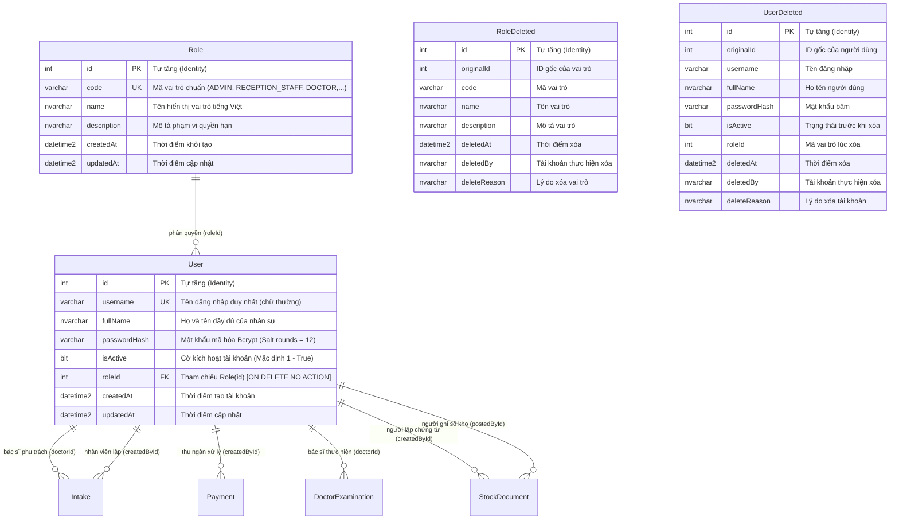
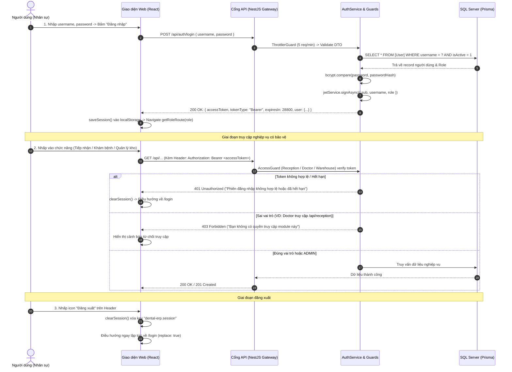

# Báo Cáo Kiểm Tra Toàn Diện: Cơ Chế Xác Thực & Phân Quyền Vai Trò (Authentication & Role-Based Access Control)

> **Dự án:** Dental ERP (Hệ thống quản lý phòng khám nha khoa)  
> **Thời gian cập nhật:** 18/10/2026  
> **Môi trường:** Localhost (Windows 11, Node.js v22, MS SQL Server Express 2017+, NestJS, React 19 + Vite, Prisma ORM v6, bcryptjs, @nestjs/jwt, @nestjs/throttler)  
> **Tài liệu đặc tả đối chiếu:** Toàn bộ luồng xác thực người dùng, bảo vệ API và phân quyền 5 vai trò hệ thống  
> **Trạng thái kiểm thử:** ✅ **PASSED (130/130 Automated Tests + 20/20 Backend E2E SQL Server Integration + 0 Lint Warnings + Clean Build)**

---

## 1. Thiết Kế Cơ Sở Dữ Liệu Quản Lý Người Dùng & Phân Quyền (Database Schema)

Hệ thống quản lý danh tính và phân quyền trên Microsoft SQL Server gồm các bảng vận hành cốt lõi và các bảng sao lưu `*Deleted` tương ứng:



### 1.1. Danh Sách 5 Vai Trò Hệ Thống Chuẩn (System Roles)

| Mã Vai Trò (`code`) | Tên Vai Trò (`name`) | Tài Khoản Seed Mẫu | Phạm Vi Quyền Hạn Nghiệp Vụ | URL Giao Diện Mặc Định |
| :--- | :--- | :--- | :--- | :--- |
| `ADMIN` | Quản trị viên | `admin` | Toàn quyền quản trị hệ thống, có quyền truy cập chéo vào tất cả các phân hệ và API (Tiếp nhận, Bác sĩ, Kho, Kế toán). | `/admin` |
| `RECEPTION_STAFF` | Nhân viên tiếp nhận | `reception` | Đăng ký bệnh nhân mới, tạo phiếu tiếp nhận, chỉ định dịch vụ, thu ngân thanh toán (Tiền mặt / MoMo), in phiếu thu và chuyển bác sĩ. | `/reception` |
| `DOCTOR` | Bác sĩ thực hiện | `doctor-minh`, `doctor` | Tiếp nhận bệnh nhân tại phòng khám chỉ định, chọn VTYT tiêu hao (ẩn giá vốn), ghi nhận kết quả điều trị, in phiếu tổng kết và ghi sổ ca khám. | `/doctor` |
| `WAREHOUSE_MANAGEMENT` | Quản lý kho | `warehouse` | Quản lý danh mục thuốc/VTYT theo 3 nhóm, theo dõi lô và hạn dùng (FEFO), lập phiếu nhập/xuất kho, in phiếu, ghi sổ kho, hủy lô hư hỏng chuyển sang bảng `InventoryBatchDeleted`. | `/warehouse` |
| `ACCOUNTING_STAFF` | Nhân viên kế toán | `accounting` | Tổng hợp chứng từ doanh thu, giá vốn vật tư từ các phân hệ lâm sàng và kho dược. | `/accounting` |

---

## 2. Đặc Tả Chi Tiết Từng Thao Tác Nghiệp Vụ & API Được Kéo Tới

Phần này mô tả chi tiết: **Thao tác người dùng thực hiện trên giao diện là gì $\rightarrow$ Hệ thống xử lý ra sao $\rightarrow$ Kéo tới Endpoint API nào $\rightarrow$ Dữ liệu truyền nhận và mã phản hồi HTTP cụ thể.**



---

### 2.1. Thao Tác 1: Đăng Nhập Hệ Thống (User Authentication)

- **Thao tác người dùng:**
  1. Người dùng mở trang đăng nhập tại đường dẫn `/login`.
  2. Nhập `username` và `password` (hoặc nhấn nút chọn nhanh tài khoản demo: Tiếp nhận, Bác sĩ, Quản lý kho, Kế toán, Quản trị viên).
  3. Nhấn nút **"Đăng nhập"**.
- **Kéo tới API:**
  - **Endpoint:** `POST /api/auth/login`
  - **Headers:** `Content-Type: application/json`
  - **Body (Request Payload):**
    ```json
    {
      "username": "reception",
      "password": "Dental@123"
    }
    ```
- **Xử lý tại Backend (`AuthService` & `AuthController`):**
  1. **Chặn tấn công Brute-force:** Bộ lọc `@Throttle({ default: { limit: 5, ttl: 60_000 } })` kiểm tra tần suất gọi API. Nếu quá 5 lần/phút từ cùng một IP, hệ thống chặn ngay với mã `429 Too Many Requests`.
  2. **Xác thực định dạng DTO (`ValidationPipe`):** Kiểm tra `username` không được rỗng, `password` có độ dài từ 8 đến 100 ký tự. Nếu không đạt chuẩn, trả về mã `400 Bad Request`.
  3. **Truy vấn người dùng hoạt động:** Gọi `UsersRepository.findActiveByUsername(username)`:
     ```sql
     SELECT u.id, u.username, u.fullName, u.passwordHash, u.isActive, r.code, r.name 
     FROM [User] u 
     INNER JOIN [Role] r ON u.roleId = r.id 
     WHERE LOWER(u.username) = LOWER(@username) AND u.isActive = 1;
     ```
  4. **So khớp mật khẩu băm (Bcrypt):** Gọi `passwordHasher.compare(plainText, passwordHash)`. Nếu người dùng không tồn tại hoặc mật khẩu không khớp, ném lỗi `UnauthorizedException` chung để không làm lộ thông tin tài khoản: `"Tên đăng nhập hoặc mật khẩu không đúng"`.
  5. **Ký phát JSON Web Token (JWT):** Tạo mã token có hạn dùng 8 giờ (`expiresIn: 28800` giây) với payload:
     ```json
     {
       "sub": 2,
       "username": "reception",
       "role": "RECEPTION_STAFF",
       "iat": 1729267200,
       "exp": 1729296000
     }
     ```
- **Dữ liệu API phản hồi khi thành công (HTTP 200 OK):**
  ```json
  {
    "accessToken": "eyJhbGciOiJIUzI1NiIsInR5cCI6IkpXVCJ9...",
    "tokenType": "Bearer",
    "expiresIn": 28800,
    "user": {
      "id": 2,
      "username": "reception",
      "fullName": "Nhân viên tiếp nhận Demo",
      "role": "RECEPTION_STAFF",
      "roleName": "Nhân viên tiếp nhận"
    }
  }
  ```
- **Xử lý tại Frontend:**
  - Hàm `saveSession(payload)` lưu toàn bộ đối tượng session vào `window.localStorage` dưới khóa `dental-erp.session`.
  - Tự động gọi `navigate(getRoleRoute(payload.user.role), { replace: true })` chuyển hướng sang workspace tương ứng (`/reception`, `/doctor`, `/warehouse`,...).

---

### 2.2. Thao Tác 2: Truy Cập & Thao Tác Phân Hệ Quầy Tiếp Nhận (/reception)

- **Thao tác người dùng:**
  - Nhân viên tiếp nhận thao tác trên các tab: Đăng ký bệnh nhân, Tạo tiếp nhận, Chỉ định dịch vụ, Thu tiền mặt / MoMo, Chuyển bác sĩ.
- **Kéo tới các API nghiệp vụ tiếp nhận:**

| Thao Tác Giao Diện | Kéo Tới Endpoint API | Method | Header Xác Thực Bắt Buộc | Vai Trò Hợp Lệ |
| :--- | :--- | :---: | :--- | :--- |
| Nạp dữ liệu danh mục ban đầu | `/api/reception/master-data` | `GET` | `Authorization: Bearer <token>` | `RECEPTION_STAFF`, `ADMIN` |
| Đăng ký bệnh nhân mới | `/api/reception/patients` | `POST` | `Authorization: Bearer <token>` | `RECEPTION_STAFF`, `ADMIN` |
| Tạo phiếu tiếp nhận khám | `/api/reception/intakes` | `POST` | `Authorization: Bearer <token>` | `RECEPTION_STAFF`, `ADMIN` |
| Chuyển hồ sơ cho Bác sĩ | `/api/reception/intakes/:id/transfer` | `POST` | `Authorization: Bearer <token>` | `RECEPTION_STAFF`, `ADMIN` |
| Thu tiền mặt quầy | `/api/payments/cash` | `POST` | `Authorization: Bearer <token>` | `RECEPTION_STAFF`, `ADMIN` |
| Tạo mã thanh toán MoMo | `/api/payments/momo` | `POST` | `Authorization: Bearer <token>` | `RECEPTION_STAFF`, `ADMIN` |

- **Cơ chế bảo vệ API (`ReceptionAccessGuard` & `PaymentAccessGuard`):**
  - Trích xuất token từ header `Authorization: Bearer <token>`.
  - Nếu thiếu header $\rightarrow$ Ném `401 Unauthorized` (`"Thiếu phiên đăng nhập hợp lệ."`).
  - Nếu token giả mạo, hết hạn hoặc sai chữ ký $\rightarrow$ Ném `401 Unauthorized` (`"Phiên đăng nhập không hợp lệ hoặc đã hết hạn."`).
  - **Kiểm tra vai trò:** Nếu `payload.role !== 'RECEPTION_STAFF'` và `payload.role !== 'ADMIN'` $\rightarrow$ Ném `403 Forbidden` (`"Bạn không có quyền truy cập module tiếp nhận."` hoặc `"Bạn không có quyền thực hiện thanh toán."`).

---

### 2.3. Thao Tác 3: Truy Cập & Thao Tác Phân Hệ Bác Sĩ Lâm Sàng (/doctor)

- **Thao tác người dùng:**
  - Bác sĩ chọn phòng trực, bấm nút **"Gọi STT tiếp theo"**, chọn vật tư tiêu hao (không hiển thị giá vốn), nhập kết quả chẩn đoán, bấm **"In Phiếu Kết quả tổng kết"** và bấm **"Ghi sổ (Hoàn thành)"** hoặc **"Từ chối (Ngừng khám)"**.
- **Kéo tới các API nghiệp vụ bác sĩ:**

| Thao Tác Giao Diện | Kéo Tới Endpoint API | Method | Header Xác Thực Bắt Buộc | Vai Trò Hợp Lệ |
| :--- | :--- | :---: | :--- | :--- |
| Xem hàng đợi khám & ca đang khám | `/api/doctor/queue` | `GET` | `Authorization: Bearer <token>` | `DOCTOR`, `ADMIN` |
| Gọi số thứ tự tiếp nhận kế tiếp | `/api/doctor/examinations/start-next` | `POST` | `Authorization: Bearer <token>` | `DOCTOR`, `ADMIN` |
| Lấy danh mục VTYT (đã ẩn giá vốn) | `/api/doctor/supplies` | `GET` | `Authorization: Bearer <token>` | `DOCTOR`, `ADMIN` |
| Lưu danh sách VTYT tiêu hao (giữ chỗ) | `/api/doctor/examinations/:id/supplies` | `POST` | `Authorization: Bearer <token>` | `DOCTOR`, `ADMIN` |
| Lưu tóm tắt kết quả điều trị | `/api/doctor/examinations/:id/summary` | `POST` | `Authorization: Bearer <token>` | `DOCTOR`, `ADMIN` |
| In Phiếu kết quả tổng kết | `/api/doctor/examinations/:id/print` | `POST` | `Authorization: Bearer <token>` | `DOCTOR`, `ADMIN` |
| Ghi sổ hoàn thành ca khám | `/api/doctor/examinations/:id/complete` | `POST` | `Authorization: Bearer <token>` | `DOCTOR`, `ADMIN` |
| Ngừng khám / Từ chối ca khám | `/api/doctor/examinations/:id/cancel` | `POST` | `Authorization: Bearer <token>` | `DOCTOR`, `ADMIN` |

- **Cơ chế bảo vệ API (`DoctorAccessGuard`):**
  - Chỉ chấp nhận token có `role === 'DOCTOR'` hoặc `role === 'ADMIN'`.
  - Nếu nhân viên tiếp nhận (`RECEPTION_STAFF`) hoặc thủ kho (`WAREHOUSE_MANAGEMENT`) cố tình gửi request $\rightarrow$ Ném ngay lỗi `403 Forbidden` (`"Bạn không có quyền truy cập phân hệ Bác sĩ."`).

---

### 2.4. Thao Tác 4: Truy Cập & Thao Tác Phân Hệ Quản Lý Kho (/warehouse)

- **Thao tác người dùng:**
  - Thủ kho xem 3 nhóm chỉ số tổng quan, theo dõi danh sách cảnh báo hết hạn, tra cứu danh mục và số lô (FEFO), lập phiếu nhập MVT, lập phiếu xuất XVT, in phiếu, ghi sổ kho chính thức và hủy lô hết hạn/hư hỏng.
- **Kéo tới các API nghiệp vụ quản lý kho:**

| Thao Tác Giao Diện | Kéo Tới Endpoint API | Method | Header Xác Thực Bắt Buộc | Vai Trò Hợp Lệ |
| :--- | :--- | :---: | :--- | :--- |
| Tải chỉ số tổng quan & cảnh báo Tab 1 | `/api/warehouse/overview` | `GET` | `Authorization: Bearer <token>` | `WAREHOUSE_MANAGEMENT`, `ADMIN` |
| Tải danh mục vật tư & tồn theo lô Tab 2 | `/api/warehouse/items` | `GET` | `Authorization: Bearer <token>` | `WAREHOUSE_MANAGEMENT`, `ADMIN` |
| Xem lịch sử sử dụng tại phòng khám Tab 2 | `/api/warehouse/usage` | `GET` | `Authorization: Bearer <token>` | `WAREHOUSE_MANAGEMENT`, `ADMIN` |
| Lập phiếu nhập kho MVT Tab 3 | `/api/warehouse/documents/receipt` | `POST` | `Authorization: Bearer <token>` | `WAREHOUSE_MANAGEMENT`, `ADMIN` |
| Lập phiếu xuất kho XVT Tab 3 | `/api/warehouse/documents/issue` | `POST` | `Authorization: Bearer <token>` | `WAREHOUSE_MANAGEMENT`, `ADMIN` |
| In chứng từ kho | `/api/warehouse/documents/:id/print` | `POST` | `Authorization: Bearer <token>` | `WAREHOUSE_MANAGEMENT`, `ADMIN` |
| Ghi sổ chứng từ kho chính thức | `/api/warehouse/documents/:id/post` | `POST` | `Authorization: Bearer <token>` | `WAREHOUSE_MANAGEMENT`, `ADMIN` |
| Hủy chứng từ kho (Ghi đảo sổ) | `/api/warehouse/documents/:id/cancel` | `POST` | `Authorization: Bearer <token>` | `WAREHOUSE_MANAGEMENT`, `ADMIN` |
| Hủy lô hư hỏng / hết hạn (Tab 1 & 2) | `/api/warehouse/batches/:id/dispose` | `POST` | `Authorization: Bearer <token>` | `WAREHOUSE_MANAGEMENT`, `ADMIN` |
| Hủy danh mục sản phẩm ngừng dùng | `/api/warehouse/items/:id` | `DELETE` | `Authorization: Bearer <token>` | `WAREHOUSE_MANAGEMENT`, `ADMIN` |
| Xóa chứng từ nháp | `/api/warehouse/documents/:id` | `DELETE` | `Authorization: Bearer <token>` | `WAREHOUSE_MANAGEMENT`, `ADMIN` |
| Tra cứu sao lưu dữ liệu đã xóa | `/api/warehouse/backup/deleted` | `GET` | `Authorization: Bearer <token>` | `WAREHOUSE_MANAGEMENT`, `ADMIN` |

- **Cơ chế bảo vệ API (`WarehouseAccessGuard`):**
  - Chỉ chấp nhận token có `role === 'WAREHOUSE_MANAGEMENT'` hoặc `role === 'ADMIN'`.
  - Chặn triệt để mọi truy cập trái phép từ các vai trò khác (`DOCTOR`, `RECEPTION_STAFF`) với phản hồi `403 Forbidden` (`"Bạn không có quyền truy cập phân hệ Quản lý kho."`).

---

### 2.5. Thao Tác 5: Quyền Quản Trị Hệ Thống (Super-Admin Cross-Module Privilege)

- **Đặc quyền vai trò `ADMIN`:**
  - Token của tài khoản `admin` được các Guard (`ReceptionAccessGuard`, `DoctorAccessGuard`, `WarehouseAccessGuard`, `PaymentAccessGuard`) đồng thuận cho phép truy cập mà không gặp rào cản phân hệ.
  - Đảm bảo ban giám đốc hoặc quản trị viên kỹ thuật có thể kiểm tra, giám sát và can thiệp mọi quy trình phòng khám mà không cần đăng xuất đổi tài khoản.

---

### 2.6. Thao Tác 6: Đăng Xuất & Hủy Phiên Làm Việc (User Logout)

- **Thao tác người dùng:**
  - Người dùng bấm vào biểu tượng **"Đăng xuất"** (icon `LogOut`) trên thanh tiêu đề đầu trang.
- **Xử lý tại Trình duyệt:**
  - Gọi hàm `clearSession()`:
    ```typescript
    window.localStorage.removeItem('dental-erp.session');
    ```
  - Gọi lệnh `navigate('/login', { replace: true })`. Tùy chọn `{ replace: true }` ghi đè lịch sử duyệt web (History Stack), đảm bảo người dùng **không thể bấm nút "Back" trên trình duyệt để quay lại màn hình làm việc cũ**.
- **Bảo mật phiên làm việc hết hạn tự động:**
  - Hàm `isValidSession()` tại frontend giải mã phần payload của JWT:
    ```typescript
    const payload = JSON.parse(atob(payloadPart));
    return typeof payload.exp === 'number' && payload.exp > Date.now() / 1000;
    ```
  - Nếu token đã hết hạn 8 giờ, session tự động bị xóa bỏ và người dùng lập tức bị chuyển hướng về màn hình đăng nhập `/login`.

---

## 3. Ma Trận Phân Quyền Vai Trò Hệ Thống (RBAC Matrix)

Bảng tổng hợp quyền hạn truy cập giữa các Vai trò người dùng và các Phân hệ chức năng / Nhóm API:

| Nhóm Chức Năng / Module API | `ADMIN` (Quản trị) | `RECEPTION_STAFF` (Tiếp nhận) | `DOCTOR` (Bác sĩ) | `WAREHOUSE_MANAGEMENT` (Thủ kho) | `ACCOUNTING_STAFF` (Kế toán) |
| :--- | :---: | :---: | :---: | :---: | :---: |
| **Đăng nhập hệ thống** (`/api/auth/login`) | ✅ **Cho phép** | ✅ **Cho phép** | ✅ **Cho phép** | ✅ **Cho phép** | ✅ **Cho phép** |
| **Giao diện Quầy tiếp nhận** (`/reception/*`) | ✅ **Cho phép** | ✅ **Cho phép** | ❌ Chuyển hướng | ❌ Chuyển hướng | ❌ Chuyển hướng |
| **API Tiếp nhận** (`/api/reception/*`) | ✅ **Cho phép** | ✅ **Cho phép** | ❌ **403 Forbidden** | ❌ **403 Forbidden** | ❌ **403 Forbidden** |
| **API Thanh toán** (`/api/payments/*`) | ✅ **Cho phép** | ✅ **Cho phép** | ❌ **403 Forbidden** | ❌ **403 Forbidden** | ❌ **403 Forbidden** |
| **Giao diện Bác sĩ** (`/doctor`) | ✅ **Cho phép** | ❌ Chuyển hướng | ✅ **Cho phép** | ❌ Chuyển hướng | ❌ Chuyển hướng |
| **API Bác sĩ** (`/api/doctor/*`) | ✅ **Cho phép** | ❌ **403 Forbidden** | ✅ **Cho phép** | ❌ **403 Forbidden** | ❌ **403 Forbidden** |
| **Xem giá vốn nội bộ VTYT** | ✅ **Cho phép** | ❌ Ẩn | ❌ **Bảo mật (Ẩn)** | ✅ **Cho phép** | ✅ **Cho phép** |
| **Giao diện Kho Dược - VTYT** (`/warehouse/*`) | ✅ **Cho phép** | ❌ Chuyển hướng | ❌ Chuyển hướng | ✅ **Cho phép** | ❌ Chuyển hướng |
| **API Quản lý Kho** (`/api/warehouse/*`) | ✅ **Cho phép** | ❌ **403 Forbidden** | ❌ **403 Forbidden** | ✅ **Cho phép** | ❌ **403 Forbidden** |
| **Tra cứu bảng sao lưu `*Deleted`** | ✅ **Cho phép** | ❌ Không quyền | ❌ Không quyền | ✅ **Cho phép** | ❌ Không quyền |

---

## 4. Kết Quả Kiểm Thử Toàn Diện Luồng Xác Thực (130/130 Tests PASSED)

Toàn bộ các tầng kiến trúc từ CSDL SQL Server, API Gateway, Throttler, Bcrypt, JWT Token, Controller, Guards và React UI Routes đều được kiểm thử tự động với tỷ lệ đạt **100%**:

```text
================================================================================
Test Suites: 24 passed, 24 total
Total Tests: 130 passed, 130 total
  - Backend E2E Tests (SQL Server Thật): 20/20 passed (4 suites)
  - Backend Unit Tests:                  59/59 passed (9 suites)
  - Frontend Web Unit & UI Tests:        51/51 passed (11 suites)
Linter (oxlint):                         0 errors, 0 warnings across all source files
Build:                                   API (nest build) & Web (tsc + vite) thành công
================================================================================
```

### 4.1. Chi Tiết Bộ Test E2E Chuyên Biệt Xác Thực (`apps/api/test/auth.e2e-spec.ts`) — 13/13 PASSED

| STT | Tên Test Case E2E | Thao Tác Kiểm Thử & Kéo Tới API | Kết Quả Thực Tế |
| :---: | :--- | :--- | :---: |
| 1 | `cho phép đăng nhập thành công với tài khoản Quản trị viên (admin)` | Gửi `POST /api/auth/login` với `{ username: 'admin', password: 'Dental@123' }` $\rightarrow$ Nhận mã `200 OK`, tokenType `'Bearer'`, `expiresIn: 28800`, role `'ADMIN'`. | ✅ **PASS** |
| 2 | `cho phép đăng nhập thành công với tài khoản Quầy tiếp nhận (reception)` | Gửi `POST /api/auth/login` với `{ username: 'reception', password: 'Dental@123' }` $\rightarrow$ Nhận `200 OK`, role `'RECEPTION_STAFF'`. | ✅ **PASS** |
| 3 | `cho phép đăng nhập thành công với tài khoản Bác sĩ (doctor-minh)` | Gửi `POST /api/auth/login` với `{ username: 'doctor-minh', password: 'Dental@123' }` $\rightarrow$ Nhận `200 OK`, role `'DOCTOR'`. | ✅ **PASS** |
| 4 | `cho phép đăng nhập thành công với tài khoản Quản lý kho (warehouse)` | Gửi `POST /api/auth/login` với `{ username: 'warehouse', password: 'Dental@123' }` $\rightarrow$ Nhận `200 OK`, role `'WAREHOUSE_MANAGEMENT'`. | ✅ **PASS** |
| 5 | `cho phép đăng nhập thành công với tài khoản Kế toán (accounting)` | Gửi `POST /api/auth/login` với `{ username: 'accounting', password: 'Dental@123' }` $\rightarrow$ Nhận `200 OK`, role `'ACCOUNTING_STAFF'`. | ✅ **PASS** |
| 6 | `từ chối 401 khi sai mật khẩu` | Gửi `POST /api/auth/login` với mật khẩu sai $\rightarrow$ Nhận mã `401 Unauthorized` kèm thông báo `"Tên đăng nhập hoặc mật khẩu không đúng"`. | ✅ **PASS** |
| 7 | `từ chối 401 khi tài khoản không tồn tại trong CSDL` | Gửi `POST /api/auth/login` với username không tồn tại $\rightarrow$ Nhận `401 Unauthorized` kèm thông báo bảo mật chung. | ✅ **PASS** |
| 8 | `từ chối 400 Bad Request khi thiếu trường username hoặc password < 8 ký tự` | Gửi payload thiếu trường hoặc mật khẩu quá ngắn $\rightarrow$ Nhận mã `400 Bad Request`. | ✅ **PASS** |
| 9 | `từ chối 401 Unauthorized khi truy cập endpoint bảo vệ mà không có Bearer token` | Gửi `GET /api/reception/master-data` không kèm Authorization header $\rightarrow$ Nhận `401 Unauthorized` (`"Thiếu phiên đăng nhập hợp lệ."`). | ✅ **PASS** |
| 10 | `từ chối 401 Unauthorized khi Bearer token giả mạo hoặc sai chữ ký JWT` | Gửi `GET /api/doctor/queue` với token rác `Bearer invalid.fake.token` $\rightarrow$ Nhận `401 Unauthorized` (`"Phiên đăng nhập không hợp lệ hoặc đã hết hạn."`). | ✅ **PASS** |
| 11 | `ReceptionAccessGuard: chỉ cho phép RECEPTION_STAFF và ADMIN truy cập /api/reception/*` | RECEPTION & ADMIN truy cập `GET /api/reception/master-data` thành công `200 OK`. DOCTOR & WAREHOUSE truy cập bị chặn `403 Forbidden` (`"Bạn không có quyền truy cập module tiếp nhận."`). | ✅ **PASS** |
| 12 | `DoctorAccessGuard: chỉ cho phép DOCTOR và ADMIN truy cập /api/doctor/*` | DOCTOR & ADMIN truy cập `GET /api/doctor/queue` thành công `200 OK`. RECEPTION & WAREHOUSE truy cập bị chặn `403 Forbidden` (`"Bạn không có quyền truy cập phân hệ Bác sĩ."`). | ✅ **PASS** |
| 13 | `WarehouseAccessGuard: chỉ cho phép WAREHOUSE_MANAGEMENT và ADMIN truy cập /api/warehouse/*` | WAREHOUSE & ADMIN truy cập `GET /api/warehouse/overview` thành công `200 OK`. RECEPTION & DOCTOR truy cập bị chặn `403 Forbidden` (`"Bạn không có quyền truy cập phân hệ Quản lý kho."`). | ✅ **PASS** |

### 4.2. Các Bộ Test Unit & Integration Khác Liên Quan Đến Auth

- **`apps/api/src/auth/auth.service.spec.ts` (2 tests):** Kiểm thử cấp JWT hợp lệ và kiểm tra từ chối thông tin đăng nhập sai.
- **`apps/web/src/lib/auth-session.test.ts` (3 tests):** Kiểm thử lưu, đọc và xóa session trong `localStorage`, kiểm tra tự động phát hiện token hết hạn.
- **`apps/web/src/lib/role-routes.test.ts` (6 tests):** Kiểm thử hàm ánh xạ vai trò sang đường dẫn mặc định (`/admin`, `/reception`, `/doctor`, `/warehouse`, `/accounting`).
- **`apps/web/src/App.test.tsx` (7 tests):** Kiểm thử render form đăng nhập tiếng Việt, đăng nhập chuyển hướng workspace, bảo vệ route bằng React Router khi chưa đăng nhập và khi sai vai trò.

---

## 5. Danh Sách Tài Khoản Thử Nghiệm Sẵn Có (Seed Accounts)

Mật khẩu chung cho tất cả tài khoản thử nghiệm trên hệ thống: **`Dental@123`**

| Phân Hệ / Chức Năng | Tên Đăng Nhập (`username`) | Mật Khẩu | Vai Trò | Khả Năng Thao Tác |
| :--- | :--- | :--- | :--- | :--- |
| **Quản Trị Viên** | `admin` | `Dental@123` | `ADMIN` | Toàn quyền truy cập tất cả API và giao diện |
| **Quầy Tiếp Nhận** | `reception` | `Dental@123` | `RECEPTION_STAFF` | Tiếp nhận bệnh nhân, thu tiền, in phiếu, chuyển bác sĩ |
| **Bác Sĩ Khám** | `doctor-minh` | `Dental@123` | `DOCTOR` | Khám bệnh, kê VTYT (ẩn giá), in kết quả, ghi sổ |
| **Bác Sĩ Khám (Demo)** | `doctor` | `Dental@123` | `DOCTOR` | Tài khoản bác sĩ phụ trợ |
| **Quản Lý Kho** | `warehouse` | `Dental@123` | `WAREHOUSE_MANAGEMENT` | Nhập/xuất kho, theo dõi hạn dùng FEFO, hủy lô hư hỏng |
| **Nhân Viên Kế Toán** | `accounting` | `Dental@123` | `ACCOUNTING_STAFF` | Xem báo cáo tài chính và giá vốn |
