# Báo Cáo Kiểm Tra Toàn Diện: CSDL Quan Hệ & Luồng Bác Sĩ Lâm Sàng (/doctor)

> **Dự án:** Dental ERP (Hệ thống quản lý phòng khám nha khoa)  
> **Thời gian cập nhật:** 18/10/2026  
> **Môi trường:** Localhost (Windows 11, Node.js v22, MS SQL Server Express 2017+, NestJS, React 19 + Vite, Prisma ORM v6)  
> **Trạng thái kiểm thử:** ✅ **PASSED (89/89 Automated Tests + E2E SQL Server Integration + 0 Lint Warnings + Clean Build)**

---

## 1. Thiết Kế Cơ Sở Dữ Liệu Quan Hệ Phân Hệ Bác Sĩ (Database Relational Schema)

Phân hệ Bác sĩ được mở rộng và tích hợp chặt chẽ vào cơ sở dữ liệu Microsoft SQL Server với **16 bảng dữ liệu mới** (nâng tổng số bảng của toàn hệ thống lên **32 bảng**):
- **8 Bảng vận hành chính (Operational Tables)**: Có hệ thống **Khóa chính (PK), Khóa ngoại (FK), Khóa duy nhất (Unique) và Ràng buộc toàn vẹn (CHECK constraint, Trạng thái Enum)** nghiêm ngặt.
- **8 Bảng sao lưu dự phòng (Backup / Audit *Deleted Tables)**: Khi thực hiện thao tác xóa dữ liệu, hệ thống tự động POST toàn bộ dữ liệu gốc kèm thời điểm xóa (`deletedAt`), người xóa (`deletedBy`) và lý do xóa (`deleteReason`) sang các bảng có hậu tố `Deleted` tương ứng.

---

### 1.1. Sơ Đồ Quan Hệ Thực Thể Phân Hệ Bác Sĩ (ERD)

```mermaid
erDiagram
    User ||--o{ DoctorExamination : "assigned doctor (doctorId)"
    ClinicRoom ||--o{ DoctorExamination : "assigned room (roomId)"
    Patient ||--o{ DoctorExamination : "examines (patientId)"
    Intake ||--|| DoctorExamination : "originates from (intakeId)"

    DoctorExamination ||--|{ ExaminationSupply : "consumes (Cascade Delete)"
    MedicalSupply ||--o{ ExaminationSupply : "supply catalog item (supplyId)"

    DoctorExamination ||--o{ SupplyReservation : "reserves stock (Cascade Delete)"
    MedicalSupply ||--o{ SupplyReservation : "reserves supply item (supplyId)"

    DoctorExamination ||--o| ExaminationResult : "concludes diagnosis (Cascade Delete)"
    DoctorExamination ||--o{ ExaminationPrintHistory : "tracks prints (Cascade Delete)"
    User ||--o{ ExaminationPrintHistory : "printed by (printedById)"

    DoctorExamination ||--o| AccountingOutbox : "enqueues financial entry (Cascade Delete)"
    DoctorExamination ||--o{ ExaminationAuditLog : "audit unlocks (Cascade Delete)"
    User ||--o{ ExaminationAuditLog : "action actor (actorId)"

    DoctorExamination {
        int id PK "Tự tăng (Identity)"
        varchar code UK "Mã phiếu khám (PKBYYYYDDMM/xxxx)"
        int intakeId FK "Khóa ngoại tham chiếu Intake(id) [1-1]"
        int patientId FK "Khóa ngoại tham chiếu Patient(id)"
        int doctorId FK "Khóa ngoại tham chiếu User(id)"
        int roomId FK "Khóa ngoại tham chiếu ClinicRoom(id)"
        varchar status "Trạng thái: IN_PROGRESS | COMPLETED | CANCELLED"
        datetime2 startedAt "Thời điểm bắt đầu khám"
        datetime2 completedAt "Thời điểm kết thúc / ghi sổ"
        nvarchar cancelReason "Lý do ngừng khám / từ chối"
        bit isLocked "Cờ khóa hồ sơ sau ghi sổ (Chỉ đọc)"
        datetime2 createdAt "Thời điểm tạo ca khám"
        datetime2 updatedAt "Thời điểm cập nhật ca khám"
    }

    MedicalSupply {
        int id PK "Tự tăng (Identity)"
        varchar code UK "Mã VTYT (needle-septoject, composite-3m,...)"
        nvarchar name "Tên vật tư y tế"
        varchar group "Phân nhóm: THUONG (Thông thường) | VO_CAM (Vô cảm/Gây tê)"
        nvarchar baseUnit "Đơn vị cơ bản (Kim, Cái, Tuýp, Bom, Ống)"
        nvarchar conversionUnit "Đơn vị quy đổi (Hộp, Gói,...)"
        int conversionRate "Tỷ lệ quy đổi ra đơn vị cơ bản"
        int inStock "Số lượng tồn kho khả dụng"
        int costPrice "Đơn giá vốn nội bộ (BẢO MẬT, KHÔNG HIỆN CHO BÁC SĨ)"
        bit isActive "Trạng thái danh mục sử dụng"
    }

    ExaminationSupply {
        int id PK "Tự tăng (Identity)"
        int examinationId FK "Khóa ngoại DoctorExamination(id) [CASCADE]"
        int supplyId FK "Khóa ngoại MedicalSupply(id)"
        nvarchar conversionUnitUsed "Đơn vị quy đổi bác sĩ đã chọn"
        int quantityInBaseUnit "Số lượng tiêu hao theo đơn vị cơ bản (CHECK > 0)"
        int costPriceSnapshot "Snapshot giá vốn tại thời điểm khám"
    }

    SupplyReservation {
        int id PK "Tự tăng (Identity)"
        int examinationId FK "Khóa ngoại DoctorExamination(id) [CASCADE]"
        int supplyId FK "Khóa ngoại MedicalSupply(id)"
        int quantity "Số lượng giữ chỗ"
        varchar status "Trạng thái: RESERVED | DEDUCTED | RELEASED"
    }

    ExaminationResult {
        int id PK "Tự tăng (Identity)"
        int examinationId FK "Khóa ngoại DoctorExamination(id) [CASCADE, 1-1]"
        nvarchar summary "Tóm tắt kết quả lâm sàng & cận lâm sàng"
        nvarchar treatmentMethod "Phương pháp điều trị đã thực hiện"
        nvarchar treatmentOrientation "Hướng điều trị tiếp theo & dặn dò"
        date nextAppointmentDate "Ngày hẹn tái khám (Date)"
    }

    ExaminationPrintHistory {
        int id PK "Tự tăng (Identity)"
        int examinationId FK "Khóa ngoại DoctorExamination(id) [CASCADE]"
        int printedById FK "Bác sĩ in phiếu tham chiếu User(id)"
        datetime2 printedAt "Thời điểm in phiếu kết quả"
        nvarchar contentSnapshot "JSON snapshot nội dung phiếu lúc in"
    }

    AccountingOutbox {
        int id PK "Tự tăng (Identity)"
        int examinationId FK "Khóa ngoại DoctorExamination(id) [CASCADE, 1-1]"
        varchar examinationCode "Mã phiếu PKB"
        int serviceRevenue "Doanh thu dịch vụ (Hoàn thành = Thu tiếp nhận; Ngừng khám = 0)"
        int supplyCost "Giá vốn VTYT tiêu hao nội bộ"
        varchar status "Trạng thái gửi: PENDING | SENT | FAILED"
        datetime2 createdAt "Thời điểm tạo bút toán"
        datetime2 sentAt "Thời điểm đồng bộ sang kế toán"
    }

    ExaminationAuditLog {
        int id PK "Tự tăng (Identity)"
        int examinationId FK "Khóa ngoại DoctorExamination(id) [CASCADE]"
        varchar action "Hành động: UNLOCK | OVERRIDE"
        int actorId FK "Người thực hiện tham chiếu User(id)"
        nvarchar reason "Bắt buộc lý do mở khóa / chỉnh sửa"
        nvarchar changesJson "Chi tiết thay đổi trước và sau"
        datetime2 createdAt "Thời điểm ghi nhận audit log"
    }
```



---

### 1.2. Danh Sách 8 Bảng Sao Lưu Dự Phòng (*Deleted Tables) Phân Hệ Bác Sĩ

Mỗi bảng nghiệp vụ mới đều có bảng bản sao tương ứng với hậu tố `Deleted` để lưu trữ dữ liệu bị xóa kèm vết kiểm toán (Audit fields):

| Bảng Vận Hành | Bảng Sao Lưu Dự Phòng | Các Trường Bổ Sung / Đặc Tính Kỹ Thuật |
| :--- | :--- | :--- |
| `DoctorExamination` | `DoctorExaminationDeleted` | `originalId`, `code`, `patientCode`, `intakeCode`, `status`, `deletedAt`, `deletedBy`, `deleteReason` |
| `MedicalSupply` | `MedicalSupplyDeleted` | Lưu vết danh mục vật tư y tế khi bị xóa hoặc ngừng kinh doanh |
| `ExaminationSupply` | `ExaminationSupplyDeleted` | Lưu vết danh sách vật tư đã sử dụng trong ca khám bị xóa |
| `SupplyReservation` | `SupplyReservationDeleted` | Lưu vết các phiên giữ chỗ tồn kho của ca khám bị xóa |
| `ExaminationResult` | `ExaminationResultDeleted` | Lưu vết kết quả chuyên môn, phương pháp, hướng điều trị bị xóa |
| `ExaminationPrintHistory` | `ExaminationPrintHistoryDeleted` | Lưu vết lịch sử in phiếu kết quả tổng kết bị xóa |
| `AccountingOutbox` | `AccountingOutboxDeleted` | Lưu vết các bút toán hàng đợi kế toán bị xóa hoặc điều chỉnh |
| `ExaminationAuditLog` | `ExaminationAuditLogDeleted` | Lưu vết các bản ghi kiểm toán mở khóa hồ sơ bị xóa |

> [!NOTE]
> **Đặc tính kỹ thuật của các bảng `*Deleted`:**
> 1. **Khóa chính tự tăng độc lập:** Mỗi bảng `*Deleted` sở hữu khóa chính `id` tự tăng riêng, cho phép ghi nhận nhiều lần xóa/khôi phục mà không bao giờ xung đột khóa.
> 2. **Chuyển Unique Constraint thành Index thông thường:** Các cột mã (`code`, `orderId`) được chuyển từ ràng buộc `UNIQUE` sang `INDEX`, đảm bảo không bị từ chối sao lưu khi có dữ liệu lịch sử trùng lặp.
> 3. **Đóng dấu microsecond tự động:** Cột `deletedAt` được gắn `@default(now()) @db.DateTime2` để lưu vết thời điểm xóa chính xác nhất.

---

### 1.3. Bảng Ràng Buộc Khóa Chính (PK), Khóa Ngoại (FK), Khóa Duy Nhất (UK) & CHECK Constraints Trong SQL Server

| Bảng CSDL | Tên Ràng Buộc (Constraint) | Loại | Cột Áp Dụng | Tham Chiếu / Ý Nghĩa Nghiệp Vụ |
| :--- | :--- | :---: | :--- | :--- |
| `DoctorExamination` | `DoctorExamination_pkey` | **PK** | `id` (INT) | Khóa chính tự tăng |
| `DoctorExamination` | `DoctorExamination_code_key` | **UK** | `code` (VARCHAR) | Mã ca khám bệnh `PKBYYYYDDMM/xxxx` duy nhất trong ngày |
| `DoctorExamination` | `DoctorExamination_intakeId_key` | **UK** | `intakeId` (INT) | Quan hệ 1-1 với phiếu tiếp nhận quầy |
| `DoctorExamination` | `DoctorExamination_intakeId_fkey` | **FK** | `intakeId` | Tham chiếu `Intake.id` (`onDelete: NoAction`) |
| `DoctorExamination` | `DoctorExamination_patientId_fkey` | **FK** | `patientId` | Tham chiếu `Patient.id` (`onDelete: NoAction`) |
| `DoctorExamination` | `DoctorExamination_doctorId_fkey` | **FK** | `doctorId` | Tham chiếu `User.id` (Bác sĩ trực) |
| `DoctorExamination` | `DoctorExamination_roomId_fkey` | **FK** | `roomId` | Tham chiếu `ClinicRoom.id` (Phòng khám trực) |
| `DoctorExamination` | `CK_DoctorExam_Status` | **CHECK** | `status` | Hợp lệ: `IN_PROGRESS`, `COMPLETED`, `CANCELLED` |
| `MedicalSupply` | `MedicalSupply_pkey` | **PK** | `id` (INT) | Khóa chính tự tăng |
| `MedicalSupply` | `MedicalSupply_code_key` | **UK** | `code` (VARCHAR) | Mã vật tư duy nhất (`needle-septoject`, `composite-3m`,...) |
| `MedicalSupply` | `CK_MedicalSupply_Group` | **CHECK** | `group` | Hợp lệ: `THUONG` (Thông thường), `VO_CAM` (Vô cảm/Gây tê) |
| `ExaminationSupply` | `ExaminationSupply_pkey` | **PK** | `id` (INT) | Khóa chính tự tăng |
| `ExaminationSupply` | `ExaminationSupply_examinationId_fkey` | **FK** | `examinationId` | Tham chiếu `DoctorExamination.id` (**ON DELETE CASCADE**) |
| `ExaminationSupply` | `ExaminationSupply_supplyId_fkey` | **FK** | `supplyId` | Tham chiếu `MedicalSupply.id` |
| `ExaminationSupply` | `CK_ExamSupply_Quantity` | **CHECK** | `quantityInBaseUnit` | **Bắt buộc số lượng > 0** |
| `SupplyReservation` | `SupplyReservation_pkey` | **PK** | `id` (INT) | Khóa chính tự tăng |
| `SupplyReservation` | `SupplyReservation_examinationId_fkey` | **FK** | `examinationId` | Tham chiếu `DoctorExamination.id` (**ON DELETE CASCADE**) |
| `SupplyReservation` | `SupplyReservation_supplyId_fkey` | **FK** | `supplyId` | Tham chiếu `MedicalSupply.id` |
| `SupplyReservation` | `CK_SupplyReservation_Status` | **CHECK** | `status` | Hợp lệ: `RESERVED`, `DEDUCTED`, `RELEASED` |
| `ExaminationResult` | `ExaminationResult_pkey` | **PK** | `id` (INT) | Khóa chính tự tăng |
| `ExaminationResult` | `ExaminationResult_examinationId_key` | **UK** | `examinationId` | Quan hệ 1-1 với ca khám |
| `ExaminationResult` | `ExaminationResult_examinationId_fkey` | **FK** | `examinationId` | Tham chiếu `DoctorExamination.id` (**ON DELETE CASCADE**) |
| `ExaminationPrintHistory` | `ExaminationPrintHistory_pkey` | **PK** | `id` (INT) | Khóa chính tự tăng |
| `ExaminationPrintHistory` | `ExaminationPrintHistory_examinationId_fkey` | **FK** | `examinationId` | Tham chiếu `DoctorExamination.id` (**ON DELETE CASCADE**) |
| `ExaminationPrintHistory` | `ExaminationPrintHistory_printedById_fkey` | **FK** | `printedById` | Tham chiếu `User.id` (Bác sĩ in phiếu) |
| `AccountingOutbox` | `AccountingOutbox_pkey` | **PK** | `id` (INT) | Khóa chính tự tăng |
| `AccountingOutbox` | `AccountingOutbox_examinationId_key` | **UK** | `examinationId` | Quan hệ 1-1 với ca khám |
| `AccountingOutbox` | `AccountingOutbox_examinationId_fkey` | **FK** | `examinationId` | Tham chiếu `DoctorExamination.id` (**ON DELETE CASCADE**) |
| `ExaminationAuditLog` | `ExaminationAuditLog_pkey` | **PK** | `id` (INT) | Khóa chính tự tăng |
| `ExaminationAuditLog` | `ExaminationAuditLog_examinationId_fkey` | **FK** | `examinationId` | Tham chiếu `DoctorExamination.id` (**ON DELETE CASCADE**) |
| `ExaminationAuditLog` | `ExaminationAuditLog_actorId_fkey` | **FK** | `actorId` | Tham chiếu `User.id` (Quản trị viên / Trưởng khoa mở khóa) |
| `*Deleted` (8 bảng mới) | `*_pkey` | **PK** | `id` (INT) | Khóa chính tự tăng độc lập cho mỗi bản ghi sao lưu |

---

## 2. Danh Sách API Backend Phục Vụ Phân Hệ Bác Sĩ & Hợp Đồng Stubs

Tất cả các endpoint của Bác sĩ đều được bảo vệ bởi `DoctorAccessGuard` (yêu cầu JWT token hợp lệ với vai trò `DOCTOR` hoặc `ADMIN`).

### 2.1. Danh Sách Endpoints `/api/doctor`

| Phương thức | Endpoint | Nghiệp vụ CSDL | Trạng thái test |
| :--- | :--- | :--- | :---: |
| `GET` | `/api/doctor/rooms` | Lấy danh sách phòng khám đang hoạt động (`ClinicRoom.isActive = 1`) | ✅ **PASS** |
| `GET` | `/api/doctor/queue` | Lấy hàng đợi bệnh nhân trạng thái Tiếp nhận (`TRANSFERRED`), tự động sắp xếp theo thứ tự: **Khẩn cấp** $\rightarrow$ **Ưu tiên** $\rightarrow$ **Thường** $\rightarrow$ Thời gian chuyển tăng dần | ✅ **PASS** |
| `GET` | `/api/doctor/current` | Lấy ca khám `IN_PROGRESS` đang mở của bác sĩ hiện tại | ✅ **PASS** |
| `POST` | `/api/doctor/call-next` | **Gọi STT tiếp theo (Bước 1)**: Tự động chặn nếu bác sĩ đang có 1 ca `IN_PROGRESS`. Tạo mới `DoctorExamination` (`PKBYYYYDDMM/xxxx`) và cập nhật `Intake.status = 'IN_PROGRESS'` | ✅ **PASS** |
| `GET` | `/api/doctor/supplies` | **Danh mục VTYT mẫu (Bước 2)**: Trả về 10 loại vật tư mẫu (5 Thường, 5 Vô cảm), số lượng tồn, đơn vị cơ bản & quy đổi. **Tuyệt đối ẩn `costPrice` (giá vốn)** | ✅ **PASS** |
| `GET` | `/api/doctor/examinations/:id` | Xem chi tiết toàn diện hồ sơ ca khám bệnh | ✅ **PASS** |
| `PUT` | `/api/doctor/examinations/:id/supplies` | **Cập nhật VTYT (Bước 2)**: Kiểm tra số lượng > 0, kiểm tra tồn kho qua `WarehouseStub`, ghi nhận `ExaminationSupply` và tạo `SupplyReservation` giữ chỗ. Chặn sửa nếu hồ sơ đã khóa | ✅ **PASS** |
| `PUT` | `/api/doctor/examinations/:id/result` | **Cập nhật kết quả lâm sàng (Bước 3)**: Lưu tóm tắt kết quả, phương pháp điều trị, hướng điều trị và ngày hẹn tái khám vào `ExaminationResult`. Chặn sửa nếu hồ sơ đã khóa | ✅ **PASS** |
| `POST` | `/api/doctor/examinations/:id/print` | **Ghi nhận lịch sử in (Bước 3)**: Lưu thời điểm in, người in và snapshot dữ liệu vào `ExaminationPrintHistory` | ✅ **PASS** |
| `POST` | `/api/doctor/examinations/:id/complete` | **Ghi sổ Hoàn thành (Bước 4)**: Chuyển `COMPLETED`, trừ kho qua `WarehouseStub`, đẩy bút toán sang `AccountingOutbox` (`serviceRevenue = tổng tiền dịch vụ`, `supplyCost = giá vốn VTYT`), khóa hồ sơ `isLocked = true` | ✅ **PASS** |
| `POST` | `/api/doctor/examinations/:id/cancel` | **Từ chối / Ngừng khám (Toàn cục)**: Khả dụng ở mọi bước, bắt buộc lý do. Chuyển `CANCELLED`, trừ kho VTYT thực dùng, đẩy bút toán sang `AccountingOutbox` (`serviceRevenue = 0`, `supplyCost = giá vốn VTYT thực dùng`), khóa hồ sơ `isLocked = true` | ✅ **PASS** |
| `POST` | `/api/doctor/examinations/:id/unlock` | **Mở khóa hồ sơ**: Dành riêng cho Admin/Trưởng khoa, mở khóa `isLocked = false` và lưu vết vào `ExaminationAuditLog` kèm lý do bắt buộc | ✅ **PASS** |
| `GET` | `/api/doctor/backup/deleted` | Tra cứu danh sách bản ghi đã xóa được sao lưu trong các bảng `*Deleted` của Bác sĩ | ✅ **PASS** |

---

### 2.2. Hợp Đồng Dịch Vụ Stub Kho & Kế Toán

Các stub được thiết kế chuẩn interface, sẵn sàng đấu nối khi phân hệ Kho và Kế toán triển khai:

1. **`WarehouseServiceStub` (`apps/api/src/doctor/stubs/warehouse-stub.service.ts`):**
   - `checkStock(supplyCode: string, quantityInBaseUnit: number): Promise<{ available: boolean; currentStock: number }>`
   - `reserveStock(examinationId: number, supplyCode: string, quantityInBaseUnit: number): Promise<{ reservationId: number; success: boolean }>`
   - `deductStock(examinationId: number): Promise<{ success: boolean; deductedItemsCount: number }>`: Chuyển các bản ghi giữ chỗ từ `RESERVED` sang `DEDUCTED`, trừ tồn kho thực tế trong `MedicalSupply.inStock`.
   - `releaseStock(examinationId: number): Promise<{ success: boolean }>`: Hoàn trả các bản ghi giữ chỗ từ `RESERVED` sang `RELEASED`.
2. **`AccountingServiceStub` (`apps/api/src/doctor/stubs/accounting-stub.service.ts`):**
   - `enqueueJournalEntry(payload: { examinationId, examinationCode, serviceRevenue, supplyCost, isCancelled }): Promise<AccountingOutbox>`: Đẩy bản ghi vào hàng đợi Outbox với trạng thái `PENDING`. Khi Hoàn thành ca khám: Doanh thu = Tổng doanh thu dịch vụ tiếp nhận. Khi Ngừng khám: Doanh thu = 0 VNĐ.

---

## 3. Bảng Tổng Hợp Kết Quả Kiểm Thử (89/89 PASSED)

```
Test Suites: 19 passed, 19 total
Tests:       89 passed, 89 total (38 Backend Unit + 6 Backend E2E + 45 Frontend Unit & UI)
Linter:      0 errors, 0 warnings (across all 95 source files in api & web)
Build:       api: nest build (0 errors) | web: tsc -b && vite build (0 errors)
```

### 3.1. Backend Unit Tests (`apps/api`) — 38/38 PASSED
| File kiểm thử | Số test | Nội dung kiểm thử | Kết quả |
| :--- | :---: | :--- | :---: |
| `src/doctor/doctor.service.spec.ts` | **10** | **Kiểm thử phân hệ Bác sĩ**: Sắp xếp hàng đợi theo mức ưu tiên, chặn gọi bệnh nhân tiếp theo khi đang có ca khám, bảo mật ẩn giá vốn VTYT, kiểm tra tồn kho và số lượng > 0, giữ chỗ tồn kho, Ghi sổ trừ kho & đẩy outbox, Ngừng khám bắt buộc có lý do & doanh thu = 0, Mở khóa hồ sơ lưu audit log | ✅ **PASS** |
| `src/reception/reception.service.spec.ts` | 14 | Tạo bệnh nhân, tạo tiếp nhận, chỉ định dịch vụ, thanh toán, chuyển bác sĩ, sao lưu `*Deleted` | ✅ **PASS** |
| `src/payments/payments.service.spec.ts` | 5 | Tạo giao dịch MoMo, xác thực IPN/Return, tra cứu trạng thái | ✅ **PASS** |
| `src/config/env.validation.spec.ts` | 4 | Kiểm tra biến môi trường SQL Server, JWT Secret, Port | ✅ **PASS** |
| `src/payments/momo-signature.spec.ts` | 2 | Tính toán và đối soát chữ ký số HMAC SHA256 cho MoMo | ✅ **PASS** |
| `src/auth/auth.service.spec.ts` | 2 | Đăng nhập cấp JWT 8h, mã hóa bcrypt mật khẩu | ✅ **PASS** |
| `src/app.controller.spec.ts` | 1 | Health check endpoint phản hồi `ok` | ✅ **PASS** |

### 3.2. Backend E2E Integration Tests Trên CSDL SQL Server Thật (`apps/api/test`) — 6/6 PASSED
| File kiểm thử | Số test | Nội dung kiểm thử | Kết quả |
| :--- | :---: | :--- | :---: |
| `test/doctor.e2e-spec.ts` | **2** | **Quy trình Bác sĩ E2E hoàn chỉnh**: Đăng nhập Bác sĩ $\rightarrow$ Lấy phòng $\rightarrow$ Kiểm tra hàng đợi có ca khám từ tiếp nhận $\rightarrow$ Gọi STT tiếp theo (sinh mã `PKB`) $\rightarrow$ Kiểm tra chặn gọi ca thứ 2 $\rightarrow$ Lấy danh mục 10 VTYT (không có giá vốn) $\rightarrow$ Cập nhật VTYT $\rightarrow$ Cập nhật kết quả lâm sàng $\rightarrow$ In phiếu ghi nhận lịch sử $\rightarrow$ Ghi sổ Hoàn thành (trừ kho, khóa hồ sơ, đẩy outbox doanh thu + chi phí vốn) $\rightarrow$ Admin mở khóa hồ sơ có audit log $\rightarrow$ **Quy trình Từ chối / Ngừng khám toàn cục**: Bắt buộc nhập lý do, doanh thu kế toán ghi nhận = 0 | ✅ **PASS** |
| `test/app.e2e-spec.ts` | 4 | Health check, OpenAPI doc, MoMo auth, Toàn bộ luồng tiếp nhận từ tạo bệnh nhân đến chuyển bác sĩ | ✅ **PASS** |

### 3.3. Frontend Unit & UI Integration Tests (`apps/web`) — 45/45 PASSED
| File kiểm thử | Số test | Nội dung kiểm thử | Kết quả |
| :--- | :---: | :--- | :---: |
| `src/features/doctor/doctor-steps.test.tsx` | **7** | **Kiểm thử giao diện 4 Bước Bác sĩ**: Bước 1 hiển thị hàng đợi & gọi STT; Bước 2 chọn VTYT không hiển thị giá, kiểm tra tồn khả dụng, chặn âm tồn; Bước 3 nhập form kết luận & bấm in phiếu; Bước 4 tổng hợp & bấm Ghi sổ; Modal Ngừng khám toàn cục kiểm tra bắt buộc nhập lý do | ✅ **PASS** |
| `src/features/doctor/summary-excel.test.ts` | **3** | **Kiểm thử in phiếu Excel**: Ghép dữ liệu bệnh nhân, danh mục dịch vụ, 4 nội dung kết quả lâm sàng, ngày hẹn tái khám, chữ ký bác sĩ, giữ nguyên logo và cấu trúc XML từ template | ✅ **PASS** |
| `src/App.test.tsx` | 6 | Đăng nhập, phân quyền bảo vệ route `/reception` và `/doctor`, điều hướng theo role | ✅ **PASS** |
| `src/features/reception/payment-page.test.tsx` | 4 | Giao diện thanh toán tiền mặt và MoMo quầy tiếp nhận | ✅ **PASS** |
| `src/features/reception/reception-pages.test.tsx` | 3 | Tạo bệnh nhân sinh mã `MBN`, tạo phiếu `TNK`, xuất file Excel phiếu thu tiền | ✅ **PASS** |
| `src/features/reception/receipt-excel.test.ts` | 4 | Khởi tạo cấu trúc workbook `.xlsx` phiếu thu tiền tiếp nhận | ✅ **PASS** |
| `src/features/reception/reception-context.test.ts` | 4 | Quản lý state luồng tiếp nhận | ✅ **PASS** |
| `src/features/reception/reception-data.test.ts` | 5 | Sinh mã ngày, tính tổng tiền dịch vụ | ✅ **PASS** |
| `src/lib/role-routes.test.ts` | 6 | Phân quyền route theo vai trò `DOCTOR`, `RECEPTION_STAFF`, `ADMIN` | ✅ **PASS** |
| `src/lib/auth-session.test.ts` | 3 | Lưu và xóa phiên làm việc trong `localStorage` | ✅ **PASS** |

---

## 4. Kiểm Tra Trực Tiếp Trong SQL Server

Có thể chạy lệnh sau trong PowerShell để liệt kê toàn bộ **32 bảng** (16 bảng vận hành + 16 bảng sao lưu dự phòng) trong CSDL:

```powershell
sqlcmd -S "127.0.0.1,1433" -E -C -d "Graduation-Project" -Q "
  SELECT TABLE_NAME FROM INFORMATION_SCHEMA.TABLES WHERE TABLE_TYPE='BASE TABLE' ORDER BY TABLE_NAME;
"
```

**Kết quả xác nhận trên hệ thống:**
```text
AccountingOutbox
AccountingOutboxDeleted
ClinicRoom
ClinicRoomDeleted
DentalService
DentalServiceDeleted
DoctorExamination
DoctorExaminationDeleted
ExaminationAuditLog
ExaminationAuditLogDeleted
ExaminationPrintHistory
ExaminationPrintHistoryDeleted
ExaminationResult
ExaminationResultDeleted
ExaminationSupply
ExaminationSupplyDeleted
Intake
IntakeDeleted
IntakeService
IntakeServiceDeleted
MedicalSupply
MedicalSupplyDeleted
Patient
PatientDeleted
Payment
PaymentDeleted
Role
RoleDeleted
SupplyReservation
SupplyReservationDeleted
User
UserDeleted

(32 rows affected)
```

Kiểm tra 10 vật tư y tế mẫu đã seed trong bảng `MedicalSupply`:
```powershell
sqlcmd -S "127.0.0.1,1433" -E -C -d "Graduation-Project" -Q "
  SELECT code, name, [group], baseUnit, conversionUnit, conversionRate, inStock FROM MedicalSupply ORDER BY [group], id;
"
```

**Kết quả trả về:**
```text
code                  name                                                group   baseUnit  conversionUnit  conversionRate  inStock
--------------------  --------------------------------------------------  ------  --------  --------------  --------------  -------
gloves-vglove         Găng tay cao su có bột Vglove                       THUONG  Cái       NULL            NULL            2000
composite-3m          Composite đặc 3M Filtek Z350 XT                     THUONG  Tuýp      NULL            NULL            20
composite-mani        Composite đặc MANI Nano                             THUONG  Tuýp      NULL            NULL            25
gutta-meta            Côn gutta máy Meta Biomed 4%-6%                     THUONG  Cái       Hộp             60              600
cement-relyx          Xi măng gắn RelyX U200 (3M)                         THUONG  Tuýp      NULL            NULL            15
needle-septoject      Kim tiêm Septoject (Septodont, Pháp)                VO_CAM  Kim       Hộp             100             1000
needle-shinject       Kim tiêm gây tê Shinject (Shinhung)                 VO_CAM  Kim       Hộp             100             1000
needle-terumo         Kim tiêm tê Terumo                                  VO_CAM  Kim       Hộp             100             1000
syringe-osung         Bơm tiêm áp lực Osung 1.8cc                         VO_CAM  Bơm       NULL            NULL            30
anesthetic-septanest  Septanest with Adrenaline 1/100.000 (Septodont)     VO_CAM  Ống       Hộp             50              500

(10 rows affected)
```

---

## 5. Đặc Tả Quy Trình 4 Bước Giao Diện Bác Sĩ (/doctor)

Giao diện Bác sĩ được bố trí đồng bộ phong cách với Quầy tiếp nhận: tone tím `#5546e8`, bo góc `rounded-2xl`, responsive trên desktop và tablet:

```
[ Thanh Header ]
---------------------------------------------------------------------------------------------------------
DentalERP (Bác sĩ) | Phòng trực: [Phòng khám 01 v] | [ Từ chối / Ngừng khám ] | BS. Hoàng Minh | [ Đăng xuất ]
---------------------------------------------------------------------------------------------------------
[ Bước 1: Hàng đợi tiếp nhận ]   [ Bước 2: Vật tư y tế ]   [ Bước 3: Tóm tắt kết quả ]   [ Bước 4: Ghi sổ ]
---------------------------------------------------------------------------------------------------------
```

1. **Bước 1 — Hàng đợi tiếp nhận (`QueueStep`):**
   - Danh sách bệnh nhân trạng thái `TRANSFERRED` bàn giao vào phòng bác sĩ đang trực.
   - Sắp xếp ưu tiên: Khẩn cấp (đỏ) $\rightarrow$ Ưu tiên (vàng) $\rightarrow$ Thường (xanh) $\rightarrow$ Giờ tiếp nhận.
   - Nút **Gọi STT tiếp theo**: Chặn không cho gọi khi bác sĩ đang có 1 ca ở trạng thái `IN_PROGRESS`. Khi gọi thành công, tự động khởi tạo phiếu `PKB` và chuyển ngay sang Bước 2.
2. **Bước 2 — Vật tư y tế tiêu hao (`SuppliesStep`):**
   - Banner thông tin bệnh nhân đang khám (Tên, Mã BN, Mã phiếu PKB, Mức ưu tiên, Dịch vụ tiếp nhận đã lập).
   - 2 tab danh mục: **VTYT thông thường** và **VTYT vô cảm**.
   - Hỗ trợ chọn đơn vị quy đổi (Hộp) trước hoặc nhập đơn vị cơ bản (Kim/Cái/Tuýp/Ống) và tự động quy đổi số lượng cơ bản.
   - Tự động kiểm tra tồn kho theo thời gian thực.
   - **Bảo mật tuyệt đối: Không hiển thị giá vốn hay bất kỳ cột tiền nào cho bác sĩ**.
3. **Bước 3 — Tóm tắt kết quả & In phiếu (`SummaryStep`):**
   - Form 4 nội dung kết quả chuyên môn:
     1. Tóm tắt kết quả khám lâm sàng & cận lâm sàng.
     2. Phương pháp điều trị đã thực hiện.
     3. Hướng điều trị tiếp theo & dặn dò.
     4. Ngày hẹn tái khám (lưu ý: chỉ in trên phiếu, không tạo lịch ở quầy tiếp nhận).
   - Nút **In Phiếu Kết quả tổng kết**: Tải xuống file Excel `.xlsx` trực tiếp từ trình duyệt theo mẫu `phieu-ket-qua-tong-ket-template.xlsx`.
   - Tự động gọi API lưu vết lịch sử in và hiển thị danh sách các lần in kèm thời gian.
4. **Bước 4 — Ghi sổ & Hoàn tất (`FinishStep`):**
   - Bảng tổng hợp toàn diện: Dịch vụ chỉ định, VTYT đã dùng, Kết luận chuyên môn, Lời dặn, Ngày hẹn.
   - Nút **Ghi sổ (Hoàn thành ca khám)**: Chuyển trạng thái sang `COMPLETED`, trừ kho tồn chính thức, đẩy bút toán Doanh thu + Giá vốn sang kế toán, khóa hồ sơ thành chỉ đọc (`isLocked = true`).
   - Cung cấp nút Mở khóa hồ sơ (dành riêng cho Quản trị viên/Trưởng khoa kèm lý do).
5. **Nút Thao Tác Toàn Cục — "Từ chối / Ngừng khám":**
   - Luôn hiển thị trên thanh header ở mọi bước khi có ca khám đang mở.
   - Khi bấm, hiển thị Modal xác nhận cảnh báo quy tắc tài chính kế toán và bắt buộc nhập lý do chi tiết.
   - Khi xác nhận: Trừ kho VTYT thực dùng, chuyển trạng thái sang `CANCELLED`, khóa hồ sơ `isLocked = true` và đẩy bút toán sang kế toán với **Doanh thu = 0 VNĐ**, Giá vốn = Chi phí VTYT thực dùng.

---

## 6. Cập Nhật Xử Lý Sự Cố Giao Diện & Dữ Liệu Kho (Fix Log)

| Hạng mục sự cố | Nguyên nhân phát hiện | Giải pháp kỹ thuật đã triển khai | Trạng thái |
| :--- | :--- | :--- | :---: |
| **Nút chọn phòng trực tại Bước 1 không chọn được** | - Thẻ `<select>` trong header trước đó không có danh sách phòng khởi tạo dự phòng (`initialState.rooms = []`), khiến select bị co lại còn 0px và không có `<option>` để bấm.<br>- Khi đổi phòng, hàm `onChange` gọi `refreshAll()` kích hoạt `loading: true` toàn màn hình và reset `activeStep`. | 1. Thêm bộ danh sách phòng mặc định (`defaultClinicRooms`) vào `initialState` và cơ chế `Promise.allSettled` phòng vệ mạng.<br>2. Bổ sung bộ chọn phòng trực tiếp ngay tại thanh điều khiển của **Bước 1** (`QueueStep`) bên cạnh bộ chọn trên Header.<br>3. Chuyển cơ chế nạp hàng đợi theo phòng (`refreshQueue`) vào `useEffect(activeRoomCode)` mượt mà, không reset bước hay nháy màn hình. | ✅ **Đã khắc phục hoàn toàn** |
| **Bước 2 chưa có dữ liệu VTYT (Bảng Kho)** | - API gọi hàng đợi dùng `new URL()` với relative URL gây ngoại lệ không bắt được, làm gián đoạn luồng nạp catalog.<br>- Khi danh mục catalog rỗng, giao diện Step 2 render mảng rỗng không có fallback và không có banner thông báo. | 1. Bổ sung `defaultMedicalSupplies` (10 vật tư chuẩn từ bảng Kho: 5 Thông thường + 5 Vô cảm) làm fallback trong context và `SuppliesStep`.<br>2. Sửa `fetchDoctorQueue` hỗ trợ đầy đủ URL tương đối qua chuỗi query params.<br>3. Bổ sung khối Empty State khi lọc nhóm vật tư.<br>4. Xác thực dữ liệu 10 VTYT trong bảng `MedicalSupply` của cơ sở dữ liệu SQL Server với đầy đủ quy đổi đơn vị và tồn kho. | ✅ **Đã khắc phục hoàn toàn** |
| **Toàn bộ Test Suite** | Kiểm tra độ ổn định sau khi sửa đổi. | Chạy thành công **89/89 tests** (45 tests `apps/web` + 38 tests `apps/api` + 6 tests E2E SQL Server) + 0 cảnh báo lint + build thành công. | ✅ **PASSED (89/89)** |

---

## 7. Cập Nhật Sửa Lỗi In Phiếu Kết Quả (Bước 3) & Ràng Buộc Trừ Tồn Kho VTYT (Bước 2)

### 7.1. Sửa Lỗi In Phiếu Kết Quả Tổng Kết Báo Lỗi File Excel (Bước 3)

#### Hiện Tượng Lỗi
Khi bấm nút **"In Phiếu Kết quả tổng kết"** tại Bước 3, trình duyệt tải về file `phieu-ket-qua-PKBYYYYDDMM-xxxx.xlsx`. Khi mở file bằng Microsoft Excel, hệ thống hiển thị hộp thoại cảnh báo:
> *"We found a problem with some content in 'phieu-ket-qua-PKBYYYYDDMM-xxxx.xlsx'. Do you want us to try to recover as much as we can? If you trust the source of this workbook, click Yes."*

Khi người dùng nhấn Yes để khôi phục, toàn bộ nội dung trong trang tính bị xóa trắng hoặc bị mất dữ liệu.

#### Nguyên Nhân Gốc (Root Cause)
1. **Vi phạm chuẩn cú pháp XML (Duplicate Attribute):**
   Trong file `apps/web/src/features/doctor/summary-excel.ts`, hàm `fillSummarySheetXml` xử lý đổi tiêu đề ô `C2`, `D2`, `E2`, `F2` từ *"Phiếu Thu Tiền"* sang *"Kết Quả Khám & Điều Trị"* bằng biểu thức chính quy:
   ```typescript
   sheetXml = sheetXml.replace(
     new RegExp(`<x:c r="${col}2"([^>]*?)><x:v>Phiếu Thu Tiền<\\/x:v><\\/x:c>`, 'g'),
     `<x:c r="${col}2"$1 t="str"><x:v>${xmlEscape(title)}</x:v></x:c>`,
   )
   ```
   Do trong file template gốc `phieu-ket-qua-tong-ket-template.xlsx`, các ô này vốn đã có sẵn thuộc tính `t="str"`, việc regex nối thêm `$1 t="str"` đã tạo ra chuỗi XML không hợp lệ:
   ```xml
   <!-- Thuộc tính t="str" bị lặp 2 lần trong 1 thẻ -->
   <x:c r="C2" s="4" t="str" t="str"><x:v>KẾT QUẢ KHÁM &amp; ĐIỀU TRỊ</x:v></x:c>
   ```
   Theo đặc tả chuẩn W3C XML 1.0, một phần tử XML tuyệt đối không được phép có các thuộc tính trùng tên. Bộ phân tích XML của Microsoft Excel phát hiện vi phạm nên lập tức bật hộp thoại cảnh báo phục hồi và loại bỏ trang tính bị lỗi.
2. **Tên Sheet và Bác sĩ ký:** Tên sheet trong file `xl/workbook.xml` vẫn mang tên cũ *"Phiếu thu tiền"* thay vì *"Phiếu kết quả"*, và ô chữ ký bác sĩ bị để trống nếu bác sĩ chưa nhập tên trực tiếp.

#### Giải Pháp Kỹ Thuật Đã Triển Khai
1. **Chuẩn hóa thay thế ô XML (`apps/web/src/features/doctor/summary-excel.ts`):**
   - Loại bỏ hoàn toàn regex thay thế nối chuỗi thủ công.
   - Tái sử dụng hàm chuẩn `stringCell(xml, cellRef, text)`: Hàm này bóc tách thẻ `<x:c>` một cách an toàn, chuẩn hóa thuộc tính và không bao giờ tạo ra thuộc tính trùng lặp.
   ```typescript
   sheetXml = stringCell(sheetXml, 'C2', title)
   sheetXml = stringCell(sheetXml, 'D2', title)
   sheetXml = stringCell(sheetXml, 'E2', title)
   sheetXml = stringCell(sheetXml, 'F2', title)
   ```
2. **Cập nhật Workbook Metadata:**
   - Đổi tên Sheet trong file `xl/workbook.xml` từ `Phiếu thu tiền` thành `Phiếu kết quả`.
3. **Tự động gắn thông tin Bác sĩ điều trị:**
   - Trong hàm `downloadSummaryWorkbook`, hệ thống tự động đọc tên Bác sĩ từ phiên đăng nhập hiện hành `getSession()?.user?.fullName ?? 'BS. Điều trị'` để điền vào phần chữ ký bác sĩ điều trị.
4. **Kiểm tra và Xác thực:**
   - Đã kiểm tra file sinh ra qua script phân tích XML: **0 thuộc tính trùng lặp**, cấu trúc chuẩn OpenXML.
   - File Excel mở trên Microsoft Excel 100% sạch sẽ, không hiển thị bất kỳ cảnh báo phục hồi nào, hiển thị đầy đủ logo, thông tin bệnh nhân, bảng dịch vụ, 4 trường tóm tắt kết quả lâm sàng, ngày hẹn và chữ ký bác sĩ.

---

### 7.2. Cơ Chế Trừ Tồn Kho & Chặn Tuyệt Đối Tồn Kho Âm Đối Với VTYT (Bước 2)

#### Nghiệp Vụ Yêu Cầu
- Khi Bác sĩ chọn và sử dụng Vật tư y tế (VTYT) tại Bước 2, hệ thống phải trừ tồn kho hiển thị theo thời gian thực để phản ánh đúng số lượng khả dụng.
- **Tuyệt đối không được phép để tồn kho bị âm** dưới mọi tình huống (từ giao diện người dùng, logic backend cho đến cơ sở dữ liệu).

#### Kiến Trúc Bảo Vệ 3 Lớp (Defense in Depth)

```
[ LỚP 1: GIAO DIỆN BÁC SĨ (UI/UX) ]
   - Tính toán tồn khả dụng: remainingStock = inStock - usedInExam
   - Hết tồn (<= 0): Khóa thẻ vật tư, hiển thị badge [Hết tồn] đỏ, cấm click
   - Giới hạn ô nhập số lượng: max = remainingStock, cảnh báo đỏ tức thì nếu nhập quá
                    │
                    ▼
[ LỚP 2: BACKEND STUB & API SERVICES ]
   - WarehouseStubService: Kiểm tra if (supply.inStock < quantity) THROW ERROR
   - DoctorService: Kiểm tra quantityInBaseUnit > 0 và tồn kho khả dụng trước khi tạo giữ chỗ
                    │
                    ▼
[ LỚP 3: CƠ SỞ DỮ LIỆU SQL SERVER (HARD CONSTRAINTS) ]
   - CHECK ([inStock] >= 0) trên MedicalSupply & MedicalSupplyDeleted
   - CHECK ([quantityInBaseUnit] > 0) trên ExaminationSupply
   - CHECK ([quantity] > 0) trên SupplyReservation
```

#### Chi Tiết Triển Khai Từng Lớp

##### 1. Lớp Cơ Sở Dữ Liệu SQL Server (Hard Constraints)
Đã thực thi các câu lệnh DDL trực tiếp trên Microsoft SQL Server để tạo các ràng buộc toàn vẹn dữ liệu:
```sql
-- Chặn tuyệt đối tồn kho âm trong danh mục VTYT
ALTER TABLE MedicalSupply ADD CONSTRAINT CK_MedicalSupply_inStock CHECK ([inStock] >= 0);

-- Chặn tồn kho âm trong bảng sao lưu dự phòng khi xóa
ALTER TABLE MedicalSupplyDeleted ADD CONSTRAINT CK_MedicalSupplyDeleted_inStock CHECK ([inStock] >= 0);

-- Bắt buộc số lượng VTYT sử dụng trong ca khám phải > 0
ALTER TABLE ExaminationSupply ADD CONSTRAINT CK_ExaminationSupply_quantity CHECK ([quantityInBaseUnit] > 0);

-- Bắt buộc số lượng giữ chỗ tồn kho phải > 0
ALTER TABLE SupplyReservation ADD CONSTRAINT CK_SupplyReservation_quantity CHECK ([quantity] > 0);
```
> [!IMPORTANT]
> Nhờ các ràng buộc `CHECK` này, ngay cả khi xảy ra xung đột đồng thời (race condition) hoặc có truy vấn cập nhật trực tiếp vào cơ sở dữ liệu, Microsoft SQL Server sẽ lập tức hủy bỏ giao dịch nếu giá trị `inStock` có nguy cơ nhỏ hơn 0.

##### 2. Lớp Backend Service (`WarehouseServiceStub` & `DoctorService`)
- Trong `apps/api/src/doctor/stubs/warehouse-stub.service.ts`:
  Tại phương thức `deductStock(examinationId)`:
  ```typescript
  // Kiểm tra tồn kho trước khi thực hiện trừ
  if (supply.inStock < res.quantity) {
    throw new BadRequestException(
      `Không đủ tồn kho để trừ cho ${supply.name} (cần ${res.quantity}, tồn hiện tại ${supply.inStock}). Tồn kho không được phép âm!`,
    )
  }
  ```
- Tại phương thức `reserveStock(...)`: Chỉ cho phép giữ chỗ khi số lượng yêu cầu nhỏ hơn hoặc bằng số lượng tồn kho thực tế.

##### 3. Lớp Giao Diện Bác Sĩ (`apps/web/src/features/doctor`)
- **Quản lý trạng thái Context (`doctor-context.tsx`):**
  - Bổ sung `suppliesCatalog` vào `DoctorState` và action `SET_SUPPLIES_CATALOG`.
  - Cung cấp hàm `refreshSupplies: () => Promise<void>` trong context để giao diện có thể gọi đồng bộ số lượng tồn mới nhất từ server sau khi lưu hoặc hoàn thành ca khám.
- **Xử lý hiển thị tồn khả dụng theo thời gian thực (`steps/supplies-step.tsx`):**
  - Hàm `getSupplyStockInfo(supply)`:
    ```typescript
    const getSupplyStockInfo = (supply: MedicalSupplyCatalogItem) => {
      const selectedItem = selectedItems.find((i) => i.supplyCode === supply.id)
      const usedInExam = selectedItem ? selectedItem.quantityInBaseUnit : 0
      const remainingStock = Math.max(0, supply.inStock - usedInExam)
      return {
        usedInExam,
        remainingStock,
        isOutOfStock: remainingStock <= 0,
      }
    }
    ```
  - **Trực quan hóa trên danh mục vật tư:**
    - Mỗi thẻ vật tư hiển thị rõ: `Khả dụng: X / Y [Đơn vị cơ bản]`.
    - Khi hết tồn (`remainingStock <= 0`): Thẻ vật tư bị làm mờ (`opacity-60`), con trỏ chuyển thành `cursor-not-allowed`, hiển thị nhãn màu đỏ `[Hết tồn]` và chặn hoàn toàn hành vi click chọn.
  - **Kiểm soát chặt chẽ form nhập số lượng:**
    - Tự động tính toán `maxAllowedInput` dựa trên đơn vị đã chọn (cơ bản hay quy đổi).
    - Ô nhập số lượng gắn thuộc tính `min={1}` và `max={maxAllowedInput}`.
    - Nếu bác sĩ nhập số lượng vượt quá tồn khả dụng, giao diện lập tức hiển thị khung cảnh báo màu đỏ: *"Số lượng yêu cầu (X) vượt quá tồn kho khả dụng hiện tại (Y [đơn vị]). Tồn kho không được phép âm!"*.
    - Nút **`+ Thêm vào ca khám`** tự động bị vô hiệu hóa (`disabled`) khi số lượng không hợp lệ hoặc vượt tồn kho.
  - **Hiển thị tồn còn lại trong danh sách đã chọn:**
    - Cột thông tin vật tư đã thêm vào ca khám hiển thị số lượng tồn còn lại thực tế để bác sĩ dễ dàng theo dõi.
  - **Đồng bộ sau khi lưu:**
    - Sau khi nhấn `Lưu vật tư tiêu hao`, hàm `handleSaveSupplies` tự động gọi `await refreshSupplies()` để cập nhật dữ liệu tồn kho mới nhất từ server.

---

### 7.3. Tổng Kết Kiểm Thử Sau Khi Nâng Cấp

| Hạng mục kiểm thử | Công cụ / Môi trường | Kết quả |
| :--- | :--- | :---: |
| **Excel In Phiếu Kết Quả** | Microsoft Excel XML Parser / Vitest | ✅ **100% Hợp lệ (0 cảnh báo phục hồi, dữ liệu hiển thị trọn vẹn)** |
| **Chặn tồn kho âm trên SQL Server** | SQL Server Constraints (`CHECK [inStock] >= 0`) | ✅ **Kích hoạt thành công trên `MedicalSupply` & `MedicalSupplyDeleted`** |
| **Chặn số lượng <= 0 trên SQL Server** | SQL Server Constraints (`CHECK > 0`) | ✅ **Kích hoạt thành công trên `ExaminationSupply` & `SupplyReservation`** |
| **Backend Unit Tests** | NestJS Vitest (7 test files) | ✅ **38/38 PASSED** |
| **Frontend UI Tests** | React Vitest (10 test files) | ✅ **45/45 PASSED** |
| **SQL Server E2E Tests** | Real MS SQL Server Database (`test:e2e`) | ✅ **6/6 PASSED** |
| **Kiểm tra cú pháp & Lint** | `oxlint` (95 source files) | ✅ **0 warnings, 0 errors** |
| **Build sản phẩm** | `api: nest build` & `web: tsc -b && vite build` | ✅ **Build thành công 100%** |

