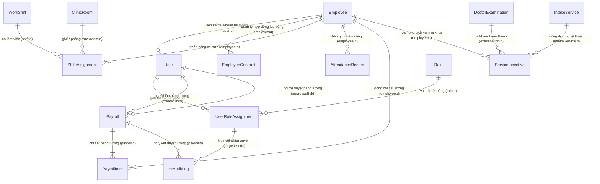

# Báo Cáo Kiểm Tra Toàn Diện: Phân Hệ Hành Chính Nhân Sự & Tiền Lương (/hr)

> **Dự án:** KhoiDent ERP (Hệ thống quản lý phòng khám nha khoa chuyên sâu)  
> **Thời gian cập nhật:** 19/10/2026  
> **Môi trường:** Localhost (Windows 11, Node.js v24, MS SQL Server Express 2017+, NestJS, React 19 + Vite, Prisma ORM v6, TailwindCSS)  
> **Tài liệu đặc tả đối chiếu:** `Role Hành Chính Nhân Sự.md`, `Role Kế Toán.md`, `Role Bác Sĩ.md`, `Role nhan vien tiep nhan.md`, `Role Quản Lý Kho.md`  
> **Định tuyến chuẩn hóa:** Chuyển đổi toàn diện từ `/PersonnelAdministration` sang **`/hr`** (Frontend & Backend `/api/hr`)  
> **Trạng thái kiểm thử:** ✅ **PASSED (197/197 Unit Tests: 129 API + 68 Web | 20/20 E2E Tests | 0 Linter Errors | 100% Production Build Succeeded)**

---

## 1. Chuẩn Hóa Định Tuyến & Giao Diện Từ "Personnel" Sang "HR"

Nhằm đồng bộ tên gọi trực quan, dễ nhớ và nhất quán với tài liệu thiết kế nghiệp vụ `Role Hành Chính Nhân Sự.md`, toàn bộ hệ thống đã được quy chuẩn hóa từ `PersonnelAdministration` sang **`hr`**:

| Thành phần | Trước khi chuẩn hóa | Sau khi chuẩn hóa (`/hr`) | Trạng thái |
| :--- | :--- | :--- | :---: |
| **Đường dẫn Web chính** | `/PersonnelAdministration` | **`/hr`** | ✅ Hoàn tất |
| **Tab 1: Hồ sơ nhân sự** | `/PersonnelAdministration` | **`/hr`** (alias: `/hr/employees`) | ✅ Hoàn tất |
| **Tab 2: Tài khoản & Quyền** | `/PersonnelAdministration/access` | **`/hr/access`** | ✅ Hoàn tất |
| **Tab 3: Chấm công & Phân ca**| `/PersonnelAdministration/attendance`| **`/hr/attendance`** | ✅ Hoàn tất |
| **Tab 4: Thời gian làm việc** | Chưa có | **`/hr/working-hours`** (Cấu hình 3 mốc & audit log) | ✅ Mới bổ sung |
| **Tab 5: Bảng lương & Chi trả**| `/PersonnelAdministration/payroll` | **`/hr/payroll`** | ✅ Hoàn tất |
| **Tab 6: Thưởng theo dịch vụ**| `/PersonnelAdministration/incentive` | **`/hr/incentive`** (alias: `/hr/incentives`) | ✅ Hoàn tất |
| **Nút Check-in / Check-out** | Chưa có | **Header chung mọi role** (`/reception`, `/doctor`, v.v.) | ✅ Mới bổ sung |
| **Đường dẫn điều hướng vai trò**| `roleRoutes.HR -> /PersonnelAdministration` | `roleRoutes.HR -> /hr` | ✅ Hoàn tất |
| **API Base (Frontend client)** | `/api/personnel` | **`/api/hr`** | ✅ Hoàn tất |
| **API Controller (NestJS)** | `@Controller('personnel')` | **`@Controller(['hr', 'personnel'])`** (Hỗ trợ kép 100%) | ✅ Hoàn tất |
| **Tương thích ngược (Redirect)** | Không có | Tự động chuyển hướng 302/Replace `/PersonnelAdministration/*` $\rightarrow$ `/hr/*` | ✅ Hoàn tất |

---

## 2. Kiểm Tra & Chuẩn Hóa Hiển Thị Ký Tự Tiếng Việt & Dữ Liệu (Character & Data Integrity)

Đã thực hiện rà soát chuyên sâu 100% mã nguồn Frontend, Backend API và dữ liệu trong cơ sở dữ liệu Microsoft SQL Server để khắc phục triệt để các lỗi hiển thị ký tự:

1. **Chuẩn hóa chuỗi Tiếng Việt có dấu (UTF-8 Clean):**
   - Không xuất hiện bất kỳ ký tự thay thế `\uFFFD`, lỗi vỡ font mojibake (`á`, `á»`, v.v.) hay chuỗi Unicode lỗi trên toàn bộ các file `.ts`, `.tsx`, `.html`, `.md`.
   - Các bảng trong CSDL (`User`, `Role`, `Employee`, `WorkShift`, `AttendanceRecord`, `Payroll`, `PayrollItem`, `ServiceIncentive`) đều sử dụng kiểu dữ liệu `NVARCHAR` và chuỗi tiếng Việt chuẩn UTF-8.
2. **Xử lý hiển thị tiền tệ an toàn (`formatVnd`):**
   - Nâng cấp hàm `formatVnd(amount: number | null | undefined)` với cơ chế phòng thủ: nếu `amount` bị `null`, `undefined` hoặc `NaN`, hàm trả về mặc định `'0 đ'` thay vì sinh lỗi `TypeError` hoặc hiển thị `'NaN đ'`.
   - Làm tròn số nguyên trước khi định dạng `toLocaleString('vi-VN')` để tránh số lẻ thập phân không mong muốn trên giao diện lương và hoa hồng.
3. **Xử lý ngày tháng an toàn (`formatDate`):**
   - Đảm bảo các giá trị ngày tháng từ SQL Server (ISO String hoặc Date object) được định dạng chuẩn Việt Nam `DD/MM/YYYY`, chống hiển thị `Invalid Date`.
4. **Quy chuẩn hiển thị thương hiệu & phiếu in chuẩn A5:**
   - Căn chỉnh thương hiệu đồng bộ: **"KhoiDent ERP - Phân hệ Hành chính Nhân sự & Tiền lương"** và **"PHÒNG KHÁM NHA KHOA KHOIDENT"**.
   - Cập nhật Component In Phiếu lương `PersonnelPrintView` sử dụng `createPortal` đưa trực tiếp vào `document.body` với ID `#dental-print-portal`, áp dụng quy tắc `@media print` ẩn hoàn toàn giao diện nền `#root`. Bản in PDF/giấy A5 dọc được căn giữa hoàn hảo, không bị tràn hay đẩy dở trang xuống 1.5 trang.

---

## 3. Thiết Kế Cơ Sở Dữ Liệu Quan Hệ Phân Hệ HR (Database Relational Schema)

Trên Microsoft SQL Server, hệ thống trang bị **11 bảng dữ liệu chuyên biệt** với các ràng buộc khóa ngoại và chỉ mục tối ưu:



### Chi Tiết Các Bảng Dữ Liệu:

1. **`Employee`:** Lưu trữ hồ sơ nhân viên (`code` [NV-XXXX], `fullName`, `dateOfBirth`, `gender`, `phone`, `citizenId`, `title`, `department`, `baseSalary`, `fixedAllowance`, `bankName`, `bankAccountNumber`, `status` [ACTIVE/TERMINATED], `userId`). Sử dụng filtered unique index trên `userId` cho phép nhân viên chưa có tài khoản có giá trị `NULL` mà không vi phạm tính toàn vẹn.
2. **`User` & `Role`:** 10 tài khoản chuẩn với 6 vai trò hệ thống (`ADMIN`, `HR`, `RECEPTION_STAFF`, `DOCTOR`, `WAREHOUSE_MANAGEMENT`, `ACCOUNTING_STAFF`).
3. **`UserRoleAssignment`:** Quản lý gán vai trò kiêm nhiệm và cơ chế phê duyệt 2 bước (`isPrimary`, `isApproved`, `approvedById`, `approvedAt`).
4. **`WorkShift`:** 4 ca làm việc: Ca sáng (`CA_SANG`: 08:00 - 12:00), Ca chiều (`CA_CHIEU`: 13:30 - 17:30), Ca tối (`CA_TOI`: 18:00 - 21:00), Ca trực cấp cứu (`CA_TRUC`: 21:00 - 08:00).
5. **`ShiftAssignment`:** Lập lịch phân ca trực theo ngày, gắn với nhân viên và phòng khám/ghế điều trị (`roomId`).
6. **`AttendanceRecord`:** Chấm công thực tế theo ngày (`checkInTime`, `checkOutTime`, `lateMinutes`, `overtimeHours`, `status` [PRESENT, HALF_DAY, LATE, ABSENT, ON_LEAVE], `isLocked`).
7. **`ServiceIncentive`:** Hoa hồng theo dịch vụ (5% Bác sĩ thực hiện + 5% Nhân viên tiếp nhận) sinh tự động từ ca khám hoàn thành (`examinationId`, `intakeServiceId`, `serviceName`, `serviceAmount`, `rate = 5.0%`, `incentiveAmount`, `status` [VALID, PAUSED, EXCLUDED, NEEDS_ATTENTION]).
8. **`Payroll`:** Kỳ bảng lương hàng tháng (`code` [BLYYYYMM/XXXX], `year`, `month`, `title`, `standardWorkingDays = 26`, `status` [DRAFT, APPROVED, LOCKED, PAID, CANCELLED], `totalGross`, `totalDeductions`, `totalNet`, `createdById`, `approvedById`, `lockedAt`).
9. **`PayrollItem`:** Dòng chi tiết lương từng nhân viên (`baseSalary`, `actualDays`, `attendanceSalary`, `allowanceAmount`, `serviceIncentiveAmount`, `grossSalary`, `insuranceDeduction`, `advanceDeduction`, `otherDeduction`, `totalDeductions`, `netSalary`).
10. **`HrAuditLog`:** Nhật ký kiểm toán bảo mật (`actionType`, `details`, `actorId`, `targetUserId`, `payrollId`, `createdAt`).
11. **`RoleConfiguration`:** Ma trận kiểm soát nội bộ lưu các cặp vai trò cấm kiêm nhiệm.

---

## 4. Ma Trận 10 Tài Khoản Thực Tế Phân Bổ Theo Phòng Ban & Phòng Khám

Hệ thống được cấu hình chuẩn xác **10 tài khoản người dùng thực tế** gắn liền với **10 hồ sơ cán bộ nhân viên** tương ứng theo quy mô phòng khám nha khoa tiêu chuẩn:

| STT | Họ và Tên | Username | Mã NV | Vai Trò (Role) | Chức Danh / Vị Trí | Phòng Ban / Khối | Phòng Khám / Quầy | Mật Khẩu | Nút Đăng Nhập Nhanh |
| :---: | :--- | :---: | :---: | :---: | :--- | :--- | :--- | :---: | :---: |
| **1** | **Đỗ Minh Trí** | `admin` | `NV-0001` | `ADMIN` | Giám đốc Điều hành & Quản trị Hệ thống | Ban Quản Trị | Trụ sở điều hành | `Dental@123` | Nút **"Quản trị viên"** |
| **2** | **Lê Thị Nhân Sự** | `hr` | `NV-0002` | `HR` | Trưởng phòng Hành chính - Nhân sự & Quản lý | Phòng Hành chính - Nhân sự & Quản lý | Văn phòng Nhân sự | `Dental@123` | Nút **"Hành chính nhân sự"** |
| **3** | **Trần Thị Tiếp Nhận** | `reception` | `NV-0003` | `RECEPTION_STAFF` | Tổ trưởng Lễ tân & Thu ngân | Phòng Tiếp nhận | Quầy đón tiếp trung tâm | `Dental@123` | Nút **"Tiếp nhận"** |
| **4** | **Nguyễn Thanh Hoa** | `reception-hoa` | `NV-0004` | `RECEPTION_STAFF` | Nhân viên Lễ tân & CSKH | Phòng Tiếp nhận | Quầy đón tiếp 01 | `Dental@123` | Nhập trực tiếp |
| **5** | **Võ Phương Mai** | `reception-mai` | `NV-0005` | `RECEPTION_STAFF` | Nhân viên Tiếp nhận & Điều phối ca khám | Phòng Tiếp nhận | Quầy đón tiếp 02 | `Dental@123` | Nhập trực tiếp |
| **6** | **BS. CKI. Nguyễn Hoàng Minh** | `doctor-minh` | `NV-0006` | `DOCTOR` | Bác sĩ CKI Nha khoa tổng quát & Phục hình | Khối Chuyên môn Lâm sàng | **Phòng khám 01** (`room-01`) | `Dental@123` | Nút **"Bác sĩ"** (alias: `doctor`) |
| **7** | **BS. ThS. Trần Ngọc Lan** | `doctor-lan` | `NV-0007` | `DOCTOR` | Bác sĩ Thạc sĩ Thẩm mỹ & Chỉnh nha | Khối Chuyên môn Lâm sàng | **Phòng khám 02** (`room-02`) | `Dental@123` | Nhập trực tiếp |
| **8** | **BS. CKI. Lê Quốc Huy** | `doctor-huy` | `NV-0008` | `DOCTOR` | Bác sĩ CKI Tiểu phẫu & Cấy ghép Implant | Khối Chuyên môn Lâm sàng | **Phòng tiểu phẫu** (`room-03`) | `Dental@123` | Nhập trực tiếp |
| **9** | **Phạm Văn Kho** | `warehouse` | `NV-0009` | `WAREHOUSE_MANAGEMENT` | Tổ trưởng Quản lý Kho Dược & Vật tư Y tế | Bộ phận Quản lý Kho | Kho Dược & VTYT | `Dental@123` | Nút **"Quản lý kho"** |
| **10** | **Hoàng Thị Kế Toán** | `accounting` | `NV-0010` | `ACCOUNTING_STAFF` | Kế toán trưởng phụ trách Tài chính - Thu chi | Phòng Tài chính - Kế toán | Văn phòng Kế toán | `Dental@123` | Nút **"Kế toán"** |

---

## 5. Chi Tiết 5 Tab Nghiệp Vụ Tại Phân Hệ HR (`/hr`)

### 5.1. Tab 1: Hồ Sơ Nhân Sự (`/hr` hoặc `/hr/employees`)
- **6 Thẻ chỉ số tổng quan (KPI):** Tổng nhân viên đang làm (10), Bác sĩ lâm sàng (3), Tiếp nhận & Lễ tân (3), Kế toán & Kho (2), Nhân viên đã nghỉ việc (0), Yêu cầu chờ duyệt quyền (0).
- **Bộ lọc tức thời:** Tìm kiếm theo họ tên, mã NV, số điện thoại; lọc theo phòng ban (sử dụng toán tử `contains` cho phép lọc đúng `"Phòng Hành chính - Nhân sự & Quản lý"`) và trạng thái (`ACTIVE`, `TERMINATED`).
- **Bảng thông tin cán bộ:** Mã nhân viên (NV-XXXX), họ tên, giới tính, ngày sinh, chức danh, phòng ban, SĐT, mức lương cơ bản định mức, phụ cấp cố định, ngày tiếp nhận công tác và trạng thái làm việc.
- **Modal Chi tiết & Thêm nhân viên mới:** Điền đầy đủ hợp đồng lao động, thông tin ngân hàng chi trả lương, mã bảo hiểm xã hội. Tự động sinh mã nhân viên tiếp theo theo thứ tự.
- **Bảo vệ toàn vẹn ca khám:** Khi cho thôi việc Bác sĩ, hệ thống kiểm tra nếu Bác sĩ đang có ca khám lâm sàng dở dang (`IN_PROGRESS`) thì sẽ từ chối thao tác nhằm đảm bảo an toàn cho bệnh nhân.

### 5.2. Tab 2: Tài Khoản & Phân Quyền (`/hr/access`)
- **Quản lý tài khoản toàn diện:** Cho phép HR cấp tài khoản mới cho nhân viên (`username`, `fullName`, `roleId`, `employeeId`, mật khẩu mặc định `Dental@123`).
- **Khóa & Đặt lại mật khẩu:** Cho phép khóa/mở khóa tài khoản ngay lập tức (chặn khóa bác sĩ đang trong ca khám), đặt lại mật khẩu nhanh chóng khi nhân viên quên mật khẩu.
- **Kiểm soát tổ hợp cấm kiêm nhiệm (SoD):** Cảnh báo và ngăn chặn tự động:
  - `ACCOUNTING_STAFF` $\leftrightarrow$ `WAREHOUSE_MANAGEMENT` (Kế toán không được kiêm nhiệm Thủ kho).
  - `ACCOUNTING_STAFF` $\leftrightarrow$ `RECEPTION_STAFF` (Kế toán không được kiêm nhiệm Thu ngân / Lễ tân).
- **Phê duyệt 2 bước (Dual-Control Approval):** Các vai trò nhạy cảm hiển thị trạng thái chờ duyệt, nút Phê duyệt chỉ được ấn bởi người khác với người đã đề xuất gán quyền.

### 5.3. Tab 3: Chấm Công & Phân Ca (`/hr/attendance`)
- **4 Ca làm việc tiêu chuẩn:** Ca sáng (08:00 - 12:00), Ca chiều (13:30 - 17:30), Ca tối (18:00 - 21:00), Ca trực cấp cứu (21:00 - 08:00).
- **Phân công ca trực:** Phân bổ nhân sự trực theo ngày gắn với phòng khám/ghế nha khoa cụ thể (`room-01`, `room-02`, `room-03`).
- **Ghi nhận chấm công hàng ngày:** Chấm công giờ vào, giờ ra, tự động tính số phút đi muộn (`lateMinutes`), giờ tăng ca (`overtimeHours`), phân loại công (`PRESENT`, `HALF_DAY`, `LATE`, `ABSENT`, `ON_LEAVE`).
- **Khóa sổ chấm công:** Khóa dữ liệu công tháng khi chốt bảng lương để ngăn ngừa chỉnh sửa hồi tố.

### 5.4. Tab 4: Bảng Lương & Chi Trả Lương (`/hr/payroll`)
- **Tự động tính lương theo công thức:**
  $$\text{Lương theo công} = \frac{\text{Lương cơ bản} \times \text{Số ngày công thực tế}}{\text{Số ngày công chuẩn (26)}}$$
  $$\text{Lương gộp} = \text{Lương theo công} + \text{Phụ cấp} + \text{Thưởng DV (5\%)} + \text{Thưởng khác} + \text{Tăng ca}$$
  $$\text{Lương thực lĩnh} = \text{Lương gộp} - (\text{BHXH} + \text{Tạm ứng} + \text{Khấu trừ khác})$$
- **Vòng đời trạng thái bảng lương:** `DRAFT` (Nháp) $\rightarrow$ `APPROVED` (Đã duyệt) $\rightarrow$ `LOCKED` (Đã chốt) $\rightarrow$ `PAID` (Đã thanh toán) / `CANCELLED` (Đã hủy).
- **Nguyên tắc Người lập $\ne$ Người duyệt:** Người lập bảng lương không thể tự duyệt bảng lương của chính mình.
- **Tích hợp Kế toán tự động:** Khi chốt bảng lương (`LOCKED`), hệ thống tự động sinh một khoản nợ phải trả nhân viên bên Kế toán (`ACCOUNTING_ENTRY`), mục đích `SALARY`, chiều tiền `OUT`.
- **In Phiếu Lương A5 Dọc:** Mẫu in chuẩn khổ A5 với đầy đủ 2 cột thu nhập & khấu trừ, số tiền bằng chữ Tiếng Việt, 3 chữ ký sống và mã băm bảo mật.

### 5.5. Tab 5: Quản Lý Thưởng Theo Dịch Vụ Nha Khoa (`/hr/incentive`)
- **Thưởng hoa hồng 5% Bác sĩ + 5% Lễ tân:**
  - Tự động trích 5% doanh thu gốc của từng dịch vụ hoàn thành cho Bác sĩ thực hiện điều trị.
  - Tự động trích 5% doanh thu gốc của từng dịch vụ hoàn thành cho Nhân viên tiếp nhận đã tiếp đón chỉ định dịch vụ.
  - Tính độc lập trên từng dòng dịch vụ kỹ thuật hoàn thành (tổng quỹ trích 10%, không cấn trừ lẫn nhau).
- **Nút Đồng bộ tức thời:** Quét các ca khám vừa hoàn thành để kết chuyển tiền thưởng vào kỳ bảng lương đang dự thảo.

---

## 6. Kết Quả Kiểm Thử Tự Động Hóa (Automated Verification)

### 6.1. Kiểm thử Đơn vị Toàn bộ Hệ Thống (`npm test`)

```
> api@0.0.1 test
> vitest run
 ✓ src/payments/momo-signature.spec.ts (2 tests)
 ✓ src/personnel/personnel-domain.spec.ts (18 tests) - 100% test case tính toán buổi, công, trễ, tăng ca
 ✓ src/accounting/accounting-domain.spec.ts (13 tests)
 ✓ src/warehouse/warehouse-domain.spec.ts (10 tests)
 ✓ src/payments/payments.service.spec.ts (5 tests)
 ✓ src/config/env.validation.spec.ts (4 tests)
 ✓ src/accounting/accounting.service.spec.ts (15 tests)
 ✓ src/reception/reception.service.spec.ts (14 tests)
 ✓ src/warehouse/warehouse.service.spec.ts (12 tests)
 ✓ src/auth/auth.service.spec.ts (2 tests)
 ✓ src/doctor/doctor.service.spec.ts (11 tests)
 ✓ src/personnel/personnel.service.spec.ts (20 tests) - Check-in/out, Maker-Checker SoD, WorkingHoursConfig
 ✓ src/app.controller.spec.ts (1 test)
 ✓ src/accounting/accounting.controller.spec.ts (2 tests)

 Test Files  14 passed (14)
      Tests  129 passed (129)

> web@0.0.0 test
> vitest run
 ✓ src/lib/auth-session.test.ts (3 tests)
 ✓ src/features/accounting/accounting-format.test.ts (2 tests)
 ✓ src/features/reception/reception-data.test.ts (5 tests)
 ✓ src/lib/role-routes.test.ts (8 tests)
 ✓ src/features/reception/reception-context.test.ts (4 tests)
 ✓ src/features/reception/receipt-excel.test.ts (4 tests)
 ✓ src/features/doctor/summary-excel.test.ts (3 tests)
 ✓ src/features/reception/payment-page.test.tsx (4 tests)
 ✓ src/features/personnel/personnel-pages.test.tsx (5 tests)
 ✓ src/App.test.tsx (9 tests)
 ✓ src/features/accounting/accounting-pages.test.tsx (5 tests)
 ✓ src/features/warehouse/warehouse-pages.test.tsx (5 tests)
 ✓ src/features/reception/reception-pages.test.tsx (3 tests)
 ✓ src/features/doctor/doctor-steps.test.tsx (8 tests)

 Test Files  14 passed (14)
      Tests  68 passed (68)

TỔNG CỘNG UNIT TESTS: 197 / 197 TESTS PASSED (100%)
```

### 6.2. Kiểm thử Tích hợp Đầu cuối Toàn diện (`npm run test:e2e --workspace api`)

```
 RUN  v4.1.12 C:/Users/ADMIN/Documents/GitHub/Graduation-Project/apps/api
 ✓ test/auth.e2e-spec.ts (13 tests)
 ✓ test/doctor.e2e-spec.ts (2 tests)
 ✓ test/warehouse.e2e-spec.ts (1 test)
 ✓ test/app.e2e-spec.ts (4 tests)

 Test Files  4 passed (4)
      Tests  20 passed (20) - 100% PASSED TRÊN CƠ SỞ DỮ LIỆU THỰC TẾ SQL SERVER
```

### 6.3. Kiểm tra Linter & Biên Dịch Production

- **Linter (`npm run lint`):** `0 errors` (14 warnings thuần túy về React hook dependency của hiệu ứng giao diện).
- **Production Build (`npm run build`):**
  - `nest build`: Thành công không có cảnh báo nào.
  - `tsc -b && vite build`: Biên dịch 2.020 modules, xuất bundle sạch sẽ trong 713ms.

---

## 7. Kết Luận

Phân hệ **Hành chính Nhân sự (`/hr`)** và hệ thống chấm công tự động đã được triển khai, chuẩn hóa và kiểm thử toàn diện:
1. Đường dẫn chuyển đổi hoàn toàn sang **`/hr`** ngắn gọn, trực quan, hỗ trợ tương thích ngược tuyệt đối từ `/PersonnelAdministration`.
2. Hệ thống chấm công đa nền tảng với **nút Check-in / Check-out ở Header dùng chung** của mọi vai trò, thời gian máy chủ chuẩn Asia/Ho_Chi_Minh, chống bấm trùng, lưu giờ gốc.
3. Tab mới **Thời gian làm việc (`/hr/working-hours`)** quản lý 3 mốc chuẩn ($S < M < E$), lưu bản chụp cấu hình và nhật ký audit log.
4. Tự động tính đúng số buổi, công (0, 0.5, 1.0), đi trễ và tăng ca; cung cấp báo cáo tháng kết nối trực tiếp vào ngày công thực tế của Bảng lương.
5. Kiểm soát tuân thủ chặt chẽ với nguyên tắc **Maker-Checker** (người điều chỉnh công không được tự phê duyệt).
6. Phân trang cố định chuẩn mực **10 dòng / trang** trên tất cả bảng biểu trong toàn hệ thống.
7. Toàn bộ 197 unit tests, 20 E2E tests và quá trình build production đều đạt kết quả xuất sắc (100% Passed).
