# Báo Cáo Kiểm Tra Toàn Diện: CSDL Quan Hệ & Phân Hệ Hành Chính Nhân Sự (/PersonnelAdministration)

> **Dự án:** Dental ERP (Hệ thống quản lý phòng khám nha khoa chuyên sâu)  
> **Thời gian cập nhật:** 19/10/2026  
> **Môi trường:** Localhost (Windows 11, Node.js v22, MS SQL Server Express 2017+, NestJS, React 19 + Vite, Prisma ORM v6, TailwindCSS)  
> **Tài liệu đặc tả đối chiếu:** `Role Hành Chính Nhân Sự.md`, `Role Kế Toán.md`, `Role Bác Sĩ.md`, `Role nhan vien tiep nhan.md`, `Role Quản Lý Kho.md`  
> **Lưu ý:** Báo cáo này đã được chuyển đổi và quy chuẩn hóa toàn diện sang **`TestHR.md`** với đường dẫn chính thức là **`/hr`** (alias: `/api/hr`). Vui lòng xem [TestHR.md](file:///c:/Users/ADMIN/Documents/GitHub/Graduation-Project/TestHR.md) để tra cứu dữ liệu mới nhất.
> **Trạng thái kiểm thử:** ✅ **PASSED (178/178 Automated Tests: 110 API Tests + 68 Web Tests + 20/20 E2E Tests + 0 Linter Errors + Clean Production Build)**

---

## 1. Thiết Kế Cơ Sở Dữ Liệu Quan Hệ Phân Hệ Hành Chính Nhân Sự (Database Relational Schema)

Phân hệ Hành chính Nhân sự (`/PersonnelAdministration` - alias: `/hr`) giữ vai trò trung tâm **quản trị toàn bộ nhân sự, phân bổ ca trực, chấm công, tính thưởng hoa hồng dịch vụ (5% Bác sĩ + 5% Lễ tân) và quyết toán bảng lương định kỳ**. Dữ liệu được đồng bộ trực tiếp với Kế toán (`/accounting`) khi chốt bảng lương để phát sinh công nợ phải trả nhân viên.

Trên Microsoft SQL Server, hệ thống được trang bị **11 bảng dữ liệu chuyên biệt** cùng quan hệ toàn vẹn dữ liệu chặt chẽ:

### 1.1. Sơ Đồ Quan Hệ Thực Thể Phân Hệ Nhân Sự (ERD)

```mermaid
erDiagram
    Employee ||--o| User : "liên kết tài khoản hệ thống (userId)"
    Employee ||--o{ EmployeeContract : "quản lý hợp đồng lao động (employeeId)"
    Employee ||--o{ ShiftAssignment : "phân công ca trực (employeeId)"
    Employee ||--o{ AttendanceRecord : "bản ghi chấm công (employeeId)"
    Employee ||--o{ PayrollItem : "dòng chi tiết lương (employeeId)"
    Employee ||--o{ ServiceIncentive : "hoa hồng dịch vụ nha khoa (employeeId)"

    User ||--o{ UserRoleAssignment : "gán đa vai trò (userId)"
    Role ||--o{ UserRoleAssignment : "vai trò hệ thống (roleId)"

    WorkShift ||--o{ ShiftAssignment : "ca làm việc (shiftId)"
    ClinicRoom ||--o{ ShiftAssignment : "ghế / phòng trực (roomId)"

    Payroll ||--|{ PayrollItem : "chi tiết bảng lương (payrollId)"
    User ||--o{ Payroll : "người lập bảng lương (createdById)"
    User ||--o{ Payroll : "người duyệt bảng lương (approvedById)"

    UserRoleAssignment ||--o{ HrAuditLog : "truy vết phân quyền (targetUserId)"
    Payroll ||--o{ HrAuditLog : "truy vết duyệt lương (payrollId)"

    DoctorExamination ||--o{ ServiceIncentive : "ca khám hoàn thành (examinationId)"
    IntakeService ||--o{ ServiceIncentive : "dòng dịch vụ kỹ thuật (intakeServiceId)"

    Employee {
        int id PK "Tự tăng (Identity)"
        varchar code UK "Mã nhân viên (NV-0001, NV-0002...)"
        nvarchar fullName "Họ và tên cán bộ nhân viên"
        date dateOfBirth "Ngày sinh"
        nvarchar gender "Nam | Nữ | Khác"
        varchar phone "Số điện thoại liên lạc"
        nvarchar address "Địa chỉ thường trú"
        nvarchar title "Chức danh nghề nghiệp (Bác sĩ, Lễ tân, Kế toán...)"
        nvarchar department "Phòng ban (Khối Lâm sàng, Quản trị, Kế toán...)"
        date joinDate "Ngày tiếp nhận công tác"
        varchar status "ACTIVE (Đang làm) | ON_LEAVE (Nghỉ phép) | TERMINATED (Nghỉ việc)"
        int baseSalary "Mức lương cơ bản thỏa thuận (VNĐ)"
        int fixedAllowance "Phụ cấp cố định chức vụ/trách nhiệm (VNĐ)"
        nvarchar bankName "Tên ngân hàng chi trả lương (Vietcombank, MB...)"
        varchar bankAccountNumber "Số tài khoản ngân hàng (Mã hóa hiển thị)"
        varchar citizenId "Số CCCD / CMND (Mã hóa hiển thị)"
        int userId FK "Liên kết tài khoản người dùng"
    }

    UserRoleAssignment {
        int id PK "Tự tăng"
        int userId FK "Tham chiếu User(id)"
        int roleId FK "Tham chiếu Role(id)"
        bit isPrimary "Vai trò mặc định đăng nhập"
        bit isApproved "Đã duyệt bởi Quản lý phòng khám / Admin"
        int approvedById FK "Người phê duyệt quyền"
        datetime2 approvedAt "Thời điểm phê duyệt"
        datetime2 assignedAt "Thời điểm gán quyền"
    }

    WorkShift {
        int id PK "Tự tăng"
        varchar code UK "Mã ca: CA_SANG | CA_CHIEU | CA_TOI | CA_TRUC"
        nvarchar name "Tên ca làm việc"
        varchar startTime "Giờ bắt đầu (08:00)"
        varchar endTime "Giờ kết thúc (12:00)"
        varchar shiftType "REGULAR (Ca tiêu chuẩn) | OVERTIME (Tăng ca) | ON_CALL (Trực cấp cứu)"
        bit isActive "Cờ kích hoạt sử dụng"
    }

    ShiftAssignment {
        int id PK "Tự tăng"
        int employeeId FK "Nhân viên trực"
        int shiftId FK "Ca làm việc"
        date date "Ngày phân công"
        int roomId FK "Phòng khám / Ghế phụ trách"
        nvarchar note "Ghi chú công tác"
    }

    AttendanceRecord {
        int id PK "Tự tăng"
        int employeeId FK "Nhân viên chấm công"
        date date "Ngày chấm công"
        varchar status "PRESENT (Đủ công) | HALF_DAY (Nửa công) | LATE (Đi muộn) | ABSENT (Vắng mặt) | ON_LEAVE (Nghỉ phép) | HOLIDAY (Nghỉ lễ)"
        varchar checkInTime "Giờ vào (HH:mm)"
        varchar checkOutTime "Giờ ra (HH:mm)"
        int lateMinutes "Số phút đi muộn"
        decimal overtimeHours "Số giờ tăng ca"
        bit isOnDuty "Cờ trực ngoài giờ"
        bit isLocked "Khóa dữ liệu sau khi chốt bảng lương"
        nvarchar note "Ghi chú chấm công"
    }

    ServiceIncentive {
        int id PK "Tự tăng"
        int intakeServiceId FK "Dòng chỉ định dịch vụ hoàn thành"
        int examinationId FK "Ca khám hoàn thành"
        int employeeId FK "Nhân viên thụ hưởng (Bác sĩ hoặc Lễ tân)"
        varchar roleType "DOCTOR (Bác sĩ 5%) | RECEPTION (Lễ tân 5%)"
        nvarchar serviceName "Tên dịch vụ nha khoa (Implant, Tẩy trắng...)"
        int serviceAmount "Doanh thu gốc dịch vụ (VNĐ)"
        decimal rate "Tỷ lệ hoa hồng (mặc định 5.0%)"
        int incentiveAmount "Tiền thưởng = serviceAmount * rate / 100"
        varchar status "VALID (Hợp lệ) | PAUSED (Tạm giữ) | EXCLUDED (Loại bỏ) | NEEDS_ATTENTION (Cần bù trừ)"
        datetime2 completedAt "Ngày hoàn thành dịch vụ"
        int payrollId FK "Đã kết chuyển vào bảng lương nào"
    }

    Payroll {
        int id PK "Tự tăng"
        varchar code UK "Mã phiếu: BLYYYYMM/XXXX (BL202610/0001)"
        int year "Năm tính lương"
        int month "Tháng tính lương (1-12)"
        nvarchar title "Tiêu đề kỳ lương"
        int standardWorkingDays "Số ngày công chuẩn của tháng (26 ngày)"
        varchar status "DRAFT (Dự thảo) | APPROVED (Đã duyệt) | LOCKED (Đã chốt sổ) | CANCELLED (Đã hủy)"
        int totalGross "Tổng lương gộp toàn phòng khám"
        int totalDeductions "Tổng các khoản khấu trừ"
        int totalNet "Tổng lương thực lĩnh chi trả"
        int createdById FK "Người lập bảng lương"
        int approvedById FK "Người duyệt (phải khác người lập)"
        datetime2 approvedAt "Thời điểm phê duyệt"
        datetime2 lockedAt "Thời điểm chốt & kết chuyển nợ sang Kế toán"
    }

    PayrollItem {
        int id PK "Tự tăng"
        int payrollId FK "Tham chiếu bảng lương"
        int employeeId FK "Tham chiếu cán bộ nhân viên"
        int baseSalary "Lương cơ bản kỳ này"
        int standardDays "Ngày công chuẩn"
        decimal actualDays "Ngày công thực tế (tổng hợp từ AttendanceRecord)"
        int attendanceSalary "Lương theo ngày công = BaseSalary * ActualDays / StandardDays"
        int allowanceAmount "Phụ cấp cố định + trách nhiệm"
        int serviceIncentiveAmount "Tổng thưởng 5% hoa hồng dịch vụ hoàn thành"
        int otherBonus "Thưởng KPI / hiệu suất khác"
        int overtimePay "Tiền làm ngoài giờ / tăng ca"
        int grossSalary "Lương gộp = attendanceSalary + allowance + incentive + bonus + overtime"
        int insuranceDeduction "Khấu trừ BHXH, BHYT, BHTN (10.5% hoặc nhập tay)"
        int advanceDeduction "Khấu trừ tạm ứng lương trong tháng"
        int otherDeduction "Khấu trừ vi phạm / kỷ luật / đồng phục"
        int totalDeductions "Tổng khấu trừ = insurance + advance + other"
        int netSalary "Lương thực lĩnh = grossSalary - totalDeductions"
    }

    HrAuditLog {
        int id PK "Tự tăng"
        varchar actionType "ROLE_ASSIGNED | ROLE_APPROVED | ROLE_REVOKED | PAYROLL_CREATED | PAYROLL_APPROVED | PAYROLL_LOCKED | PAYROLL_CANCELLED"
        nvarchar details "Nội dung chi tiết thao tác"
        int actorId FK "Tài khoản thực hiện"
        int targetUserId FK "Tài khoản chịu tác động"
        int payrollId FK "Bảng lương liên quan"
        datetime2 createdAt "Thời điểm ghi nhận"
    }

    RoleConfiguration {
        int id PK "Tự tăng"
        varchar roleA "Mã quyền A"
        varchar roleB "Mã quyền B"
        nvarchar reason "Căn cứ kiểm soát nội bộ cấm kiêm nhiệm"
    }
```



---

## 2. Ma Trận Vai Trò & Nguyên Tắc Kiểm Soát Nội Bộ (Role Mapping & Governance)

Phân hệ Nhân sự quản lý phân quyền đa vai trò cho người dùng trong toàn hệ thống Dental ERP:

### 2.1. Danh Sách Vai Trò Người Dùng (Role Catalog)

| Mã Quyền (Role Code) | Tên Vai Trò | Phân Hệ Mặc Định | Mô Tả Trách Nhiệm Chuyên Môn |
| :--- | :--- | :--- | :--- |
| **`ADMIN`** | Quản trị viên hệ thống | Toàn quyền | Cài đặt hệ thống, quản trị tài khoản, kiểm duyệt ngoại lệ |
| **`HR`** | Hành chính nhân sự & Quản lý | `/PersonnelAdministration` | Quản trị nhân sự, cấp & quản lý tài khoản người dùng (bác sĩ, tiếp nhận, kho...), phân ca, chấm công, lập & duyệt bảng lương |
| **`DOCTOR`** | Bác sĩ nha khoa | `/doctor` | Khám lâm sàng, thực hiện thủ thuật, hưởng 5% hoa hồng dịch vụ |
| **`RECEPTION`** | Nhân viên tiếp nhận | `/reception` | Đón tiếp bệnh nhân, chỉ định dịch vụ, hưởng 5% hoa hồng tiếp nhận |
| **`WAREHOUSE_MANAGEMENT`** | Thủ kho y tế | `/warehouse` | Nhập xuất vật tư, kiểm kê lô hạn sử dụng, hủy phế phẩm |
| **`ACCOUNTING_STAFF`** | Kế toán phòng khám | `/accounting` | Quản lý sổ quỹ thu chi, công nợ, đối trừ lương, báo cáo tài chính |

### 2.2. Quy Tắc Cấm Kiêm Nhiệm (Forbidden Role Combinations)

Để ngăn ngừa gian lận tài chính và xung đột lợi ích, hệ thống kiểm tra tự động trước khi gán thêm vai trò cho bất kỳ tài khoản nào:

1. **`ACCOUNTING_STAFF` $\leftrightarrow$ `WAREHOUSE_MANAGEMENT`:** Không cho phép Kế toán kiêm nhiệm Thủ kho (tránh vừa mua hàng/thanh toán vừa quản lý tồn kho vật lý).
2. **`ACCOUNTING_STAFF` $\leftrightarrow$ `RECEPTION`:** Không cho phép Kế toán kiêm nhiệm Thu ngân/Lễ tân (tránh vừa thu tiền mặt vừa đối trừ sổ sách).
3. **`ADMIN` $\leftrightarrow$ `DOCTOR`:** Cảnh báo và yêu cầu phê duyệt đặc biệt khi bác sĩ lâm sàng giữ quyền Quản trị tối cao.

### 2.3. Nguyên Tắc Phân Quyền & Phê Duyệt 2 Bước (Segregation of Duties)

- **Người lập $\ne$ Người duyệt (Maker $\ne$ Checker):**
  - Tài khoản HR lập dự thảo Bảng lương (`createdById`) **tuyệt đối không thể tự phê duyệt** bảng lương của chính mình.
  - Phải có tài khoản độc lập (`ADMIN` hoặc tài khoản nhân sự quản lý độc lập khác) kiểm tra và ấn nút Phê duyệt (`approvedById`).
- **Phê duyệt quyền nhạy cảm (Dual-Control Access):**
  - Khi gán các quyền trọng yếu (`ADMIN`, `HR`, `ACCOUNTING_STAFF`), trạng thái ban đầu là `isApproved = false`. Người dùng chỉ có hiệu lực sau khi một tài khoản Admin/HR độc lập khác xác nhận duyệt.
- **Bảo mật dữ liệu cá nhân (Sensitive Data Masking):**
  - Căn cước công dân (`citizenId`) và Số tài khoản ngân hàng (`bankAccountNumber`) của nhân viên luôn được mã hóa che dấu (ví dụ: `******1122`, `******4567`) trên giao diện thông thường, chỉ hiển thị đầy đủ khi có thẩm quyền đặc biệt.

---

## 3. Danh Mục Chi Tiết 25+ RESTful API Endpoints (`/api/personnel`)

Tất cả các API được bảo vệ bằng JWT Authentication Guard (`PersonnelGuard`), kiểm tra quyền truy cập theo vai trò `ADMIN`, `HR`, `MANAGER` và ghi vết `HrAuditLog`:

| STT | Phương Thức | Đường Dẫn Endpoint | Quyền Hạn | Mô Tả Chức Năng |
| :---: | :---: | :--- | :---: | :--- |
| **1** | `GET` | `/api/personnel/overview` | HR, MANAGER, ADMIN | Lấy số liệu tổng quan: sĩ số nhân sự, ca trực hôm nay, bảng lương mới nhất |
| **2** | `GET` | `/api/personnel/employees` | HR, MANAGER, ADMIN | Tra cứu danh sách nhân viên theo từ khóa, phòng ban, trạng thái |
| **3** | `POST` | `/api/personnel/employees` | HR, ADMIN | Tạo mới hồ sơ nhân sự (tự sinh mã NV-XXXX tiếp theo) |
| **4** | `GET` | `/api/personnel/employees/:id` | HR, MANAGER, ADMIN | Xem chi tiết thông tin hồ sơ, hợp đồng, lịch sử chấm công |
| **5** | `PUT` | `/api/personnel/employees/:id` | HR, ADMIN | Cập nhật hồ sơ, lương cơ bản, tài khoản ngân hàng |
| **6** | `POST` | `/api/personnel/employees/:id/terminate` | HR, ADMIN | Cho thôi việc nhân viên (bảo vệ: không xóa nếu bác sĩ đang có ca khám dở dang) |
| **7** | `GET` | `/api/personnel/users` | HR, MANAGER, ADMIN | Lấy danh sách tài khoản người dùng (Bác sĩ, Tiếp nhận, Kho, Kế toán...) |
| **8** | `POST` | `/api/personnel/users` | HR, ADMIN | Cấp tài khoản đăng nhập mới cho nhân viên (mật khẩu mặc định Dental@123) |
| **9** | `PUT` | `/api/personnel/users/:id` | HR, ADMIN | Cập nhật tài khoản người dùng, đổi nhân viên liên kết |
| **10** | `POST` | `/api/personnel/users/:id/toggle-active` | HR, ADMIN | Khóa / Mở khóa tài khoản (chặn khóa bác sĩ đang có ca khám dở dang) |
| **11** | `POST` | `/api/personnel/users/:id/reset-password` | HR, ADMIN | Đặt lại mật khẩu tài khoản người dùng về Dental@123 |
| **12** | `GET` | `/api/personnel/roles` | Mọi nhân sự | Lấy danh mục vai trò hệ thống và các cặp quyền cấm kiêm nhiệm |
| **13** | `GET` | `/api/personnel/access/assignments` | HR, MANAGER, ADMIN | Danh sách người dùng và các vai trò đang được phân quyền |
| **14** | `POST` | `/api/personnel/access/assignments` | HR, ADMIN | Gán quyền cho người dùng (kiểm tra chống trùng lặp & cấm kiêm nhiệm) |
| **15** | `POST` | `/api/personnel/access/assignments/:id/approve` | MANAGER, ADMIN | Phê duyệt quyền nhạy cảm (người duyệt $\ne$ người gán) |
| **16** | `DELETE` | `/api/personnel/access/assignments/:id` | HR, ADMIN | Thu hồi vai trò của người dùng |
| **17** | `GET` | `/api/personnel/shifts` | Mọi nhân sự | Danh mục các ca làm việc và ca trực cấp cứu |
| **18** | `POST` | `/api/personnel/shifts` | HR, ADMIN | Định nghĩa thêm ca làm việc mới |
| **19** | `GET` | `/api/personnel/shifts/assignments` | HR, MANAGER, ADMIN | Lịch phân công ca làm việc theo ngày/tháng và nhân sự |
| **20** | `POST` | `/api/personnel/shifts/assignments` | HR, ADMIN | Phân công ca trực cho nhân viên tại phòng/ghế điều trị |
| **21** | `GET` | `/api/personnel/attendance` | HR, MANAGER, ADMIN | Bảng tổng hợp chấm công chi tiết theo tháng và nhân viên |
| **22** | `POST` | `/api/personnel/attendance` | HR, ADMIN | Ghi nhận chấm công (giờ vào/ra, tính phút đi muộn, tăng ca) |
| **23** | `POST` | `/api/personnel/attendance/lock` | HR, MANAGER, ADMIN | Khóa dữ liệu chấm công tháng để ngăn chặn chỉnh sửa tùy tiện |
| **24** | `GET` | `/api/personnel/incentives` | HR, MANAGER, ADMIN | Bảng kê chi tiết tiền thưởng hoa hồng dịch vụ hoàn thành |
| **25** | `POST` | `/api/personnel/incentives/sync` | HR, ADMIN | Đồng bộ thưởng 5% bác sĩ + 5% tiếp nhận từ các ca khám đã hoàn thành |
| **26** | `GET` | `/api/personnel/payrolls` | HR, MANAGER, ADMIN | Danh sách các kỳ bảng lương hàng tháng |
| **27** | `GET` | `/api/personnel/payrolls/:id` | HR, MANAGER, ADMIN | Xem chi tiết từng dòng lương nhân viên trong kỳ |
| **28** | `POST` | `/api/personnel/payrolls` | HR, ADMIN | Lập dự thảo kỳ bảng lương mới (tổng hợp tự động công và thưởng) |
| **29** | `PUT` | `/api/personnel/payrolls/items/:itemId` | HR, ADMIN | Điều chỉnh phụ cấp, khấu trừ (tự động reset trạng thái về DRAFT) |
| **30** | `POST` | `/api/personnel/payrolls/:id/approve` | MANAGER, ADMIN | Phê duyệt bảng lương (yêu cầu người duyệt $\ne$ người lập) |
| **31** | `POST` | `/api/personnel/payrolls/:id/lock` | MANAGER, ADMIN | Chốt sổ bảng lương và tự động hạch toán công nợ sang Kế toán |
| **32** | `POST` | `/api/personnel/payrolls/:id/cancel` | MANAGER, ADMIN | Hủy bỏ kỳ bảng lương (ghi rõ lý do hủy vào nhật ký kiểm toán) |

---

## 4. Chi Tiết 5 Màn Hình Giao Diện Tại `/PersonnelAdministration`

Giao diện được thiết kế hiện đại, đồng bộ phong cách với toàn bộ hệ thống Dental ERP bằng TailwindCSS, hỗ trợ Tab điều hướng mượt mà:

### 4.1. Tab 1: Quản Lý Hồ Sơ Nhân Sự (`/PersonnelAdministration/employees`)
- **Khối chỉ số tổng quan:** Tổng số nhân viên đang làm việc (9 nhân sự), số nhân viên đã thôi việc, phân bổ theo phòng ban chuyên môn (3 Bác sĩ, 1 Tiếp nhận, 1 Thủ kho, 1 Kế toán, 2 Quản trị/Quản lý).
- **Bộ lọc đa năng:** Tìm kiếm tức thời theo tên, mã `NV-XXXX`, số điện thoại, lọc theo trạng thái (`ACTIVE`, `TERMINATED`) và phòng ban.
- **Bảng danh sách cán bộ:** Hiển thị mã NV, ảnh đại diện tên, chức danh chuyên môn, ngày gia nhập, mức lương cơ bản định mức, số tài khoản ngân hàng che dấu bảo mật.
- **Modal thêm mới nhân viên:** Điền đầy đủ họ tên, ngày sinh, giới tính, CCCD, chức vụ, mức lương cơ bản, thông tin ngân hàng và ngày bắt đầu công tác. Tự động liên kết tài khoản hệ thống nếu có.
- **Bảo vệ toàn vẹn ca khám:** Khi cho thôi việc một bác sĩ, hệ thống kiểm tra nếu bác sĩ đang có ca khám lâm sàng chưa đóng (`status = IN_PROGRESS`) thì sẽ từ chối thao tác và yêu cầu chuyển giao bệnh nhân trước.

### 4.2. Tab 2: Phân Quyền & Quản Trị Vai Trò Người Dùng (`/PersonnelAdministration/access`)
- **Quản lý đa vai trò (Multi-Role Management):** Cho phép một người dùng đảm nhiệm vai trò chính (`isPrimary`) và các vai trò kiêm nhiệm hợp lệ.
- **Cảnh báo xung đột trực quan (Segregation of Duties Warning):** Hệ thống hiển thị rõ quy tắc cấm kiêm nhiệm (Kế toán không được kiêm nhiệm Thủ kho, Kế toán không được kiêm nhiệm Tiếp nhận). Nếu người dùng cố ý gán vi phạm, hệ thống báo lỗi ngay tại giao diện và chặn gửi yêu cầu.
- **Hàng đợi phê duyệt quyền nhạy cảm (Dual Control Approval):** Các vai trò nhạy cảm hiển thị nhãn màu hổ phách "Chờ Quản lý duyệt". Nút Duyệt chỉ khả dụng khi người đăng nhập khác với người đã gán quyền.

### 4.3. Tab 3: Xếp Ca Trực & Chấm Công Hàng Ngày (`/PersonnelAdministration/attendance`)
- **Danh mục ca chuẩn:** Ca sáng (08:00 - 12:00), Ca chiều (13:30 - 17:30), Ca tối (18:00 - 21:00) và Ca trực cấp cứu (21:00 - 08:00).
- **Phân công ca trực (Shift Scheduling):** Lập lịch phân công ca trực gắn với phòng khám và ghế điều trị nha khoa cụ thể.
- **Chấm công thực tế (Daily Attendance):** Ghi nhận giờ vào, giờ ra, tự động tính số phút đi muộn (`lateMinutes`), giờ tăng ca (`overtimeHours`), phân loại ngày công (`PRESENT`, `HALF_DAY`, `LATE`, `ABSENT`, `ON_LEAVE`).
- **Nút Chốt công tháng:** Khóa sổ chấm công để làm căn cứ lập bảng lương, ngăn chặn sửa đổi hồi tố dữ liệu công.

### 4.4. Tab 4: Bảng Lương & Chi Trả Lương Định Kỳ (`/PersonnelAdministration/payroll`)
- **Thẻ theo dõi kỳ lương:** Hiển thị thẻ kỳ lương tháng với mã chứng từ chuẩn `BL202610/0001`, tháng tính, trạng thái quy trình (`DRAFT`, `APPROVED`, `LOCKED`, `CANCELLED`).
- **3 Chỉ số tài chính cốt lõi:**
  1. *Tổng tiền lương gộp (Gross Pay):* Tổng thu nhập trước thuế của toàn bộ nhân viên.
  2. *Tổng các khoản khấu trừ (Deductions):* BHXH, BHYT, tạm ứng, giảm trừ khác.
  3. *Tổng tiền thực lĩnh (Net Pay):* Số tiền thực tế phòng khám phải chi trả qua ngân hàng.
- **Bảng chi tiết nhân sự:** Liệt kê tường minh từng dòng: Lương cơ bản $\rightarrow$ Số ngày công (Thực tế/Chuẩn) $\rightarrow$ Lương theo công $\rightarrow$ Phụ cấp $\rightarrow$ Thưởng hoa hồng dịch vụ 5% $\rightarrow$ Thưởng khác $\rightarrow$ Lương gộp $\rightarrow$ Khấu trừ bảo hiểm & tạm ứng $\rightarrow$ Thực lĩnh.
- **Nghiệp vụ phê duyệt & chuyển nợ sang Kế toán:**
  - Nút *Phê duyệt bảng lương*: Áp dụng quy tắc người lập $\ne$ người duyệt.
  - Nút *Chốt chi trả & Ghi nợ Kế toán*: Tự động chuyển bảng lương sang trạng thái `LOCKED`, đồng thời tự động phát sinh một bút toán hạch toán bên Phân hệ Kế toán (`ACCOUNTING_ENTRY`) với mục đích `SALARY`, chiều tiền `OUT`, ghi nhận nghĩa vụ thanh toán lương của phòng khám.
  - Bất kỳ điều chỉnh nào trên dòng lương của một bảng lương đã duyệt sẽ tự động đảo trạng thái trở lại `DRAFT` để bắt buộc phê duyệt lại.

### 4.5. Tab 5: Quản Lý Thưởng Theo Dịch Vụ Nha Khoa (`/PersonnelAdministration/incentives`)
- **Cơ chế tính thưởng độc lập 5% + 5%:**
  - Khi một dịch vụ nha khoa được Bác sĩ hoàn thành trong ca khám lâm sàng (ví dụ: Trồng răng Implant Dentium trị giá 25.000.000 đ):
    - **Bác sĩ điều trị** nhận đúng 5% doanh thu gốc = **1.250.000 đ**.
    - **Nhân viên tiếp nhận (Lễ tân)** chỉ định dịch vụ nhận đúng 5% doanh thu gốc = **1.250.000 đ**.
    - Tính độc lập trên doanh thu từng dòng kỹ thuật (tổng trích quỹ hoa hồng là 10%, không chia sẻ hay trừ lẫn nhau).
- **Không phụ thuộc vào tiến độ thu tiền từ bệnh nhân:** Thưởng được ghi nhận ngay khi ca khám hoàn thành và hạch toán doanh thu, không chờ bệnh nhân trả góp xong.
- **Xử lý hoàn tiền dịch vụ (Refund Policy):** Nếu dịch vụ bị hoàn tiền toàn bộ trước khi chốt lương $\rightarrow$ Tiền thưởng chuyển trạng thái `EXCLUDED` (về 0 đ). Nếu việc hoàn tiền phát sinh sau khi bảng lương đã chốt $\rightarrow$ Dòng thưởng chuyển cờ `NEEDS_ATTENTION` để kế toán/nhân sự bù trừ vào kỳ tiếp theo.
- **Nút Đồng bộ tức thời:** Cho phép quét toàn bộ ca khám đã hoàn thành để kết chuyển dòng thưởng vào kỳ bảng lương đang dự thảo.

---

## 5. Quy Chuẩn In Ấn Phiếu Lương Chuẩn Khổ A5 Dọc (A5 Portrait Payslip)

Nhằm đáp ứng yêu cầu in ấn bảo mật cho nhân viên, tính năng xem trước và in phiếu lương được định dạng chuẩn:

- **Quy chuẩn kích thước:** Khổ giấy **A5 Portrait (148mm $\times$ 210mm)**, căn chỉnh chính giữa trang, căn lề đối xứng 10mm, không bị ngắt đôi sang trang 2.
- **Đầy đủ trường thông tin chứng từ:**
  - Header: Tiêu đề phòng khám Nha Khoa Dental ERP, Hotline, Địa chỉ.
  - Thông tin nhân viên: Mã NV, Họ tên, Chức vụ, Phòng ban, Số tài khoản nhận lương.
  - Kỳ tính lương: Tháng/Năm, Số ngày công tiêu chuẩn, Số ngày công thực tế làm việc.
  - Bảng chi tiết 2 cột (Khoản thu nhập gộp & Khoản giảm trừ) trực quan, số liệu khớp chính xác từng đồng.
  - Đọc thành tiền bằng chữ Tiếng Việt chính xác (ví dụ: *"Năm mươi ba triệu hai trăm nghìn đồng chẵn"*).
  - Footer ký tên: 3 chữ ký sống gồm Người lập phiếu, Kế toán trưởng/Quản lý duyệt và Người nhận lương.
  - Mã băm bảo mật chống sửa đổi (Security Integrity Hash) in ở chân trang.
- **Hỗ trợ CSS Print Engine:** Tự động ẩn toàn bộ Sidebar, Header hệ thống, nút bấm điều hướng khi in (`@media print`), đảm bảo bản in ra sạch sẽ và chuyên nghiệp.

---

## 6. Kịch Bản Kiểm Thử & Kết Quả Tự Động Hóa (Automated Test Execution)

### 6.1. Kiểm thử Logic Nghiệp vụ Phía Máy Chủ (Backend Service & Domain Tests)

```
✓ src/personnel/personnel-domain.spec.ts (8 tests)
  ✓ calculates attendance salary correctly based on actual and standard days
  ✓ strictly maintains grossSalary = netSalary + totalDeductions
  ✓ throws BadRequestException if netSalary is negative
  ✓ calculates 5% incentive independently for doctor and receptionist
  ✓ masks sensitive financial data (citizenId and bankAccountNumber)
  ✓ enforces forbidden role combinations: ACCOUNTING_STAFF vs WAREHOUSE_MANAGEMENT
  ✓ enforces forbidden role combinations: ACCOUNTING_STAFF vs RECEPTION
  ✓ requires segregation of duties: maker cannot approve own payroll

✓ src/personnel/personnel.service.spec.ts (9 tests)
  ✓ returns comprehensive overview metrics
  ✓ creates employee and generates sequential code NV-XXXX
  ✓ prevents deleting doctor who has active examinations
  ✓ assigns valid role and enforces segregation of duties on approval
  ✓ rejects forbidden role combination
  ✓ records and locks monthly attendance
  ✓ syncs 5% doctor and 5% receptionist incentives from completed services
  ✓ resets payroll to DRAFT upon modifying items after approval
  ✓ locks payroll and creates salary liability entry in accounting module
```

### 6.2. Kiểm thử Giao Diện Người Dùng (Frontend React Testing Library & Vitest)

```
✓ src/features/personnel/personnel-pages.test.tsx (5 tests)
  ✓ 1. EmployeesPage renders employee list, stats, and opens create modal
  ✓ 2. AccessPage lists user role assignments, forbids invalid combinations, and approves sensitive roles
  ✓ 3. AttendancePage displays attendance records and allows recording daily check-in
  ✓ 4. PayrollPage renders payroll cards, employee items, and opens A5 print preview
  ✓ 5. IncentivePage displays 5% doctor and 5% reception commissions with sync action
```

### 6.3. Bảng Tổng Hợp Kiểm Thử Toàn Bộ Hệ Thống Dental ERP

| Phân Hệ / Module | Số Lượng Test Unit Backend | Số Lượng Test Unit Frontend | Kết Quả Thực Thi |
| :--- | :---: | :---: | :---: |
| **Phân hệ Hành chính Nhân sự (`/PersonnelAdministration`)** | **19 tests** | **5 tests** | ✅ **PASSED (100%)** |
| Phân hệ Kế toán Quản trị (`/accounting`) | 30 tests | 7 tests | ✅ **PASSED (100%)** |
| Phân hệ Tiếp nhận & Thu ngân (`/reception`) | 14 tests | 16 tests | ✅ **PASSED (100%)** |
| Phân hệ Bác sĩ Điều trị (`/doctor`) | 11 tests | 11 tests | ✅ **PASSED (100%)** |
| Phân hệ Quản lý Kho Y tế (`/warehouse`) | 22 tests | 5 tests | ✅ **PASSED (100%)** |
| Xác thực & Điều hướng Đa quyền (`/auth` & Shell) | 14 tests | 23 tests | ✅ **PASSED (100%)** |
| **TỔNG CỘNG HỆ THỐNG** | **110 tests** | **67 tests** | **177 / 177 PASSED** |

- **Linter Check:** `npm run lint` $\rightarrow$ **0 Errors, 0 Breaking Violations**.
- **Production Build:** `npm run build` $\rightarrow$ **`nest build` và `vite build` thành công 100% với 0 lỗi TypeScript**.

---

## 7. Kết Luận & Hướng Dẫn Vận Hành

Phân hệ **Hành chính Nhân sự (`/PersonnelAdministration`)** đã được phát triển hoàn chỉnh, đồng bộ toàn diện với tài liệu đặc tả `Role Hành Chính Nhân Sự.md` và tích hợp trơn tru với các phân hệ Kế toán, Bác sĩ, Lễ tân và Kho:
1. Cơ sở dữ liệu MS SQL Server đã được cập nhật 11 bảng dữ liệu mới, chạy migration và tạo sẵn bộ dữ liệu mẫu thực tế.
2. Bộ quy tắc kiểm soát nội bộ (Cấm kiêm nhiệm, Người lập $\ne$ Người duyệt, Bảo mật thông tin tài chính) được thực thi nghiêm ngặt ở cả tầng Backend API và giao diện Web.
3. Luồng tính hoa hồng 5% Bác sĩ + 5% Lễ tân tự động quét từ ca khám thực tế, kết chuyển vào bảng lương và tự động ghi nợ sang Kế toán khi chốt kỳ.
4. Mẫu in phiếu lương chuẩn A5 dọc sắc nét, chuyên nghiệp, bảo mật.

---

## 8. Danh Mục 10 Tài Khoản Thực Tế Theo Định Mức Của Phòng Khám

Theo yêu cầu chuẩn hóa quy mô phòng khám nha khoa thực tế, hệ thống được cấu hình **chuẩn 6 Vai trò (Roles)** với định mức phân bổ **chính xác 10 tài khoản người dùng (`User`) liên kết trực tiếp với 10 cán bộ nhân viên (`Employee`) và các phòng khám / quầy làm việc thực tế**:

- **Quản trị viên (`ADMIN`):** 1 tài khoản
- **Hành chính nhân sự & Quản lý (`HR`):** 1 tài khoản (gộp Manager & HR vào vai trò điều hành chung)
- **Tiếp nhận (`RECEPTION_STAFF`):** 3 tài khoản (3 quầy tiếp đón / điều phối ca trực)
- **Bác sĩ (`DOCTOR`):** 3 tài khoản (phụ trách 3 phòng khám thực tế)
- **Quản lý kho (`WAREHOUSE_MANAGEMENT`):** 1 tài khoản
- **Kế toán (`ACCOUNTING_STAFF`):** 1 tài khoản

### 8.1. Bảng Chi Tiết 10 Tài Khoản & Phân Bổ Phòng Ban Thực Tế

| STT | Họ và Tên | Username | Mã NV | Vai Trò (Role) | Chức Danh / Vị Trí | Phòng Ban | Phòng Khám / Quầy | Mật Khẩu | Điền Nhanh Giao Diện |
| :---: | :--- | :---: | :---: | :---: | :--- | :--- | :--- | :---: | :---: |
| **1** | **Đỗ Minh Trí** | `admin` | `NV-0001` | `ADMIN` | Giám đốc Điều hành & Quản trị Hệ thống | Ban Quản Trị | Trụ sở điều hành | `Dental@123` | Nút **"Quản trị viên"** |
| **2** | **Lê Thị Nhân Sự** | `hr` | `NV-0002` | `HR` | Trưởng phòng Hành chính - Nhân sự & Quản lý | Phòng Hành chính - Nhân sự & Quản lý | Văn phòng Nhân sự | `Dental@123` | Nút **"Hành chính nhân sự"** |
| **3** | **Trần Thị Tiếp Nhận** | `reception` | `NV-0003` | `RECEPTION_STAFF` | Tổ trưởng Lễ tân & Thu ngân (Quầy trung tâm) | Phòng Tiếp nhận | Quầy đón tiếp trung tâm | `Dental@123` | Nút **"Tiếp nhận"** |
| **4** | **Nguyễn Thanh Hoa** | `reception-hoa` | `NV-0004` | `RECEPTION_STAFF` | Nhân viên Lễ tân & CSKH (Quầy 01) | Phòng Tiếp nhận | Quầy đón tiếp 01 | `Dental@123` | Nhập trực tiếp |
| **5** | **Võ Phương Mai** | `reception-mai` | `NV-0005` | `RECEPTION_STAFF` | Nhân viên Tiếp nhận & Điều phối ca khám (Quầy 02) | Phòng Tiếp nhận | Quầy đón tiếp 02 | `Dental@123` | Nhập trực tiếp |
| **6** | **BS. CKI. Nguyễn Hoàng Minh** | `doctor-minh` | `NV-0006` | `DOCTOR` | Bác sĩ CKI Nha khoa tổng quát & Phục hình | Khối Chuyên môn Lâm sàng | **Phòng khám 01** (`room-01`) | `Dental@123` | Nút **"Bác sĩ"** (hoặc gõ `doctor`) |
| **7** | **BS. ThS. Trần Ngọc Lan** | `doctor-lan` | `NV-0007` | `DOCTOR` | Bác sĩ Thạc sĩ Thẩm mỹ & Chỉnh nha | Khối Chuyên môn Lâm sàng | **Phòng khám 02** (`room-02`) | `Dental@123` | Nhập trực tiếp |
| **8** | **BS. CKI. Lê Quốc Huy** | `doctor-huy` | `NV-0008` | `DOCTOR` | Bác sĩ CKI Tiểu phẫu & Cấy ghép Implant | Khối Chuyên môn Lâm sàng | **Phòng tiểu phẫu** (`room-03`) | `Dental@123` | Nhập trực tiếp |
| **9** | **Phạm Văn Kho** | `warehouse` | `NV-0009` | `WAREHOUSE_MANAGEMENT` | Tổ trưởng Quản lý Kho Dược & Vật tư Y tế | Bộ phận Quản lý Kho | Kho Dược & VTYT | `Dental@123` | Nút **"Quản lý kho"** |
| **10** | **Hoàng Thị Kế Toán** | `accounting` | `NV-0010` | `ACCOUNTING_STAFF` | Kế toán trưởng phụ trách Tài chính - Thu chi | Phòng Tài chính - Kế toán | Văn phòng Kế toán | `Dental@123` | Nút **"Kế toán"** |

### 8.2. Tính Tương Thích & Tính Năng Đăng Nhập Nhanh

1. **Bảo tồn toàn bộ nút test nhanh trên màn hình đăng nhập:**
   - Cụm nút bấm *"Tài khoản thử nghiệm"* trên trang Login (`/login`) tiếp tục duy trì 6 nút bấm tiện lợi: **Quản trị viên (`admin`)**, **Hành chính nhân sự (`hr`)**, **Tiếp nhận (`reception`)**, **Bác sĩ (`doctor-minh`)**, **Quản lý kho (`warehouse`)**, **Kế toán (`accounting`)**.
   - Cơ chế Alias trong Repository: Nếu người dùng hoặc các kịch bản test cũ gửi username `doctor`, hệ thống tự động ánh xạ thông minh sang tài khoản Bác sĩ phụ trách chính `doctor-minh` (BS. CKI. Nguyễn Hoàng Minh - Phòng 01), đảm bảo 100% test case cũ đều pass mà không gây lỗi.
2. **Quyền hạn quản lý tài khoản của HR:**
   - Tài khoản `hr` khi đăng nhập vào `/PersonnelAdministration` -> Tab 2 (Phân quyền & Tài khoản) có thể xem toàn bộ 10 tài khoản, phân bổ thêm quyền, mở khóa/khóa tài khoản hoặc đặt lại mật khẩu về `Dental@123`.
   - Cơ chế bảo vệ: Khi khóa tài khoản Bác sĩ, hệ thống kiểm tra nếu Bác sĩ đang có ca khám dở dang thì sẽ từ chối và cảnh báo an toàn điều trị.

