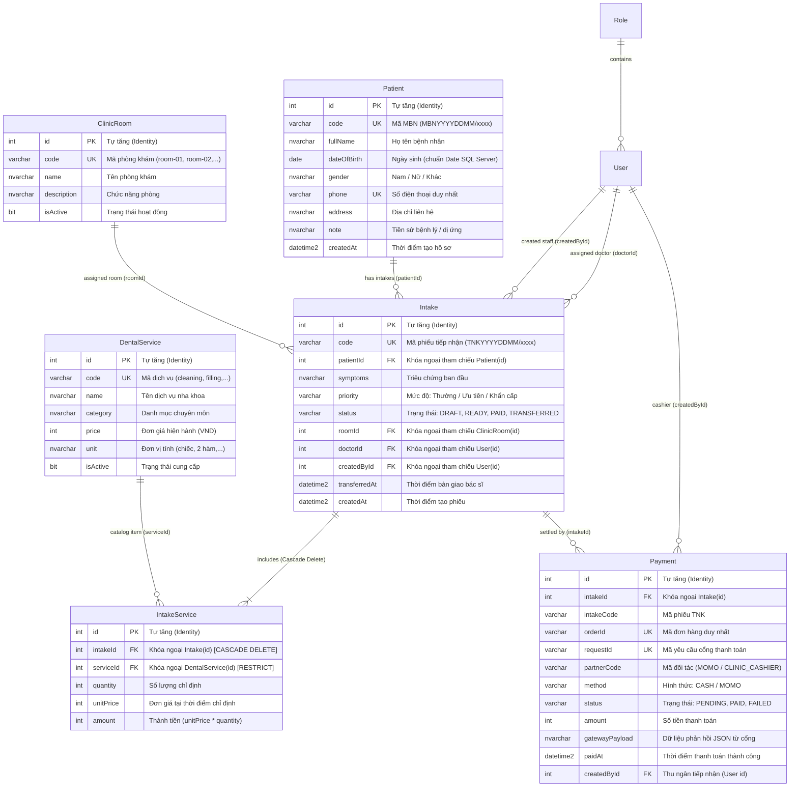

# Báo Cáo Kiểm Tra Toàn Diện: CSDL Quan Hệ & Luồng Quầy Tiếp Nhận (/reception)

> **Dự án:** Dental ERP (Hệ thống quản lý phòng khám nha khoa)  
> **Thời gian cập nhật:** 17/10/2026  
> **Môi trường:** Localhost (Windows 11, Node.js v22, MS SQL Server Express 2017+, NestJS, React 19 + Vite, Prisma ORM v6)  
> **Trạng thái kiểm thử:** ✅ **PASSED (66/66 Automated Tests + E2E DB Integration + 0 Lint Warnings)**

---

## 1. Thiết Kế Cơ Sở Dữ Liệu Quan Hệ (Database Relational Schema)

Hệ thống hoạt động với **16 bảng dữ liệu** trên Microsoft SQL Server thông qua Prisma ORM:
- **8 Bảng vận hành chính (Operational Tables)**: Có hệ thống **Khóa chính (PK), Khóa ngoại (FK) và Ràng buộc duy nhất (Unique / Cascade)** chặt chẽ.
- **8 Bảng sao lưu dự phòng (Backup / Audit *Deleted Tables)**: Khi thực hiện các chức năng xóa dữ liệu, thay vì xóa vĩnh viễn mất dữ liệu, hệ thống tự động POST toàn bộ thông tin bản ghi sang các bảng có hậu tố `Deleted` để lưu trữ lịch sử, phục vụ kiểm toán và khôi phục khi cần thiết.

---

### 1.1. Sơ Đồ Quan Hệ Thực Thể 8 Bảng Vận Hành Chính (ERD)



---

### 1.2. Danh Sách 8 Bảng Sao Lưu Dự Phòng (*Deleted Tables)

Mỗi bảng chính đều có một bảng bản sao tương ứng với hậu tố `Deleted` để lưu trữ dữ liệu bị xóa kèm các trường vết kiểm toán (Audit fields):

| Bảng Chính | Bảng Sao Lưu Dự Phòng | Các Trường Bổ Sung / Đặc Tính Kỹ Thuật |
| :--- | :--- | :--- |
| `Role` | `RoleDeleted` | `originalId` (ID gốc), `deletedAt` (thời điểm xóa), `deletedBy` (người xóa), `deleteReason` (lý do xóa) |
| `User` | `UserDeleted` | Sao lưu toàn bộ thông tin tài khoản, `originalId`, `deletedAt`, `deletedBy`, `deleteReason` |
| `Patient` | `PatientDeleted` | Lưu vết hồ sơ bệnh nhân khi xóa, không chặn trùng số điện thoại trong bảng xóa, có index tra cứu nhanh |
| `ClinicRoom` | `ClinicRoomDeleted` | Lưu vết phòng khám bị xóa hoặc ngừng khai thác |
| `DentalService` | `DentalServiceDeleted` | Lưu vết danh mục dịch vụ bị xóa |
| `Intake` | `IntakeDeleted` | Lưu vết phiếu khám bị xóa, lưu kèm `patientCode` để dễ dàng đối soát lịch sử |
| `IntakeService` | `IntakeServiceDeleted` | Lưu vết các dịch vụ đã chỉ định trong phiếu khám bị xóa |
| `Payment` | `PaymentDeleted` | Lưu vết giao dịch thu tiền / cổng thanh toán bị xóa hoặc hủy bỏ |

> [!NOTE]
> **Đặc tính kỹ thuật của các bảng `*Deleted`:**
> 1. **Khóa chính độc lập**: Mỗi bảng `*Deleted` sở hữu khóa chính `id` tự tăng riêng, cho phép một thực thể có thể được tạo rồi xóa nhiều lần mà không bao giờ gặp lỗi xung đột khóa chính.
> 2. **Chuyển Unique thành Index thông thường**: Các cột như số điện thoại, mã phiếu, mã đơn hàng được chuyển từ `Unique` sang `Index`, đảm bảo việc lưu trữ bản sao dự phòng không bao giờ bị từ chối do trùng giá trị lịch sử.
> 3. **Tự động lưu vết**: Cột `deletedAt` được gắn mặc định `@default(now()) @db.DateTime2` để tự động đóng dấu thời gian chính xác tới microsecond.

---

### 1.3. Bảng Ràng Buộc Khóa Chính (PK), Khóa Ngoại (FK) & Khóa Duy Nhất (UK) Trong SQL Server

| Bảng CSDL | Tên Ràng Buộc (Constraint) | Loại | Cột Áp Dụng | Tham Chiếu / Ý Nghĩa Nghiệp Vụ |
| :--- | :--- | :---: | :--- | :--- |
| `Patient` | `Patient_pkey` | **PK** | `id` (INT) | Khóa chính tự tăng |
| `Patient` | `Patient_code_key` | **UK** | `code` (VARCHAR) | Mã bệnh nhân `MBNYYYYDDMM/xxxx` không trùng lặp |
| `Patient` | `Patient_phone_key` | **UK** | `phone` (VARCHAR) | Chống đăng ký trùng số điện thoại giữa các bệnh nhân |
| `ClinicRoom` | `ClinicRoom_pkey` | **PK** | `id` (INT) | Khóa chính tự tăng |
| `ClinicRoom` | `ClinicRoom_code_key` | **UK** | `code` (VARCHAR) | Mã phòng khám duy nhất (`room-01`, `room-02`, `room-03`) |
| `DentalService` | `DentalService_pkey` | **PK** | `id` (INT) | Khóa chính tự tăng |
| `DentalService` | `DentalService_code_key` | **UK** | `code` (VARCHAR) | Mã dịch vụ danh mục duy nhất (`cleaning`, `filling`,...) |
| `Intake` | `Intake_pkey` | **PK** | `id` (INT) | Khóa chính tự tăng |
| `Intake` | `Intake_code_key` | **UK** | `code` (VARCHAR) | Mã tiếp nhận `TNKYYYYDDMM/xxxx` duy nhất trong ngày |
| `Intake` | `Intake_patientId_fkey` | **FK** | `patientId` | Bắt buộc tham chiếu `Patient.id` (Không thể tạo phiếu nếu không có bệnh nhân) |
| `Intake` | `Intake_roomId_fkey` | **FK** | `roomId` | Tham chiếu `ClinicRoom.id` |
| `Intake` | `Intake_doctorId_fkey` | **FK** | `doctorId` | Tham chiếu `User.id` (Bác sĩ phụ trách) |
| `Intake` | `Intake_createdById_fkey` | **FK** | `createdById` | Tham chiếu `User.id` (Nhân viên tiếp nhận lập phiếu) |
| `IntakeService` | `IntakeService_pkey` | **PK** | `id` (INT) | Khóa chính tự tăng |
| `IntakeService` | `IntakeService_intakeId_serviceId_key` | **UK** | `(intakeId, serviceId)` | Mỗi dịch vụ chỉ xuất hiện 1 dòng trong 1 phiếu khám (tránh trùng lặp) |
| `IntakeService` | `IntakeService_intakeId_fkey` | **FK** | `intakeId` | Tham chiếu `Intake.id` (**ON DELETE CASCADE**: Xóa phiếu thì tự xóa chi tiết) |
| `IntakeService` | `IntakeService_serviceId_fkey` | **FK** | `serviceId` | Tham chiếu `DentalService.id` |
| `Payment` | `Payment_pkey` | **PK** | `id` (INT) | Khóa chính tự tăng |
| `Payment` | `Payment_orderId_key` | **UK** | `orderId` | Mã giao dịch đơn hàng duy nhất |
| `Payment` | `Payment_requestId_key` | **UK** | `requestId` | Mã định danh yêu cầu thanh toán duy nhất |
| `Payment` | `Payment_intakeId_fkey` | **FK** | `intakeId` | Tham chiếu `Intake.id` |
| `Payment` | `Payment_createdById_fkey` | **FK** | `createdById` | Tham chiếu `User.id` (Thu ngân phụ trách) |
| `*Deleted` (8 bảng) | `*_pkey` | **PK** | `id` (INT) | Khóa chính tự tăng độc lập cho mỗi bản sao lưu dự phòng |

---

## 2. Danh Sách API Backend Phục Vụ Toàn Bộ Luồng Tiếp Nhận & Xóa An Toàn

Tất cả các endpoint tiếp nhận đều được bảo vệ bởi `ReceptionAccessGuard` (yêu cầu JWT token hợp lệ với vai trò `RECEPTION_STAFF` hoặc `ADMIN`).

| Phương thức | Endpoint | Nghiệp vụ CSDL | Trạng thái test |
| :--- | :--- | :--- | :---: |
| `GET` | `/api/reception/master-data` | Lấy danh mục phòng (`ClinicRoom`), dịch vụ (`DentalService`), bác sĩ (`User` role `DOCTOR`) | ✅ **PASS** |
| `GET` | `/api/reception/patients` | Lấy danh sách hồ sơ từ bảng `Patient`, sắp xếp theo `createdAt DESC` | ✅ **PASS** |
| `POST` | `/api/reception/patients` | Thêm mới bệnh nhân vào `Patient`, kiểm tra duy nhất SĐT, sinh mã `MBN` | ✅ **PASS** |
| `PUT` | `/api/reception/patients/:code` | Cập nhật hồ sơ bệnh nhân trong `Patient` theo mã `MBN` | ✅ **PASS** |
| `DELETE` | `/api/reception/patients/:code` | **Xóa bệnh nhân**: Tự động sao chép toàn bộ hồ sơ sang `PatientDeleted` (kèm theo các phiếu và dịch vụ liên đới sang `IntakeDeleted`, `IntakeServiceDeleted`) trước khi xóa khỏi bảng chính | ✅ **PASS** |
| `GET` | `/api/reception/intakes` | Lấy danh sách phiếu kèm thông tin bệnh nhân, dịch vụ, phòng khám, bác sĩ, thanh toán | ✅ **PASS** |
| `POST` | `/api/reception/intakes` | Tạo mới phiếu vào `Intake` (`DRAFT`), liên kết `patientId`, sinh mã `TNK` | ✅ **PASS** |
| `PUT` | `/api/reception/intakes/:code/services` | Xóa/tạo mới dòng chi tiết `IntakeService`, cập nhật đơn giá chụp nhanh, gán phòng & bác sĩ, chuyển `READY` | ✅ **PASS** |
| `DELETE` | `/api/reception/intakes/:code` | **Xóa phiếu tiếp nhận**: Tự động sao chép sang `IntakeDeleted` và `IntakeServiceDeleted` trước khi xóa khỏi bảng chính | ✅ **PASS** |
| `POST` | `/api/reception/intakes/:code/pay-cash` | Lưu giao dịch tiền mặt vào `Payment`, cập nhật `Intake.status = 'PAID'` | ✅ **PASS** |
| `POST` | `/api/payments/momo` | Tạo phiên thanh toán trực tuyến MoMo sandbox, lưu `Payment` (`PENDING`) | ✅ **PASS** |
| `POST` | `/api/payments/momo/ipn` | Webhook MoMo xác thực chữ ký, cập nhật `Payment.status = 'PAID'` và tự động chuyển `Intake.status = 'PAID'` | ✅ **PASS** |
| `POST` | `/api/reception/intakes/:code/transfer` | Kiểm tra điều kiện `PAID`, cập nhật `status = 'TRANSFERRED'`, ghi nhận `transferredAt` và khóa hồ sơ | ✅ **PASS** |
| `GET` | `/api/reception/backup/deleted` | Tra cứu danh sách các bản ghi đã xóa được lưu trữ trong các bảng sao lưu `*Deleted` | ✅ **PASS** |

---

## 3. Bảng Tổng Hợp Kết Quả Kiểm Thử (66/66 PASSED)

```
Test Suites: 15 passed, 15 total
Tests:       66 passed, 66 total
Linter:      0 errors, 0 warnings (across all 72 source files)
```

### 3.1. Backend Unit Tests (`apps/api`) — 28/28 PASSED
| File kiểm thử | Số test | Nội dung kiểm thử | Kết quả |
| :--- | :---: | :--- | :---: |
| `src/reception/reception.service.spec.ts` | **14** | Đọc danh mục, sinh mã `MBN`/`TNK`, chống trùng SĐT, chỉ định dịch vụ có lưu đơn giá chụp nhanh, thu tiền mặt, bàn giao bác sĩ, **kiểm thử xóa bệnh nhân tự động sao lưu vào `PatientDeleted` và xóa phiếu tự động sao lưu vào `IntakeDeleted`** | ✅ **PASS** |
| `src/payments/payments.service.spec.ts` | 5 | Tạo thanh toán MoMo, xác thực IPN/Return, tra cứu giao dịch | ✅ **PASS** |
| `src/config/env.validation.spec.ts` | 4 | Kiểm tra biến môi trường, chuỗi kết nối SQL Server, độ dài JWT | ✅ **PASS** |
| `src/payments/momo-signature.spec.ts` | 2 | Tính toán và xác thực chữ ký HMAC SHA256 cho giao dịch MoMo | ✅ **PASS** |
| `src/auth/auth.service.spec.ts` | 2 | Đăng nhập cấp JWT 8h, từ chối mật khẩu không khớp | ✅ **PASS** |
| `src/app.controller.spec.ts` | 1 | Health check endpoint phản hồi `ok` | ✅ **PASS** |

### 3.2. Backend E2E Integration Tests (`apps/api/test`) — 4/4 PASSED
| File kiểm thử | Số test | Nội dung kiểm thử | Kết quả |
| :--- | :---: | :--- | :---: |
| `test/app.e2e-spec.ts` | **4** | Chạy toàn bộ quy trình tiếp nhận trực tiếp trên MS SQL Server: Đăng nhập -> Lấy danh mục -> Tạo bệnh nhân -> Tạo tiếp nhận -> Gán dịch vụ/phòng/bác sĩ -> Thu tiền mặt -> Bàn giao bác sĩ | ✅ **PASS** |

### 3.3. Frontend Unit & Integration Tests (`apps/web`) — 34/34 PASSED
| File kiểm thử | Số test | Nội dung kiểm thử | Kết quả |
| :--- | :---: | :--- | :---: |
| `src/features/reception/reception-pages.test.tsx` | 3 | Kiểm thử tích hợp UI: Tạo bệnh nhân sinh mã `MBN`, tạo phiếu `TNK`, chọn dịch vụ & xuất file Excel | ✅ **PASS** |
| `src/features/reception/payment-page.test.tsx` | 4 | Giao diện thanh toán, xác nhận tiền mặt, chuyển hướng cổng MoMo, xử lý MoMo callback | ✅ **PASS** |
| `src/features/reception/reception-context.test.ts` | 4 | Quản lý state toàn bộ luồng tiếp nhận, đồng bộ trạng thái `PAID` và khóa khi `TRANSFERRED` | ✅ **PASS** |
| `src/features/reception/receipt-excel.test.ts` | 4 | Khởi tạo cấu trúc workbook `.xlsx`, định dạng bảng tính, kiểm tra công thức và ngày Việt Nam | ✅ **PASS** |
| `src/features/reception/reception-data.test.ts` | 5 | Sinh mã định dạng ngày, chống trùng lặp SĐT, tính tổng tiền dịch vụ | ✅ **PASS** |
| `src/lib/role-routes.test.ts` | 6 | Phân quyền route theo vai trò `RECEPTION_STAFF` và các vai trò khác | ✅ **PASS** |
| `src/App.test.tsx` | 5 | Đăng nhập, phân quyền bảo vệ route `/reception`, chuyển trang | ✅ **PASS** |
| `src/lib/auth-session.test.ts` | 3 | Quản lý phiên làm việc trong `localStorage` và xử lý hết hạn token | ✅ **PASS** |

---

## 4. Kiểm Tra Trực Tiếp Trong SQL Server

Có thể chạy lệnh sau trong PowerShell để liệt kê toàn bộ 16 bảng đã được khởi tạo trong CSDL:

```powershell
sqlcmd -S "127.0.0.1,1433" -E -C -d "Graduation-Project" -Q "
  SELECT TABLE_NAME FROM INFORMATION_SCHEMA.TABLES WHERE TABLE_TYPE='BASE TABLE' ORDER BY TABLE_NAME;
"
```

Kết quả trả về:
```
ClinicRoom
ClinicRoomDeleted
DentalService
DentalServiceDeleted
Intake
IntakeDeleted
IntakeService
IntakeServiceDeleted
Patient
PatientDeleted
Payment
PaymentDeleted
Role
RoleDeleted
User
UserDeleted

(16 rows affected)
```
