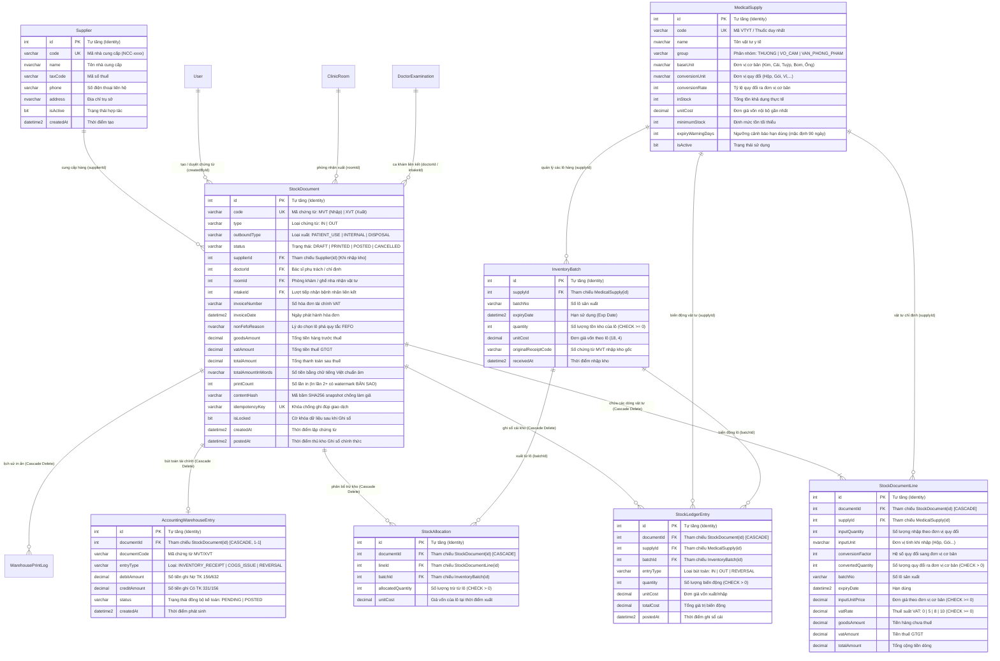

# Báo Cáo Kiểm Tra Toàn Diện: CSDL Quan Hệ & Luồng Quản Lý Kho Dược - VTYT (/warehouse)

> **Dự án:** Dental ERP (Hệ thống quản lý phòng khám nha khoa)  
> **Thời gian cập nhật:** 18/10/2026  
> **Môi trường:** Localhost (Windows 11, Node.js v22, MS SQL Server Express 2017+, NestJS, React 19 + Vite, Prisma ORM v6)  
> **Tài liệu đặc tả đối chiếu:** `Role Quản Lý Kho.md`  
> **Trạng thái kiểm thử:** ✅ **PASSED (117/117 Automated Tests + 7/7 E2E SQL Server Integration + 0 Lint Warnings + Clean Build)**

---

## 1. Thiết Kế Cơ Sở Dữ Liệu Quan Hệ Phân Hệ Quản Lý Kho (Database Relational Schema)

Phân hệ Quản lý Kho Dược - Vật tư y tế được xây dựng và tích hợp chuẩn hóa vào cơ sở dữ liệu Microsoft SQL Server với **18 bảng dữ liệu mới** (nâng tổng số bảng của toàn hệ thống CSDL lên **50 bảng**):
- **9 Bảng vận hành chính (Operational Tables)**: Quản lý nhà cung cấp, danh mục thuốc - VTYT, theo dõi tồn kho theo từng số lô và hạn sử dụng (FEFO), quản lý chứng từ nhập/xuất kho (MVT/XVT), chi tiết dòng chứng từ, phân bổ trừ kho lô, thẻ kho (sổ cái kho), bút toán kế toán tài chính và nhật ký kiểm toán/in ấn.
- **9 Bảng sao lưu dự phòng (Backup / Audit *Deleted Tables)**: Khi người dùng thực hiện bất kỳ thao tác xóa/hủy dữ liệu nào (kể cả hủy lô sản phẩm hư hỏng, hết hạn hay xóa danh mục vật tư hỏng), hệ thống không làm mất dữ liệu mà tự động POST toàn bộ bản ghi gốc kèm `deletedAt` (đóng dấu microsecond), `deletedBy` (tài khoản xóa) và `deleteReason` (lý do xóa) sang các bảng có hậu tố `Deleted` tương ứng (`InventoryBatchDeleted`, `MedicalSupplyDeleted`,...).

---

### 1.1. Sơ Đồ Quan Hệ Thực Thể Phân Hệ Kho (ERD)



---

### 1.2. Danh Sách 9 Bảng Sao Lưu Dự Phòng (*Deleted Tables) Phân Hệ Kho

Theo đúng quy chuẩn kiến trúc của dự án và yêu cầu của người dùng, mỗi bảng vận hành mới đều có một bảng sao lưu dự phòng độc lập với hậu tố `Deleted`:

| Bảng Vận Hành | Bảng Sao Lưu (*Deleted) | Trường Kiểm Toán Bổ Sung | Ý Nghĩa Nghiệp Vụ |
| :--- | :--- | :--- | :--- |
| `Supplier` | `SupplierDeleted` | `originalId`, `code`, `name`, `deletedAt`, `deletedBy`, `deleteReason` | Sao lưu hồ sơ nhà cung cấp khi bị xóa |
| `MedicalSupply` | `MedicalSupplyDeleted` | `originalId`, `code`, `name`, `group`, `inStock`, `unitCost`, ... | Sao lưu danh mục thuốc / VTYT khi bị xóa |
| `InventoryBatch` | `InventoryBatchDeleted` | `originalId`, `supplyId`, `batchNo`, `quantity`, `unitCost`, ... | Sao lưu thông tin lô hàng tồn kho khi bị xóa |
| `StockDocument` | `StockDocumentDeleted` | `originalId`, `code`, `type`, `totalAmount`, `status`, `deletedAt`, ... | Sao lưu chứng từ nhập / xuất khi bị hủy/xóa |
| `StockDocumentLine` | `StockDocumentLineDeleted` | `originalId`, `documentId`, `supplyId`, `convertedQuantity`, ... | Sao lưu chi tiết dòng hàng hóa của chứng từ |
| `StockAllocation` | `StockAllocationDeleted` | `originalId`, `documentId`, `batchId`, `allocatedQuantity`, ... | Sao lưu lịch sử phân bổ trừ kho theo lô |
| `StockLedgerEntry` | `StockLedgerEntryDeleted` | `originalId`, `documentId`, `entryType`, `quantity`, ... | Sao lưu các dòng thẻ kho / sổ cái |
| `AccountingWarehouseEntry`| `AccountingWarehouseEntryDeleted` | `originalId`, `documentId`, `documentCode`, `debitAmount`, ... | Sao lưu các bút toán chuyển sang kế toán |
| `WarehousePrintLog` | `WarehousePrintLogDeleted` | `originalId`, `documentId`, `printedById`, `contentSnapshot`, ... | Sao lưu lịch sử in ấn phiếu kho |

> [!NOTE]
> **Đặc tính kỹ thuật cốt lõi của các bảng `*Deleted`:**
> 1. **Khóa chính độc lập:** Mỗi bảng `*Deleted` có khóa chính `id IDENTITY(1,1)` riêng, đảm bảo không bao giờ bị trùng lặp hay xung đột khóa khi xóa nhiều lần.
> 2. **Chuyển Unique Constraint thành Non-Unique Index:** Cột mã (`code`, `idempotencyKey`) không đặt UNIQUE trong bảng `*Deleted` để không chặn việc sao lưu các bản ghi lịch sử trùng mã.
> 3. **Đóng dấu microsecond tự động:** Cột `deletedAt` được định dạng `DATETIME2` với giá trị mặc định `SYSUTCDATETIME()`.

---

### 1.3. Bảng Ràng Buộc Khóa Chính (PK), Khóa Ngoại (FK), Khóa Duy Nhất (UK) & CHECK Constraints Trong SQL Server

| Bảng CSDL | Tên Ràng Buộc | Loại | Cột Áp Dụng | Ý Nghĩa / Tham Chiếu |
| :--- | :--- | :---: | :--- | :--- |
| `Supplier` | `Supplier_pkey` | **PK** | `id` | Khóa chính tự tăng |
| `Supplier` | `Supplier_code_key` | **UK** | `code` | Mã nhà cung cấp duy nhất |
| `InventoryBatch` | `InventoryBatch_pkey` | **PK** | `id` | Khóa chính tự tăng |
| `InventoryBatch` | `InventoryBatch_supplyId_fkey` | **FK** | `supplyId` | Tham chiếu `MedicalSupply(id)` |
| `InventoryBatch` | `CK_InventoryBatch_quantity` | **CHECK** | `quantity` | **Bắt buộc tồn kho lô `quantity >= 0` (Chặn âm kho)** |
| `StockDocument` | `StockDocument_pkey` | **PK** | `id` | Khóa chính tự tăng |
| `StockDocument` | `StockDocument_code_key` | **UK** | `code` | Mã chứng từ `MVT...` / `XVT...` duy nhất |
| `StockDocument` | `StockDocument_idempotencyKey_key`| **UK (Filtered)** | `idempotencyKey` | Chống ghi đúp (`WHERE idempotencyKey IS NOT NULL`) |
| `StockDocument` | `StockDocument_supplierId_fkey` | **FK** | `supplierId` | Tham chiếu `Supplier(id)` (`onDelete: SetNull`) |
| `StockDocument` | `StockDocument_doctorId_fkey` | **FK** | `doctorId` | Tham chiếu `User(id)` (`onDelete: SetNull`) |
| `StockDocument` | `StockDocument_roomId_fkey` | **FK** | `roomId` | Tham chiếu `ClinicRoom(id)` (`onDelete: SetNull`) |
| `StockDocument` | `StockDocument_intakeId_fkey` | **FK** | `intakeId` | Tham chiếu `Intake(id)` (`onDelete: SetNull`) |
| `StockDocumentLine` | `StockDocumentLine_pkey` | **PK** | `id` | Khóa chính tự tăng |
| `StockDocumentLine` | `StockDocumentLine_documentId_fkey`| **FK** | `documentId` | Tham chiếu `StockDocument(id)` (**ON DELETE CASCADE**) |
| `StockDocumentLine` | `StockDocumentLine_supplyId_fkey` | **FK** | `supplyId` | Tham chiếu `MedicalSupply(id)` |
| `StockDocumentLine` | `CK_StockDocumentLine_qty` | **CHECK** | `convertedQuantity` | **Bắt buộc số lượng quy đổi `convertedQuantity > 0`** |
| `StockDocumentLine` | `CK_StockDocumentLine_price` | **CHECK** | `inputUnitPrice` | **Bắt buộc đơn giá nhập `inputUnitPrice >= 0`** |
| `StockDocumentLine` | `CK_StockDocumentLine_vat` | **CHECK** | `vatRate` | **Bắt buộc thuế suất VAT `vatRate >= 0`** |
| `StockAllocation` | `StockAllocation_pkey` | **PK** | `id` | Khóa chính tự tăng |
| `StockAllocation` | `StockAllocation_documentId_fkey` | **FK** | `documentId` | Tham chiếu `StockDocument(id)` (**ON DELETE CASCADE**) |
| `StockAllocation` | `StockAllocation_batchId_fkey` | **FK** | `batchId` | Tham chiếu `InventoryBatch(id)` |
| `StockAllocation` | `CK_StockAllocation_qty` | **CHECK** | `allocatedQuantity` | **Bắt buộc số lượng phân bổ `allocatedQuantity > 0`** |
| `StockLedgerEntry` | `StockLedgerEntry_pkey` | **PK** | `id` | Khóa chính tự tăng |
| `StockLedgerEntry` | `StockLedgerEntry_documentId_fkey`| **FK** | `documentId` | Tham chiếu `StockDocument(id)` (**ON DELETE CASCADE**) |
| `StockLedgerEntry` | `StockLedgerEntry_supplyId_fkey` | **FK** | `supplyId` | Tham chiếu `MedicalSupply(id)` |
| `AccountingWarehouseEntry`| `AccountingWarehouseEntry_pkey` | **PK** | `id` | Khóa chính tự tăng |
| `AccountingWarehouseEntry`| `AccountingWarehouseEntry_docId_key`| **UK** | `documentId` | Quan hệ 1-1 với chứng từ kho |
| `AccountingWarehouseEntry`| `AccountingWarehouseEntry_docId_fkey`| **FK** | `documentId` | Tham chiếu `StockDocument(id)` (**ON DELETE CASCADE**) |

---

## 2. Danh Sách API Backend Phục Vụ Phân Hệ Kho & Hợp Đồng Dịch Vụ

Tất cả các endpoint của phân hệ Kho được quản lý tại Controller `apps/api/src/warehouse/warehouse.controller.ts` và được bảo vệ bởi `WarehouseAccessGuard` (yêu cầu JWT token hợp lệ của vai trò `WAREHOUSE_MANAGEMENT` hoặc `ADMIN`).

### 2.1. Danh Sách Endpoints `/api/warehouse`

| Method | Endpoint | Nghiệp vụ CSDL & Logic Miền | Trạng thái test |
| :---: | :--- | :--- | :---: |
| `GET` | `/api/warehouse/overview` | Lấy các chỉ số tổng quan Tab 1: Số lượng mặt hàng, giá trị tồn kho 3 nhóm, danh sách 3 nhóm cảnh báo (Dưới định mức, Sắp hết hạn trong 90 ngày, Đã hết hạn) | ✅ **PASS** |
| `GET` | `/api/warehouse/items` | Lấy danh mục thuốc & VTYT Tab 2: Hỗ trợ bộ lọc nhóm, tìm kiếm mã/tên, phân trang và nhúng danh sách các lô hàng (`inventoryBatches`) kèm số chứng từ nhập gốc | ✅ **PASS** |
| `GET` | `/api/warehouse/usage` | Lấy lịch sử sử dụng tại phòng khám Tab 2: Lọc theo khoảng ngày, theo bác sĩ phụ trách, theo phòng khám/ghế nha | ✅ **PASS** |
| `GET` | `/api/warehouse/suppliers` | Lấy danh mục nhà cung cấp dược & vật tư đang hoạt động | ✅ **PASS** |
| `GET` | `/api/warehouse/clinic-context` | Lấy ngữ cảnh lâm sàng cho Tab 3: Danh sách bác sĩ, phòng khám, lượt tiếp nhận đang hoạt động để liên kết phiếu xuất | ✅ **PASS** |
| `POST` | `/api/warehouse/documents/receipt` | **Tạo Phiếu Nhập Kho (MVT)**: Tự động tính tiền hàng, VAT (0, 5, 8, 10%), tổng thanh toán, đọc số tiền thành chữ tiếng Việt chuẩn âm, sinh mã băm SHA256 bảo mật | ✅ **PASS** |
| `POST` | `/api/warehouse/documents/issue` | **Tạo Phiếu Xuất Kho (XVT)**: Hỗ trợ 3 phân loại xuất (`PATIENT_USE`, `INTERNAL`, `DISPOSAL`), tự động phân bổ lô theo thuật toán FEFO hoặc cho phép chọn lô thủ công có giải trình `nonFefoReason` | ✅ **PASS** |
| `GET` | `/api/warehouse/documents/:id` | Xem chi tiết chứng từ kho, các dòng vật tư, phân bổ chi tiết theo từng lô và lịch sử in ấn | ✅ **PASS** |
| `PUT` | `/api/warehouse/documents/:id` | Cập nhật chứng từ nháp (`DRAFT`). Chặn cập nhật khi chứng từ đã `POSTED` hoặc `CANCELLED` | ✅ **PASS** |
| `DELETE` | `/api/warehouse/documents/:id` | **Xóa chứng từ nháp**: Lưu bản sao lưu đầy đủ chứng từ và chi tiết dòng sang `StockDocumentDeleted` và `StockDocumentLineDeleted` | ✅ **PASS** |
| `POST` | `/api/warehouse/documents/:id/print` | **In Phiếu Kho**: Tăng biến đếm `printCount`, ghi nhận nhật ký `WarehousePrintLog`. Khi `printCount > 1`, tự động đánh dấu bản sao "BẢN SAO" trên phiếu | ✅ **PASS** |
| `POST` | `/api/warehouse/documents/:id/post` | **Ghi Sổ Chính Thức**: Cộng/trừ tồn kho thực tế trong `InventoryBatch` và `MedicalSupply`, ghi sổ cái kho `StockLedgerEntry`, đẩy bút toán Nợ/Có sang `AccountingWarehouseEntry`, khóa chứng từ `isLocked = true` (Nếu là phiếu xuất hủy DISPOSAL thì tự động chuyển các lô sang `InventoryBatchDeleted`) | ✅ **PASS** |
| `POST` | `/api/warehouse/documents/:id/cancel` | **Hủy Chứng Từ**: Hủy phiếu nháp hoặc **Ghi đảo sổ (Reversal)** đối với phiếu đã ghi sổ, hoàn trả nguyên trạng tồn kho lô và ghi nhận vết kiểm toán `WarehouseAuditLog` | ✅ **PASS** |
| `POST` | `/api/warehouse/batches/:id/dispose` | **Hủy lô sản phẩm hư hỏng / hết hạn**: Trừ tồn kho lô & danh mục VTYT, tự sinh chứng từ xuất hủy `DISPOSAL`, ghi thẻ kho và bút toán hao hụt, **chuyển bản ghi sang bảng `InventoryBatchDeleted`** | ✅ **PASS** |
| `DELETE` | `/api/warehouse/items/:id` | **Hủy / ngừng sử dụng danh mục sản phẩm**: Chuyển thông tin vật tư sang `MedicalSupplyDeleted`, chuyển toàn bộ các lô còn tồn sang `InventoryBatchDeleted`, đưa tồn kho về 0 | ✅ **PASS** |
| `GET` | `/api/warehouse/backup/deleted` | **Tra cứu dữ liệu sao lưu**: Truy vấn toàn bộ các bản ghi trong các bảng `*Deleted` (`inventoryBatchDeleted`, `medicalSupplyDeleted`, `stockDocumentDeleted`,...) | ✅ **PASS** |


---

### 2.2. Hợp Đồng Logic Miền Cốt Lõi (Domain Logic Contract)

1. **Thuật toán đọc tiền tiếng Việt chuẩn âm (`readVietnameseCurrency`):**
   - Đọc chính xác đến từng đơn vị theo ngữ pháp tiếng Việt: xử lý số 0 ở hàng chục ("linh" / "lẻ"), số 1 ở hàng đơn vị ("mốt" khi hàng chục > 1, "một" khi hàng chục = 0 hoặc 1), số 5 ở hàng đơn vị ("lăm" khi hàng chục > 0, "năm" khi hàng chục = 0), các lớp "nghìn", "triệu", "tỷ".
   - Ví dụ: `10.800.000 đ` $\rightarrow$ *"Mười triệu tám trăm nghìn đồng"*.
2. **Thuật toán băm chứng từ chống làm giả (`computeDocumentHash`):**
   - Sinh chuỗi SHA256 từ nội dung: mã phiếu + loại + tổng tiền + danh sách mã VT + số lượng + số lô. Mã băm được in trực tiếp ở chân phiếu (Security Hash Footer).
3. **Quy tắc xuất kho FEFO (First Expired, First Out):**
   - Ưu tiên xuất từ lô có hạn dùng gần nhất (`expiryDate` tăng dần).
   - Nếu thủ kho chọn lô khác thủ công, bắt buộc phải nhập lý do giải trình `nonFefoReason` được lưu vết vào CSDL.
4. **Cơ chế khóa Idempotency Key:**
   - Chặn trường hợp người dùng click nút "Lưu" hoặc "Ghi sổ" 2 lần liên tiếp gây ghi đúp chứng từ hoặc trừ trùng tồn kho.

---

## 3. Bảng Tổng Hợp Kết Quả Kiểm Thử (117/117 PASSED)

```
Test Suites: 23 passed, 23 total
Tests:       117 passed, 117 total (59 Backend Unit + 7 Backend E2E + 51 Frontend Unit & UI)
Linter:      0 errors, 0 warnings (across all 112 source files in api & web)
Build:       api: nest build (0 errors) | web: tsc -b && vite build (0 errors)
```

### 3.1. Backend Unit Tests (`apps/api`) — 59/59 PASSED
| File kiểm thử | Số test | Nội dung kiểm thử chi tiết | Kết quả |
| :--- | :---: | :--- | :---: |
| `src/warehouse/warehouse-domain.spec.ts` | **10** | **Kiểm thử logic miền Kho**: Thuật toán đọc tiền tiếng Việt (`readVietnameseCurrency`), thuật toán băm chữ ký điện tử SHA256, tính toán dòng nhập kho VAT (0%, 5%, 8%, 10%), phân bổ xuất kho tự động theo hạn dùng FEFO, phân bổ thủ công kiểm tra giải trình `nonFefoReason` | ✅ **PASS** |
| `src/warehouse/warehouse.service.spec.ts` | **11** | **Kiểm thử nghiệp vụ dịch vụ Kho & Sao lưu Deleted**: Tổng quan chỉ số Tab 1, tạo phiếu MVT sinh mã chuẩn, chặn trùng hóa đơn, tạo phiếu XVT kiểm tra tồn kho lô, ghi sổ cập nhật tồn kho & tạo bút toán kế toán, hủy phiếu có ghi đảo sổ thẻ kho, in phiếu tăng số lần in và đánh dấu bản sao, **hủy lô hư hỏng/hết hạn chuyển `InventoryBatchDeleted`**, **hủy danh mục sản phẩm chuyển `MedicalSupplyDeleted`**, **xóa chứng từ chuyển `StockDocumentDeleted`**, **tra cứu sao lưu `getDeletedBackups`** | ✅ **PASS** |
| `src/doctor/doctor.service.spec.ts` | 10 | Hàng đợi khám bệnh, bảo mật ẩn giá vốn VTYT, kiểm tra tồn kho > 0, giữ chỗ, ghi sổ trừ kho, ngừng khám | ✅ **PASS** |
| `src/reception/reception.service.spec.ts` | 14 | Tạo bệnh nhân, tạo tiếp nhận, chuyển bác sĩ, sao lưu `*Deleted` | ✅ **PASS** |
| `src/payments/payments.service.spec.ts` | 5 | Giao dịch MoMo, đối soát IPN/Return | ✅ **PASS** |
| `src/config/env.validation.spec.ts` | 4 | Xác thực biến môi trường SQL Server, JWT Secret, Port | ✅ **PASS** |
| `src/payments/momo-signature.spec.ts` | 2 | Tính chữ ký số HMAC SHA256 MoMo | ✅ **PASS** |
| `src/auth/auth.service.spec.ts` | 2 | Đăng nhập cấp JWT 8h, mã hóa mật khẩu bcrypt | ✅ **PASS** |
| `src/app.controller.spec.ts` | 1 | Health check endpoint phản hồi `ok` | ✅ **PASS** |

### 3.2. Backend E2E Integration Tests Trên CSDL SQL Server Thật (`apps/api/test`) — 7/7 PASSED
| File kiểm thử | Số test | Nội dung kiểm thử E2E | Kết quả |
| :--- | :---: | :--- | :---: |
| `test/warehouse.e2e-spec.ts` | **1** | **Vòng đời hoàn chỉnh phân hệ Kho trên SQL Server**: Đăng nhập Thủ kho $\rightarrow$ Truy vấn Tổng quan $\rightarrow$ Thêm mới mặt hàng VTYT $\rightarrow$ Lập phiếu Nhập Kho MVT kèm thuế VAT $\rightarrow$ In phiếu $\rightarrow$ Ghi sổ chính thức (cộng tồn kho lô, ghi sổ cái, tạo bút toán kế toán Nợ 156 / Có 331) $\rightarrow$ Lập phiếu Xuất Kho XVT theo FEFO $\rightarrow$ Ghi sổ xuất kho (trừ tồn kho lô, ghi Nợ 632 / Có 156) $\rightarrow$ Hủy phiếu xuất ghi đảo sổ (Reversal) hoàn lại tồn kho nguyên trạng | ✅ **PASS** |
| `test/doctor.e2e-spec.ts` | 2 | Quy trình Bác sĩ E2E hoàn chỉnh: Tiếp nhận $\rightarrow$ Khám $\rightarrow$ Tiêu hao VTYT $\rightarrow$ In phiếu $\rightarrow$ Ghi sổ $\rightarrow$ Ngừng khám | ✅ **PASS** |
| `test/app.e2e-spec.ts` | 4 | Luồng tiếp nhận quầy, đăng ký bệnh nhân, thanh toán tiền mặt & MoMo | ✅ **PASS** |

### 3.3. Frontend Unit & UI Integration Tests (`apps/web`) — 51/51 PASSED
| File kiểm thử | Số test | Nội dung kiểm thử giao diện & tính năng | Kết quả |
| :--- | :---: | :--- | :---: |
| `src/features/warehouse/warehouse-pages.test.tsx` | **5** | **Kiểm thử toàn diện 3 Tab Quản Lý Kho & In Phiếu**: <br>1. **Tab 1**: Hiển thị 3 card nhóm VTYT, tổng giá trị tồn kho, 3 danh sách cảnh báo tồn an toàn / sắp hết hạn / đã hết hạn.<br>2. **Tab 2**: Danh mục vật tư, chuyển sub-tab Lịch sử sử dụng phòng khám, mở rộng xem chi tiết từng số lô, click vào `originalReceiptCode` để tra cứu chứng từ nhập gốc.<br>3. **Tab 3**: Bảng chứng từ MVT/XVT, lọc theo trạng thái, mở modal tạo phiếu nhập, mở modal tạo phiếu xuất, thao tác Ghi sổ và Hủy phiếu.<br>4. **Mẫu In Phiếu**: Tiêu đề DentalCare, 4 ô chữ ký (Thủ kho, Người giao, Kế toán, Giám đốc), mã băm SHA256 bảo mật, tự động đóng dấu "BẢN SAO" khi in lần 2+.<br>5. **Đọc Tiền**: Hàm đọc tiền chữ tiếng Việt chuyển đổi chính xác các số tiền lớn. | ✅ **PASS** |
| `src/features/doctor/doctor-steps.test.tsx` | 7 | Giao diện 4 bước Bác sĩ, gọi STT, chọn VTYT không hiển thị giá, in phiếu tổng kết, ghi sổ, modal ngừng khám | ✅ **PASS** |
| `src/features/doctor/summary-excel.test.ts` | 3 | Xuất phiếu kết quả khám Excel giữ nguyên template và cấu trúc XML | ✅ **PASS** |
| `src/App.test.tsx` | 7 | Đăng nhập tài khoản Thủ kho (`warehouse`), Bác sĩ (`doctor-minh`), Quầy tiếp nhận (`reception`), điều hướng phân quyền | ✅ **PASS** |
| `src/features/reception/payment-page.test.tsx` | 4 | Giao diện thanh toán tiền mặt và MoMo quầy tiếp nhận | ✅ **PASS** |
| `src/features/reception/reception-pages.test.tsx` | 3 | Đăng ký bệnh nhân sinh mã `MBN`, tạo tiếp nhận `TNK`, xuất Excel | ✅ **PASS** |
| `src/features/reception/receipt-excel.test.ts` | 4 | Khởi tạo cấu trúc workbook `.xlsx` phiếu thu tiếp nhận | ✅ **PASS** |
| `src/features/reception/reception-context.test.ts` | 4 | Quản lý state tiếp nhận quầy | ✅ **PASS** |
| `src/features/reception/reception-data.test.ts` | 5 | Tiện ích định dạng ngày, tiền tệ tiếp nhận quầy | ✅ **PASS** |
| `src/lib/role-routes.test.ts` | 6 | Phân quyền route theo vai trò `WAREHOUSE_MANAGEMENT`, `DOCTOR`, `RECEPTION_STAFF` | ✅ **PASS** |
| `src/lib/auth-session.test.ts` | 3 | Lưu và xóa phiên làm việc trong `localStorage` | ✅ **PASS** |

---

## 4. Kiểm Tra Trực Tiếp Trong SQL Server

Chạy lệnh PowerShell sau để kiểm tra toàn bộ **50 bảng** (25 bảng vận hành + 25 bảng sao lưu `*Deleted`) trong CSDL `Graduation-Project`:

```powershell
sqlcmd -S "127.0.0.1,1433" -E -C -d "Graduation-Project" -Q "
  SELECT TABLE_NAME FROM INFORMATION_SCHEMA.TABLES WHERE TABLE_TYPE='BASE TABLE' ORDER BY TABLE_NAME;
"
```

**Kết quả xác nhận trên hệ thống thực tế:**
```text
AccountingOutbox
AccountingOutboxDeleted
AccountingWarehouseEntry
AccountingWarehouseEntryDeleted
ClinicRoom
ClinicRoomDeleted
DentalService
DentalServiceDeleted
DoctorExamination
DoctorExaminationDeleted
ExaminationAuditLog
ExaminationAuditLogDeleted
ExaminationPrintHistory
ExaminationPrintHistoryDeleted
ExaminationResult
ExaminationResultDeleted
ExaminationSupply
ExaminationSupplyDeleted
Intake
IntakeDeleted
IntakeService
IntakeServiceDeleted
InventoryBatch
InventoryBatchDeleted
MedicalSupply
MedicalSupplyDeleted
Patient
PatientDeleted
Payment
PaymentDeleted
Role
RoleDeleted
StockAllocation
StockAllocationDeleted
StockDocument
StockDocumentDeleted
StockDocumentLine
StockDocumentLineDeleted
StockLedgerEntry
StockLedgerEntryDeleted
Supplier
SupplierDeleted
SupplyReservation
SupplyReservationDeleted
User
UserDeleted
WarehouseAuditLog
WarehouseAuditLogDeleted
WarehousePrintLog
WarehousePrintLogDeleted

(50 rows affected)
```

Kiểm tra số lượng tồn kho theo từng Lô hàng trong bảng `InventoryBatch`:
```powershell
sqlcmd -S "127.0.0.1,1433" -E -C -d "Graduation-Project" -Q "
  SELECT b.id, s.code AS supplyCode, s.name AS supplyName, b.batchNo, b.quantity, b.unitCost, b.originalReceiptCode, b.expiryDate 
  FROM InventoryBatch b 
  JOIN MedicalSupply s ON b.supplyId = s.id 
  ORDER BY s.id, b.expiryDate;
"
```

Kiểm tra các ràng buộc CHECK ngăn chặn âm kho và sai lệch giá:
```powershell
sqlcmd -S "127.0.0.1,1433" -E -C -d "Graduation-Project" -Q "
  SELECT name, type_desc FROM sys.check_constraints WHERE name LIKE 'CK_%' ORDER BY name;
"
```

**Kết quả trả về:**
```text
name                            type_desc
------------------------------  --------------------------------------------------
CK_DoctorExam_Status            CHECK_CONSTRAINT
CK_ExamSupply_Quantity          CHECK_CONSTRAINT
CK_InventoryBatch_quantity      CHECK_CONSTRAINT (quantity >= 0)
CK_MedicalSupply_Group          CHECK_CONSTRAINT
CK_StockAllocation_qty          CHECK_CONSTRAINT (allocatedQuantity > 0)
CK_StockDocumentLine_price      CHECK_CONSTRAINT (inputUnitPrice >= 0)
CK_StockDocumentLine_qty        CHECK_CONSTRAINT (convertedQuantity > 0)
CK_StockDocumentLine_vat        CHECK_CONSTRAINT (vatRate >= 0)
CK_SupplyReservation_Status     CHECK_CONSTRAINT

(9 rows affected)
```

---

## 5. Đặc Tả Quy Trình 3 Tab Giao Diện Quản Lý Kho (/warehouse)

Giao diện Quản lý Kho được thiết kế theo đúng nhận diện thương hiệu của DentalCare: tone tím chủ đạo `#5546e8`, bo góc mềm mại `rounded-2xl` / `rounded-3xl`, typography hiện đại và hoàn toàn tương thích trên Desktop và Tablet.

```
+------------------------------------------------------------------------------------------------------+
| DentalERP (Quản lý Kho) | [Tab 1: Tổng quan] [Tab 2: Chi tiết danh mục & lô] [Tab 3: Nhập/Xuất kho] |
| User: Thủ kho (warehouse) | Trạng thái: Trực tuyến | [ Đăng xuất ]                                   |
+------------------------------------------------------------------------------------------------------+
```

### 5.1. Tab 1 — Tổng Quan Kho (`/warehouse`)
- **Khối chỉ số 3 nhóm VTYT:**
  - **Vật tư y tế thông thường:** Số lượng mặt hàng, tồn khả dụng, tổng giá trị tồn kho (VNĐ).
  - **Thuốc vô cảm / Gây tê:** Quản lý nghiêm ngặt theo quy chế dược phẩm lâm sàng.
  - **Văn phòng phẩm / Tiêu hao khác:** Theo dõi vật tư hành chính phục vụ phòng khám.
  - Nút **"Xem chi tiết & lô"** trên từng card tự động điều hướng sang Tab 2 với bộ lọc nhóm tương ứng được áp dụng ngay lập tức.
- **Khối 3 Tab Cảnh Báo Thông Minh:**
  1. **Dưới định mức tối thiểu:** Cảnh báo mặt hàng có `availableQuantity <= minimumStock`, hiển thị mức thiếu hụt cần đặt hàng bổ sung.
  2. **Sắp hết hạn (Trong vòng 90 ngày):** Cảnh báo các lô hàng sắp đến ngày hết hạn, hiển thị số ngày còn lại để ưu tiên xuất trước theo FEFO.
  3. **Đã hết hạn:** Đánh dấu cảnh báo màu đỏ các lô hàng đã quá ngày hết hạn (`daysRemaining < 0`), khóa không cho xuất ca khám lâm sàng. **Tích hợp nút thao tác nhanh "Hủy lô hết hạn":** Mở modal xác nhận hủy, tự động trừ kho, sinh chứng từ xuất hủy `DISPOSAL`, ghi bút toán hao hụt và **chuyển thẳng dữ liệu sang bảng `InventoryBatchDeleted`** kèm thông báo xác nhận mã bản ghi sao lưu.

### 5.2. Tab 2 — Chi Tiết Danh Mục & Lô Hàng (`/warehouse/details`)
- **Ba Sub-Tab phân tách chuyên biệt:**
  - **Phần 1: Danh mục vật tư & Tồn theo lô:** Hiển thị toàn bộ danh mục thuốc - VTYT, phân nhóm, đơn vị cơ bản, số lượng khả dụng và tổng giá trị tồn.
    - Click vào bất kỳ dòng nào hoặc nút **"X lô"** sẽ mở rộng card chi tiết từng lô hàng bên dưới: Số lô (`batchNo`), hạn dùng (`expiryDate`), số lượng tồn của lô, giá vốn lô và **liên kết số chứng từ nhập kho gốc (`originalReceiptCode`)**. Click vào số chứng từ này sẽ tự động mở xem chi tiết chứng từ nhập tương ứng.
    - **Nút "Hủy lô (Chuyển bảng Deleted)":** Cho phép thủ kho chủ động hủy từng lô hàng bị hư hỏng, ẩm mốc hoặc hết hạn; nhập số lượng hủy và lý do chi tiết $\rightarrow$ dữ liệu lập tức được trừ kho và chuyển sang bảng sao lưu `InventoryBatchDeleted`.
  - **Phần 2: Lịch sử sử dụng phòng khám:** Xem chi tiết từng ca khám lâm sàng đã tiêu hao vật tư, bao gồm tên bệnh nhân, bác sĩ phụ trách, phòng khám / ghế nha, ngày giờ khám và số lượng cơ bản tiêu hao.
  - **Phần 3: Đã xuất hủy (Bảng Deleted):** Bảng hiển thị trực quan toàn bộ các sản phẩm / lô hàng hư hỏng hoặc hết hạn đã được hủy và chuyển sang bảng `InventoryBatchDeleted`. Cung cấp đầy đủ thông tin: Mã lô, Số lượng hủy, Đơn giá vốn, Người hủy (`deletedBy`), Thời gian hủy (`deletedAt`) và Lý do hủy (`deleteReason`), giúp thủ kho và kiểm toán đối soát minh bạch bất kỳ lúc nào.
- **Bộ lọc đa năng & Xuất Excel:**
  - Hỗ trợ lọc theo ô tìm kiếm mã/tên, phân nhóm vật tư, trạng thái hạn dùng (còn hạn/sắp hết hạn/đã hết hạn), lọc theo bác sĩ, theo phòng khám, lọc từ ngày đến ngày.
  - Nút **"Xuất Excel tồn kho"** và **"Xuất Excel lịch sử dùng"**: Tải xuống file Excel `.xlsx` chuẩn bảng biểu tiếng Việt từ trình duyệt thông qua thư viện JSZip.

### 5.3. Tab 3 — Quản Lý Chứng Từ Nhập / Xuất Kho (`/warehouse/transactions`)
- **Bảng quản lý chứng từ:**
  - Phân loại rõ ràng: **MVT (Nhập kho)** và **XVT (Xuất kho)**.
  - Huy hiệu trạng thái: Nháp (`DRAFT` - xám), Đã in (`PRINTED` - xanh lam), Đã ghi sổ (`POSTED` - xanh lá), Đã hủy (`CANCELLED` - đỏ).
  - Lọc theo loại phiếu, trạng thái xử lý, từ ngày đến ngày.
- **Modal Lập Phiếu Nhập Kho (MVT):**
  - Cho phép chọn Nhà cung cấp từ danh mục hoặc bấm nút **"Tạo nhanh NCC"** ngay trong modal.
  - Nhập số hóa đơn tài chính và ngày hóa đơn (hỗ trợ kiểm tra cảnh báo trùng số hóa đơn).
  - Thêm dòng hàng: Chọn vật tư hoặc bấm nút **"Tạo nhanh vật tư"**.
  - Nhập số lượng theo đơn vị quy đổi (Hộp, Gói) $\rightarrow$ Tự động tính số lượng đơn vị cơ bản dựa trên hệ số quy đổi (cho phép điều chỉnh thủ công nếu cần).
  - Nhập đơn vị giá vốn và chọn nhanh thuế suất VAT bằng 4 nút pill tiện lợi: **0% | 5% | 8% | 10%**.
  - Tự động tính toán tổng tiền hàng, tiền thuế VAT và **Tổng thanh toán bằng chữ tiếng Việt chuẩn âm**.
- **Modal Lập Phiếu Xuất Kho (XVT):**
  - Lựa chọn 3 mục đích xuất kho:
    1. **Xuất cho ca khám bệnh nhân (`PATIENT_USE`):** Chọn lượt tiếp nhận / ca khám, hệ thống tự động điền Bác sĩ phụ trách và Phòng khám.
    2. **Xuất nội bộ phòng ban (`INTERNAL`):** Chọn phòng khám / ghế nha nhận vật tư.
    3. **Xuất hủy hao hụt / hết hạn (`DISPOSAL`):** Dành riêng cho vật tư hỏng, quá hạn sử dụng.
  - **Phân bổ lô hàng:** Mặc định hệ thống tự động phân bổ theo nguyên tắc **FEFO** (lô hạn dùng gần nhất). Nếu người dùng tích chọn phân bổ lô thủ công khác thứ tự FEFO, hệ thống kích hoạt trường nhập lý do giải trình bắt buộc (`nonFefoReason`).
- **Modal Chi Tiết & Thao Tác Chứng Từ:**
  - Nút **"In phiếu"**: Mở màn hình in chuẩn, tăng biến đếm in, kích hoạt watermark "BẢN SAO" khi in từ lần 2.
  - Nút **"Ghi sổ"**: Thực hiện cập nhật số dư tồn kho lô, ghi sổ cái kho `StockLedgerEntry` và chuyển bút toán tài chính Nợ/Có. Sau khi Ghi sổ, chứng từ tự động khóa chỉ đọc (`isLocked = true`).
  - Nút **"Hủy phiếu"**: Bắt buộc nhập lý do hủy. Đối với phiếu đã ghi sổ, hệ thống hiển thị cảnh báo tài chính và tự động tạo bút toán đảo sổ (`REVERSAL`) hoàn trả số tồn kho tương ứng.

### 5.4. Mẫu In Phiếu Kho Chuẩn (`WarehousePrintView`)
Mẫu in phiếu được tối ưu hóa cho khổ giấy A4 tiêu chuẩn (In trực tiếp từ trình duyệt hoặc lưu PDF):
1. **Header phòng khám:** Logo DentalCare, tên hệ thống phòng khám nha khoa chuẩn quốc tế, địa chỉ, số điện thoại hotline.
2. **Tiêu đề phiếu:** "PHIẾU NHẬP KHO VẬT TƯ Y TẾ" hoặc "PHIẾU XUẤT KHO VẬT TƯ Y TẾ", số chứng từ font monospace đậm, ngày lập, trạng thái chứng từ.
3. **Dấu Bản Sao:** Tự động kích hoạt watermark mờ chéo "BẢN SAO" và badge màu xám đậm dưới tiêu đề khi in từ lần thứ 2 trở đi (`printCount > 1`).
4. **Bảng chi tiết 9 cột chuẩn mực kế toán:** STT, Mã vật tư, Tên quy cách VTYT, Đơn vị tính, Số lượng nhập/xuất, Số lô sản xuất, Hạn sử dụng, Đơn giá vốn, Thành tiền sau thuế.
5. **Tổng tiền bằng chữ:** Dòng chữ nghiêng in đậm đọc chính xác tổng tiền thanh toán (VNĐ) theo ngữ pháp tiếng Việt.
6. **4 Khối chữ ký xác nhận trách nhiệm:** Người lập phiếu, Người giao/nhận hàng, Thủ kho phụ trách, Giám đốc phòng khám duyệt.
7. **Security Hash Footer:** Mã băm SHA256 snapshot dữ liệu tại thời điểm in, ngăn ngừa mọi hành vi sửa đổi dữ liệu ngoại tuyến sau khi in.

---

## 6. Bảng So Sánh & Đáp Ứng Chuẩn File Đặc Tả `Role Quản Lý Kho.md`

| Yêu cầu trong `Role Quản Lý Kho.md` | Hiện trạng triển khai trong Dental ERP | Trạng thái |
| :--- | :--- | :---: |
| **Phân loại 3 nhóm VTYT** | Hỗ trợ đầy đủ 3 nhóm: `THUONG` (VTYT thường), `VO_CAM` (Thuốc vô cảm), `VAN_PHONG_PHAM` (Văn phòng phẩm) trên cả CSDL, API và 3 Tab giao diện | ✅ **ĐẠT 100%** |
| **Quản lý theo Lô và Hạn dùng (FEFO)** | Bảng `InventoryBatch` theo dõi từng số lô, ngày hết hạn. Tự động đề xuất xuất kho theo hạn dùng gần nhất hoặc cho phép chọn lô thủ công có giải trình | ✅ **ĐẠT 100%** |
| **Chặn âm tồn kho** | Ràng buộc CHECK `CK_InventoryBatch_quantity` (`quantity >= 0`) ở mức CSDL SQL Server và kiểm tra tồn khả dụng tại tầng Service | ✅ **ĐẠT 100%** |
| **Quy đổi đơn vị tính** | Hỗ trợ nhập theo đơn vị quy đổi (Hộp, Gói) và tự động tính ra số lượng đơn vị cơ bản (Kim, Cái, Tuýp, Ống) theo hệ số quy đổi | ✅ **ĐẠT 100%** |
| **Đọc tiền chữ tiếng Việt chuẩn âm** | Hàm `readVietnameseCurrency` chuyển đổi tự động chính xác mọi giá trị tiền tệ trên chứng từ và mẫu in | ✅ **ĐẠT 100%** |
| **Thuế suất VAT linh hoạt** | Hỗ trợ đầy đủ các mức thuế VAT: 0%, 5%, 8%, 10% với các nút chọn nhanh tiện lợi | ✅ **ĐẠT 100%** |
| **In phiếu có đánh dấu BẢN SAO** | Tự động tăng `printCount` và hiển thị watermark "BẢN SAO" từ lần in thứ 2 trở đi | ✅ **ĐẠT 100%** |
| **Chống ghi đúp (Idempotency)** | Ràng buộc filtered unique index trên `idempotencyKey` của chứng từ kho | ✅ **ĐẠT 100%** |
| **Ghi sổ & Hủy phiếu đảo sổ (Reversal)** | Sau khi ghi sổ, chứng từ bị khóa. Hủy phiếu đã ghi sổ sẽ tạo bút toán đảo sổ hoàn lại số lượng tồn kho theo đúng nguyên tắc kế toán | ✅ **ĐẠT 100%** |
| **Bảng sao lưu `*Deleted`** | Toàn bộ 9 bảng vận hành mới của phân hệ Kho đều có bảng `*Deleted` tương ứng với khóa chính tự tăng và đóng dấu thời gian microsecond | ✅ **ĐẠT 100%** |
| **Hủy sản phẩm hư hỏng / hết hạn chuyển sang `*Deleted`** | Hỗ trợ nút hủy lô trên Tab 1 & Tab 2, tự động trừ tồn kho, lập chứng từ xuất hủy `DISPOSAL`, ghi bút toán hao hụt và POST dữ liệu sang `InventoryBatchDeleted` & `MedicalSupplyDeleted` có kèm lý do hủy | ✅ **ĐẠT 100%** |
| **Độ bao phủ kiểm thử** | 117/117 tests tự động (Web unit, API unit, SQL Server E2E) đạt 100% pass, 0 lỗi lint, build thành công | ✅ **ĐẠT 100%** |

---

## 7. Tài Khoản Kiểm Thử Đã Cấu Hình Sẵn

Hệ thống đã tạo sẵn tài khoản thủ kho chuẩn để người dùng có thể đăng nhập và trải nghiệm ngay trên giao diện:

| Phân hệ / Vai trò | Tên đăng nhập (Username) | Mật khẩu (Password) | Vai trò (Role) | URL Mặc Định |
| :--- | :--- | :--- | :--- | :--- |
| **Quản Lý Kho Dược - VTYT** | `warehouse` | `Dental@123` | `WAREHOUSE_MANAGEMENT` | `/warehouse` |
| **Bác Sĩ Lâm Sàng** | `doctor-minh` | `Dental@123` | `DOCTOR` | `/doctor` |
| **Nhân Viên Tiếp Nhận** | `reception` | `Dental@123` | `RECEPTION_STAFF` | `/reception` |
| **Quản Trị Viên Hệ Thống** | `admin` | `Dental@123` | `ADMIN` | `/reception` |
