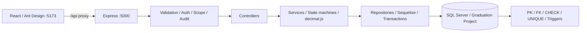
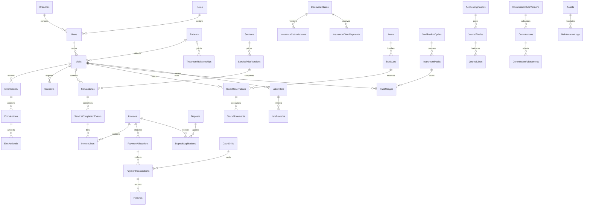

# Thiết kế nền tảng local ERP & EMR nha khoa

Ngày: 14/10/2026. Nguồn: `Prompt_Project.txt`, `Quy_trinh_NhaKhoa_TongHop_v14.md` ở gốc repository.

## Mục tiêu và phạm vi lần này

Tạo môi trường phát triển chạy được trên Windows: database bootstrap, backend Express, frontend React, kiểm tra sức khỏe API/SQL, seed tài khoản nền tảng và hướng dẫn vận hành local. Đây là nền tảng để triển khai lần lượt 12 module, không phải phần mềm khám chữa bệnh đã hoàn thiện. Chưa có đăng nhập, CRUD nghiệp vụ, mock ngân hàng, xử lý EMR, kế toán hay giao dịch tiền/kho. Không đưa dữ liệu bệnh nhân thật vào nền tảng này.

## Quyết định triển khai

- Một repository, giữ nhánh `main` như Prompt; không worktree, nhánh phụ, PR, Docker, CI/CD hoặc cloud.
- JavaScript ESM xuyên suốt (lựa chọn của người triển khai trong hai phương án Prompt cho phép), kebab-case cho tên file. Node 24 trên máy hiện tại; mức tối thiểu dự án Node 22.12 để thống nhất Vite và thư viện.
- Backend Express 5, Sequelize 6 + tedious, Zod, decimal.js, pino, helmet, cors, rate limit, bcrypt, JWT chuẩn bị cho Module 1. Không dùng `sync({ force/alter: true })`; DDL SQL là nguồn schema.
- Frontend React, Vite, Ant Design, Axios, TanStack Query, React Router. Trang đầu là bảng kiểm môi trường thực tế, không giả số liệu vận hành. Chỉ gọi health API; chưa có dữ liệu nhạy cảm/public business endpoint.
- Bind API và Vite tại `127.0.0.1`, cổng 5000 và 5173. Vite proxy `/api` đến API. CORS chỉ cho origin local cấu hình. Không đưa DB/JWT secrets vào biến `VITE_*`.
- SQL Server `DESKTOP-F5CFA0D\SQLEXPRESS`, TCP 1433, database `[Graduation Project]`: người dùng đã chọn đổi instance trong phiên làm việc ngày 14/10/2026. SQL Authentication lấy từ `.env`; không tự bật dịch vụ, sửa TCP/IP hay đổi cấu hình máy. DB_PORT bỏ qua tra cứu instance bằng Browser.
- Chọn lưu thời gian UTC (`SYSUTCDATETIME`), giao diện định dạng Việt Nam. ID `UNIQUEIDENTIFIER`, `rowversion` cho bản ghi mutable, mã hiển thị độc lập. Tiền qua API là chuỗi; CSDL `DECIMAL(18,2)`.

## Kiến trúc

Các lớp auth, scope, business services trong sơ đồ là kiến trúc sẽ triển khai theo module. Bản nền tảng chỉ có health route/controller/service và kết nối DB. Thư mục các lớp còn lại được giữ chỗ có giải thích, không có middleware giả cho phép truy cập.

## Database nền tảng và schema 12 module

DDL tạo các bảng nền tảng và bảng dữ liệu cho 12 module theo ERD bên dưới. `Users` có một `RoleId`, `BranchId`, `IsApprover`, hash bcrypt; seed 5 role và 6 tài khoản như Prompt. Seed chạy transaction, không đặt lại mật khẩu tài khoản đã tồn tại; kèm danh mục local tối thiểu cho phòng/ghế, dịch vụ/giá, kho/vật tư/lô/tồn, tài khoản kế toán và cấu hình có phiên bản.

Nhóm A nền tảng có bảng `_Deleted` cùng cột (rowversion lưu bản chụp binary(8), không IDENTITY/FK ngoài), cộng DeletedAt, DeletedBy. `INSTEAD OF DELETE` archive trước khi xóa; thiếu SESSION_CONTEXT username thì từ chối. FK bảo vệ cha đang được tham chiếu; xóa con trước trong cùng transaction. Không dùng cascading delete. Trigger khóa ID của các bảng nền tảng. Audit append-only: chặn mọi UPDATE/DELETE. Chưa có API xóa/khôi phục hoặc xem archive.

DDL chạy trong thứ tự ghi ở database/README.md và có migration marker. Tạo database riêng trước; toàn bộ schema và marker trong một transaction, lỗi rollback về DB trống. Bootstrap nhận DB mới/trống hoặc nền tảng cùng phiên bản có đủ đối tượng kiểm tra. Marker đơn lẻ không đủ: verify.sql kiểm tra bảng, trigger bật và unique key. Không tự sửa schema drift. Database cùng tên nhưng schema khác phải dừng, không tự ghi đè. Trình kiểm tra kết nối phân biệt kết nối được và schema nền tảng sẵn sàng.

## Quy tắc cho module tiếp theo

- Module 1: JWT, hash bcrypt, quyền theo 5 role + chi nhánh + mục đích + quan hệ điều trị + trạng thái; maker khác checker. `IsApprover` không thay thế kiểm tra role/phạm vi. Admin xem mọi chi nhánh nhưng không ký EMR/chốt dịch vụ/duyệt tài chính thay người có nghiệp vụ.
- Khác biệt nguồn: Prompt mở quyền đọc EMR của Admin với audit; v14 không mặc định mở quyền. Bản thiết kế chọn quy tắc cụ thể trong Prompt. Mọi endpoint EMR tương lai phải ghi audit cả cho phép/từ chối, không coi Admin được sửa lâm sàng.
- Nhóm B: payload bất biến sau chốt/ký/ghi sổ; chuyển trạng thái hợp lệ qua service và DB guards riêng, không dùng trigger chặn mọi UPDATE khiến trạng thái không tiến được. DRAFT được archive khi xóa theo schema từng module. Bản ghi không có DRAFT thì không xóa. Sửa dùng phụ lục/đảo/điều chỉnh có OriginalId.
- Idempotency phải unique `(Scope, Key)` cùng hash chuẩn hóa có principal/phạm vi. Khóa + giao dịch nghiệp vụ + kết quả trong cùng transaction; lặp khác payload trả 409 và ghi audit sau rollback bằng transaction độc lập. Không dùng cache RAM làm chứng cứ chống thu/trừ kho trùng.
- SESSION_CONTEXT phải set/reset trên đúng connection của transaction, không trên một connection pool ngẫu nhiên. Version mismatch trả 409. Khóa `UPDLOCK,HOLDLOCK` cho tồn, serial và cọc; kiểm tra lại điều kiện trong transaction.
- Giá/thuế/chính sách có khoảng hiệu lực `[from,to)` và kiểm soát overlap khi phê duyệt dưới serializable/khóa phạm vi. Không hard-code thuế, hạn ký, ngưỡng hoàn/giảm, hạn vô trùng hoặc tài khoản kế toán.
- Chỉ sự kiện hoàn thành tạo căn cứ doanh thu. Thu nợ/cấn cọc/nhận BHTM không ghi doanh thu lần nữa. QR mô phỏng vẫn cần chữ ký xác thực và idempotency. Audit thông thường không chứa EMR, request body, token, password hoặc đầy đủ số định danh.

## Thiết kế quan hệ theo phân hệ (chưa phải DDL đã triển khai)

## Lộ trình và nghiệm thu

1. Nền tảng lần này: install, health API, lỗi SQL trả 503 có kiểm soát, frontend build, test HTTP và cấu hình, script SQL và seed có thể chạy lại. SQL chỉ được xác nhận sau khi có kết nối thật.
2. Module 1–2: auth/scope/audit/archive, danh mục và versioning. AT-17, AT-21, phần AT-23.
3. Module 3–5: bệnh nhân/lượt/EMR/đồng thuận/chốt; AT-05, AT-06, AT-09, AT-13, phần AT-16/18/22/23.
4. Module 6–7: thanh toán/cọc/kho. AT-01/02/07/08/12/15/16/18/20; mock bank chỉ ở local.
5. Module 8–12: ca/kế toán/BHTM/labo/hoa hồng/tài sản/đối soát. AT-03/04/10/11/14/22/24, hoàn thiện liên kết lõi.
6. Backup/restore local và kiểm thử tích hợp AT-01 đến AT-24. Bản nền tảng không được đánh dấu các AT nghiệp vụ là đã đạt.

## Giới hạn đã quan sát

Node 24.21.0 và npm 11.19.0 có sẵn. ADMIN không truy cập được. Sau khi người dùng chọn SQLEXPRESS, kết nối Windows authentication thành công; Mixed Mode bật, TCP 1433, Browser tắt. Ngày 14/10/2026 người dùng yêu cầu xóa bảng cũ và tạo lại: 60 bảng cũ đã được backup, xóa; 99 bảng mới và seed đã được tạo, verify thành công. Chưa có SQL credentials dành cho backend. Thay đổi có sẵn của người dùng trong Prompt_Project.txt phải giữ nguyên.
