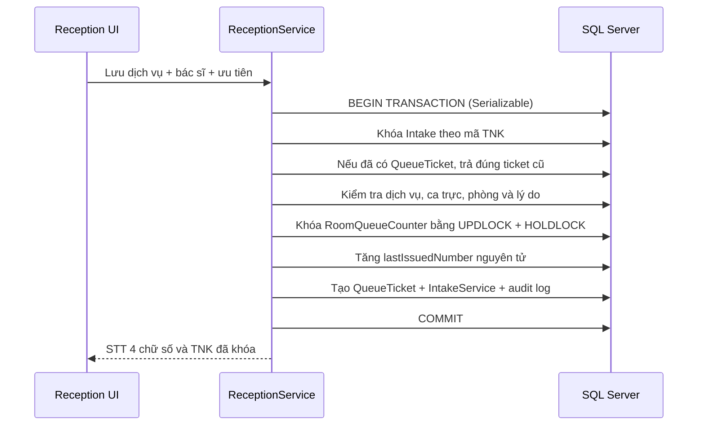
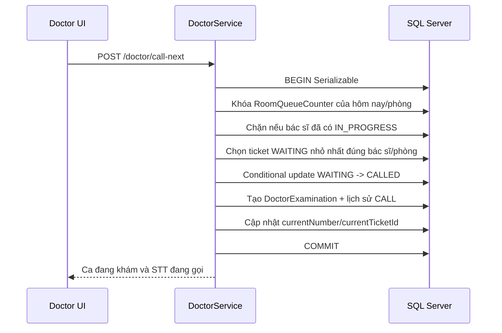

# Thiết kế STT cho `/reception` và `/doctor`

> Trạng thái: Chờ duyệt trước khi triển khai. Tài liệu này chỉ giới hạn ở hai phân hệ `/reception`, `/doctor`, migration dùng chung và hai file mô tả vai trò liên quan.

## 1. Mục tiêu

Bổ sung hàng chờ theo phòng khám và ngày, cấp STT tự động `0001`–`9999`, hiển thị mức ưu tiên nhưng luôn gọi thuần theo STT, hỗ trợ in/reprint, hủy-làm-lại và xử lý bệnh nhân vắng mặt. Toàn bộ thao tác cấp/gọi phải an toàn khi chạy đồng thời và lấy ngày nghiệp vụ theo `Asia/Ho_Chi_Minh`.

## 2. Phạm vi

Thay đổi trong phạm vi:

- API và giao diện của `/reception`.
- API và giao diện của `/doctor`.
- Prisma schema và một migration phục vụ hai phân hệ.
- Test backend/frontend tương ứng và phần test mới trong `test.md`.
- `Role Bác Sĩ.md` và `Role_nhan_vien_tiep_nhan.md`.

Không thay đổi màn hình `/hr`, `/accounting`, `/warehouse`, màn hình chờ, âm báo, SMS hoặc Zalo. Dữ liệu phân ca HR và các adapter kế toán/kho hiện có chỉ được đọc hoặc tái sử dụng từ backend của hai phân hệ.

## 3. Hiện trạng và phần tái sử dụng

### `/reception`

- Giữ luồng hiện có: tạo bệnh nhân → tạo TNK nháp → chọn dịch vụ/điều phối → thanh toán → in → bàn giao.
- Giữ `ReceptionService`, `ReceptionController`, `ReceptionProvider`, `ReceptionPrintView` và các API hiện có.
- Điểm cấp STT phù hợp nhất là `updateIntakeServices`: đây là lần đầu hệ thống có đủ dịch vụ, bác sĩ và phòng. Việc ghi dịch vụ, khóa lựa chọn và cấp STT sẽ nằm trong cùng một transaction.
- Tái sử dụng `ShiftAssignment -> Employee.userId -> User` để xác định bác sĩ đang trực và `ShiftAssignment.roomId` để tự điền phòng.
- Tái sử dụng giao diện in A5 và `triggerPrint`, nhưng lịch sử in của tiếp nhận hiện chưa được lưu ở backend nên cần bổ sung.

### `/doctor`

- Giữ `GET /doctor/queue`, `POST /doctor/call-next`, `GET /doctor/current` và cấu trúc bốn bước khám.
- Giữ quy tắc một bác sĩ chỉ có một `DoctorExamination` đang `IN_PROGRESS`.
- Giữ luồng Ngừng khám, hoàn thành, kho và kế toán hiện có.
- Thay STT tạm `index + 1` bằng STT đã cấp; bỏ sắp xếp theo ưu tiên; hàng chờ sắp xếp `queueNumber ASC`.
- Bổ sung endpoint Vắng mặt, dùng cùng nguyên tắc tài chính của Ngừng khám nhưng không có giá vốn vì chỉ được phép khi chưa có dữ liệu khám.

## 4. Giả định triển khai

- STT được cấp khi nhân viên bấm lưu lần đầu ở bước Dịch vụ & điều phối, không cấp lúc tạo TNK nháp.
- Phạm vi này dùng lý do ưu tiên dạng ghi chú ngắn. Không xây màn Admin cấu hình danh mục lý do trong lần này.
- Bác sĩ có ca hôm nay được xếp trước trong danh sách. Bác sĩ ngoài ca vẫn có thể được chọn ở nhóm riêng; phòng phải chọn thủ công và bắt buộc nhập lý do ghi đè.
- `DRAFT`, `READY`, `PAID`, `TRANSFERRED` tiếp tục phục vụ luồng nội bộ hiện có. Trạng thái hàng chờ được quản lý riêng để không phá luồng thanh toán.
- `TRANSFERRED` tương ứng “Tiếp nhận/đang chờ” trên màn bác sĩ. Phiếu có STT nhưng chưa bàn giao chưa xuất hiện trong hàng chờ bác sĩ.
- TNK bị Ngừng khám giữ trạng thái hiện có ở ca khám; giao diện hiển thị nhãn “Ngừng khám”. TNK hủy khi còn chờ dùng trạng thái riêng `CANCELLED_RECEPTION` để không nhập nhằng.
- Ngày nghiệp vụ được chuẩn hóa thành ngày lịch tại `Asia/Ho_Chi_Minh`; mọi `issuedAt`, `calledAt`, `absentAt`, `printedAt` vẫn là thời điểm máy chủ.
- Migration bảo toàn hàng chờ lúc deploy: các TNK `TRANSFERRED` và `IN_PROGRESS` của ngày triển khai được backfill ticket theo từng phòng, sắp xếp `COALESCE(transferredAt, createdAt)` tăng dần. `TRANSFERRED` thành `WAITING`; `IN_PROGRESS` thành `CALLED` và cập nhật STT đang gọi. Counter bắt đầu từ số lớn nhất vừa backfill. TNK lịch sử đã kết thúc không bị gán ngược STT vốn chưa từng tồn tại.
- Mức ưu tiên chỉ có đúng hai giá trị `Thường` và `Ưu tiên`. Loại bỏ hoàn toàn `Cao`, `Khẩn cấp` khỏi type, DTO, dữ liệu mẫu, seed, bộ lọc, nhãn giao diện và test; tuyệt đối không có logic chuyển các giá trị cũ thành `Ưu tiên`.
- Vì dữ liệu hiện tại là dữ liệu giả, migration chuẩn hóa mọi giá trị ngoài hai giá trị hợp lệ về `Thường` trước khi thêm check constraint. Đây chỉ là bước làm sạch dữ liệu kỹ thuật; ứng dụng không hiển thị hoặc hỗ trợ lựa chọn legacy.
- Nếu một bác sĩ có nhiều ca trong ngày, “ca đang trực” là ca có `startTime <= giờ máy chủ < endTime`. Nếu dữ liệu HR bị chồng ca, chọn ca có `startTime` muộn nhất rồi `ShiftAssignment.id` lớn nhất và ghi cảnh báo audit; ngoài mọi khung giờ thì xử lý như bác sĩ ngoài ca.

## 5. Mô hình dữ liệu

```mermaid
erDiagram
    ClinicRoom ||--o{ RoomQueueCounter : owns
    ClinicRoom ||--o{ QueueTicket : serves
    Intake ||--o| QueueTicket : receives
    User ||--o{ QueueTicket : issues
    QueueTicket ||--o{ QueueCallHistory : records
    Intake ||--o{ IntakePrintHistory : prints
    Intake ||--o{ IntakeAuditLog : audits
    User ||--o{ QueueCallHistory : acts
    User ||--o{ IntakePrintHistory : prints
    User ||--o{ IntakeAuditLog : acts

    RoomQueueCounter {
      int id PK
      date businessDate
      int roomId FK
      int lastIssuedNumber
      int currentTicketId nullable
      int currentNumber nullable
      datetime updatedAt
    }

    QueueTicket {
      int id PK
      int intakeId FK_UQ
      date businessDate
      int roomId FK
      int queueNumber
      string status
      int issuedById nullable
      datetime issuedAt
      datetime calledAt nullable
      datetime absentAt nullable
      datetime cancelledAt nullable
    }

    QueueCallHistory {
      int id PK
      int ticketId FK
      string action
      int actorId nullable
      datetime occurredAt
      string metadataJson nullable
    }

    IntakePrintHistory {
      int id PK
      int intakeId FK
      int printedById nullable
      datetime printedAt
      boolean isCopy
      string contentSnapshot
    }

    IntakeAuditLog {
      int id PK
      int intakeId FK
      string action
      int actorId nullable
      string reason nullable
      string changesJson nullable
      datetime createdAt
    }
```

Thay đổi trên `Intake`:

- Thêm `priorityReason` nullable, tối đa 500 ký tự.
- Thêm `roomOverrideReason` nullable, tối đa 500 ký tự.
- Thêm quan hệ một-một `queueTicket`.
- Thêm quan hệ `printHistories` và `auditLogs`.
- Giữ `priority` làm nguồn dữ liệu duy nhất và giới hạn backend ở `Thường | Ưu tiên`.
- Thêm check constraint DB để `priority` chỉ nhận `Thường` hoặc `Ưu tiên`.

Ràng buộc DB:

- `RoomQueueCounter`: unique `(businessDate, roomId)`.
- `QueueTicket`: unique `intakeId` để một TNK chỉ nhận một STT.
- `QueueTicket`: unique `(businessDate, roomId, queueNumber)` để không cấp trùng.
- Check constraint `queueNumber BETWEEN 1 AND 9999` và `lastIssuedNumber BETWEEN 0 AND 9999` trong migration SQL.
- Index hàng chờ `(businessDate, roomId, status, queueNumber)` và `(businessDate, roomId, doctor)` thông qua quan hệ Intake.
- `QueueTicket.status`: `WAITING`, `CALLED`, `COMPLETED`, `STOPPED`, `ABSENT`, `CANCELLED`.
- `QueueCallHistory.action`: `CALL`, `AUTO_CALL_AFTER_ABSENT`, `ABSENT`.
- `IntakeAuditLog.action`: `QUEUE_ISSUED`, `PRIORITY_SET`, `ROOM_OVERRIDE`, `QUEUE_CANCELLED`, `CALLED`, `ABSENT`, `PRINTED`.

## 6. Cấp STT và chống đồng thời



Chi tiết kỹ thuật:

- Transaction dùng isolation `Serializable` trên SQL Server.
- Bộ đếm được lấy bằng raw SQL có `UPDLOCK, HOLDLOCK`; khi chưa có dòng counter thì insert `lastIssuedNumber = 1`. Nếu hai transaction cùng tạo dòng, unique constraint làm một transaction thất bại và được retry có giới hạn.
- Khi counter là `9999`, trả lỗi rõ “Phòng khám đã cấp hết STT trong ngày (0001–9999).” và rollback toàn bộ.
- Bấm đúp lưu cùng TNK đọc lại `QueueTicket` theo unique `intakeId`, không tăng bộ đếm lần hai.
- Không xóa `QueueTicket`; hủy chỉ đổi trạng thái nên STT không bao giờ được tái sử dụng.

## 7. Luồng `/reception`

### Dữ liệu ca trực

`GET /reception/master-data` trả thêm:

- `businessDate` theo `Asia/Ho_Chi_Minh`.
- Mỗi bác sĩ có `isOnDuty`, `assignedRoom`, `shiftName`, `shiftStart`, `shiftEnd`, `fallbackRoom`.
- Chỉ dùng phân ca, không dùng Check-in để chặn.

### Lưu dịch vụ và cấp STT

`PUT /reception/intakes/:code/services` nhận thêm:

- `priority: 'Thường' | 'Ưu tiên'`.
- `priorityReason?: string`.
- `roomOverrideReason?: string`.

Backend chặn khi thiếu dịch vụ, bác sĩ, phòng; ưu tiên thiếu lý do; bác sĩ ngoài ca thiếu lý do ghi đè; phòng không khớp ca mà không có lý do. Sau khi có ticket, endpoint chỉ trả dữ liệu cũ và từ chối mọi thay đổi dịch vụ, bác sĩ, phòng hoặc ưu tiên.

Màn tạo tiếp nhận và mọi màn hình liên quan chỉ hiển thị hai lựa chọn `Thường`, `Ưu tiên`; không có tùy chọn, nhãn hay dữ liệu `Cao`/`Khẩn cấp`.

### Tab Phiếu tiếp nhận

`GET /reception/intakes` nhận bộ lọc ngày, phòng, ưu tiên và trả:

- `queueNumber` đã định dạng 4 chữ số, ngày STT, trạng thái hàng chờ.
- Mức ưu tiên/lý do, phòng, bác sĩ.
- `currentCallingNumber` của phòng từ `RoomQueueCounter`.
- Số lần in và cờ bản sao.

Giao diện `/reception/receipt` đổi thành danh sách phiếu có cột STT, ưu tiên, phòng, bác sĩ, trạng thái; bộ lọc ngày/phòng/ưu tiên; cụm “STT đang gọi” theo phòng. Chọn một dòng để xem/in phiếu A5 hiện có.

### In và in lại

Thêm `POST /reception/intakes/:code/print`:

- Luôn đọc ticket hiện có, không cấp ticket mới.
- Lưu snapshot, `printedById`, `printedAt`, `isCopy = printCount > 0`.
- UI chỉ gọi `window.print()` sau khi API ghi lịch sử thành công.
- Phiếu in STT lớn 4 chữ số, mức ưu tiên luôn hiện, lý do khi ưu tiên, phòng, bác sĩ, TNK, MBN, họ tên và ngày giờ.

### Hủy và làm lại

Thêm `POST /reception/intakes/:code/cancel` với lý do bắt buộc:

- Chỉ cho phép khi chưa có `DoctorExamination` và ticket chưa `CALLED`.
- Đổi `Intake.status = CANCELLED_RECEPTION`, `QueueTicket.status = CANCELLED`, ghi audit; không xóa ticket.
- Nếu đã thu tiền, phát sự kiện kết thúc tiếp nhận theo cùng semantics Ngừng khám: doanh thu dịch vụ 0, giá vốn 0, không thưởng, khoản đã thu được đánh dấu là thu trước chờ hoàn hoặc đối trừ. Phạm vi này chỉ phát sự kiện từ backend `/reception`, không sửa giao diện `/accounting`.
- Nút “Làm lại” mở `/reception/intakes/new` với bệnh nhân cũ được chọn sẵn. TNK mới được cấp STT mới khi lưu dịch vụ.

## 8. Luồng `/doctor`

### Hàng chờ

- `GET /doctor/queue` chỉ trả ticket ngày hôm nay, `WAITING`, đúng `doctorId` đăng nhập và đúng phòng được gán trên TNK.
- Sắp xếp duy nhất theo `queueNumber ASC`.
- Trả `priorityReason`, `currentCallingNumber`, `waitingCount`, `priorityWaitingCount`.
- UI hiển thị STT 4 chữ số, nhãn ưu tiên/lý do nổi bật, dòng “Có N bệnh nhân ưu tiên đang chờ”, STT đang khám và số người chờ. Ưu tiên không thay đổi vị trí dòng.
- Phòng của bác sĩ lấy từ ca trực; không cho bác sĩ tùy ý chuyển sang phòng khác.

### Gọi STT tiếp theo



- Request không tin `roomCode` tùy ý từ client; backend xác nhận phòng thuộc TNK/ca trực của bác sĩ.
- Nếu conditional update không còn khớp vì thao tác đồng thời, transaction retry lấy ticket kế tiếp.
- Không còn người chờ trả kết quả nghiệp vụ rõ ràng để UI hiển thị “Không còn bệnh nhân chờ”, không tạo ca và không đổi trạng thái.

### Vắng mặt

Thêm `POST /doctor/examinations/:id/absent`:

- Xác nhận ca thuộc bác sĩ đăng nhập, đang `IN_PROGRESS` và ticket đang `CALLED`.
- Chặn nếu đã có `ExaminationSupply`, `SupplyReservation`, `ExaminationResult` hoặc lịch sử in kết quả; thông báo dùng Ngừng khám.
- Trong transaction: `DoctorExamination.status = ABSENT`, khóa hồ sơ, `Intake.status = ABSENT`, `QueueTicket.status = ABSENT`, ghi `absentAt`, audit và lịch sử.
- Gọi adapter kế toán theo cùng semantics Ngừng khám: doanh thu 0, giá vốn 0, không thưởng; khoản thu trước giữ cho quy trình hoàn/đối trừ hiện có.
- Cùng transaction/chuỗi retry an toàn, chọn ticket `WAITING` nhỏ nhất tiếp theo, tạo ca mới và cập nhật STT đang gọi. Response trả cả ca vắng mặt và `nextExamination | null`.
- UI có hộp xác nhận. Nếu có ca kế tiếp, chuyển ngay sang Bước 2 của ca mới; nếu không có, quay lại Bước 1 và báo “Không còn bệnh nhân chờ”.

## 9. Trạng thái hiển thị

- `DRAFT`: Nháp, chưa có STT.
- `READY` hoặc `PAID` có ticket: Tiếp nhận, chưa bàn giao.
- `TRANSFERRED` + ticket `WAITING`: Tiếp nhận / Đang chờ.
- `IN_PROGRESS` + ticket `CALLED`: Đang khám.
- `COMPLETED`: Hoàn thành.
- Intake `CANCELLED` từ luồng bác sĩ hiện hữu: Ngừng khám.
- `CANCELLED_RECEPTION`: Đã hủy.
- `ABSENT`: Vắng mặt.

## 10. Phân quyền và audit

- Guard Tiếp nhận tiếp tục giới hạn `RECEPTION_STAFF`/Admin; chỉ tiếp nhận được cấp, in, hủy/làm lại.
- Guard Bác sĩ dùng `req.user.sub`; tất cả truy vấn gọi/vắng mặt bắt buộc khớp `doctorId` và phòng.
- Không có endpoint cập nhật STT. DTO không nhận `queueNumber`.
- Mọi cấp/hủy/gọi/vắng/in và ghi đè phòng đều có actor, thời gian máy chủ, phòng, STT, TNK và lý do/metadata trong audit.

## 11. Kiểm thử bắt buộc

Backend sẽ có unit/integration-level tests cho bộ đếm, unique constraints và transaction retry; frontend có tests cho validation và hiển thị. `test.md` chỉ đánh PASS cho lệnh đã chạy thực tế.

Nhóm cấp STT:

- STT đầu ngày `0001`, tăng dần, phòng độc lập, ngày mới reset.
- Hai lượt cùng phòng đồng thời không trùng.
- Bấm đúp lưu một TNK chỉ nhận một STT.
- Hết `9999` bị chặn.
- Không thể gửi/sửa STT bằng API.

Nhóm tiếp nhận:

- Phòng tự điền theo ca; bác sĩ ngoài ca yêu cầu phòng và lý do.
- Ưu tiên thiếu lý do bị chặn; ưu tiên không đổi STT.
- Có STT thì khóa dịch vụ/bác sĩ/phòng/ưu tiên.
- Hủy khi chờ được phép; hủy sau khi gọi bị chặn; làm lại nhận STT mới cuối hàng.
- In có STT/ưu tiên; in lại giữ STT và có BẢN SAO.

Nhóm bác sĩ:

- Hàng chờ tăng theo STT, ưu tiên chỉ tô nổi bật.
- Gọi đúng bệnh nhân nhỏ nhất, đúng bác sĩ/phòng; thao tác đồng thời không gọi trùng.
- Chặn gọi khi đang khám; không còn người chờ trả thông báo đúng.
- Vắng mặt xác nhận, tự gọi tiếp, không tái sử dụng STT.
- Vắng mặt sau khi có dữ liệu khám bị chặn.
- Vắng mặt có thu trước cho doanh thu/giá vốn/thưởng bằng 0 và phát sự kiện xử lý như Ngừng khám.
- STT đang gọi xuất hiện nhất quán ở cả `/doctor` và `/reception/receipt`.

## 12. Cập nhật tài liệu role sau khi code

- `Role_nhan_vien_tiep_nhan.md`: sửa mục mở phiếu, điều phối, in và bàn giao để phản ánh STT, ưu tiên, ca trực, khóa sau cấp STT, hủy/làm lại.
- `Role Bác Sĩ.md`: thay Bước 1 bằng hàng chờ theo STT, nhãn ưu tiên, gọi thuần STT, STT đang khám và Vắng mặt; bổ sung trạng thái `ABSENT` và điều kiện không có dữ liệu khám.
- Không sửa các role khác theo giới hạn lần này.

## 13. Tiêu chí duyệt thiết kế

Thiết kế được coi là duyệt khi thống nhất ba điểm: cấp STT tại lần lưu dịch vụ/điều phối đầu tiên; giữ workflow nội bộ hiện có và quản lý trạng thái hàng chờ bằng `QueueTicket`; lý do ưu tiên dùng ghi chú ngắn trong phạm vi hai màn hình.
